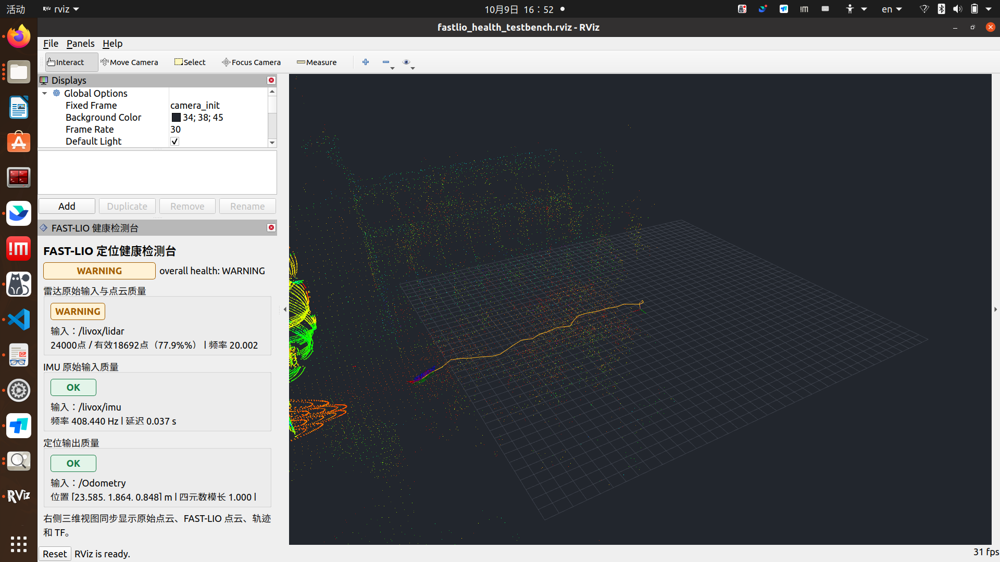
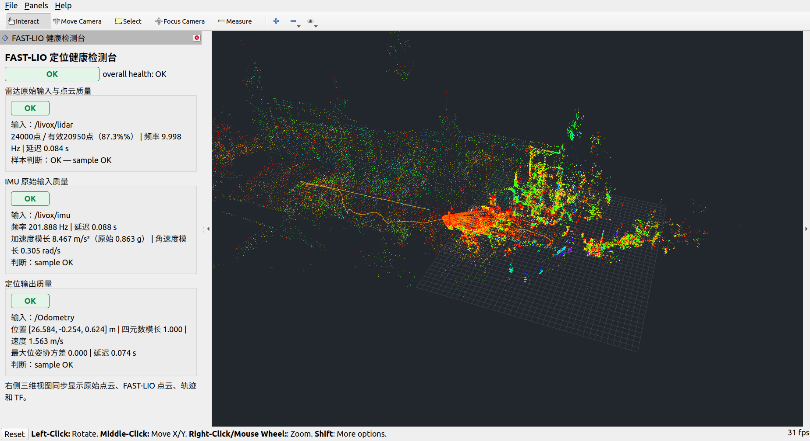

# 验证记录

日期：2026-10-09（Asia/Shanghai）

增量更新：2026-10-10，IMU 单位修复构建见第 10 节，实际回放/注入测试与新截图见第 11 节。第 0–9 节的历史记录和截图产生于修复前，其中 IMU 原始加速度曾被错误标为 m/s²；历史数值应按 Livox 的 g 输入解释。

2026-10-12 V2重构增量见[12_实施与测试记录](12_V2重构实施与测试记录.md)，实际故障bag、启停/重启、日志和新界面与历史记录区分归档。

## 0. 可视化检测台截图



早期健康面板截图：[visualization_testbench.png](images/visualization_testbench.png)。

新截图在 rosbag 正在回放时采集，已恢复原始雷达的 intensity 彩虹显示。截图中总体为 WARNING，来自 LiDAR 有效点率低于阈值，IMU 和定位输出为 OK；这是实际数据质量判定。RViz 同屏显示原始点云、FAST-LIO 当前帧、累积地图、轨迹和 TF。上一阶段分色尝试的截图保留在 [visualization_mapping_result.png](images/visualization_mapping_result.png)。

## 1. Catkin 编译

命令：

```bash
source /opt/ros/noetic/setup.bash
cd $HOME/fastlio_ws
catkin_make -j2
```

结果：成功。Catkin 遍历 `livox_ros_driver`、`fast_lio`、`fastlio_health_monitor`；最终 `fastlio_health_monitor_node` 到达 100% 并链接至 `devel/lib/fastlio_health_monitor/`。

构建输出有现存系统 PCL/VTK CMake 提示（部分可选 VTK 程序不存在，以及依赖包命名提示），未阻止编译，也未影响目标生成。

## 2. 节点、Topic、launch

- 启动命令：`roslaunch fast_lio mapping_avia.launch rviz:=false`。
- 观测到定位节点 `/laserMapping`，监控节点 `/fastlio_health_monitor`，以及 rosbag player。
- Topic 包含 `/livox/lidar`、`/livox/imu`、`/Odometry`、`/tf`、`/fastlio_health_monitor/diagnostics`、`/fastlio_health_monitor/status`。
- `rostopic type /fastlio_health_monitor/status` 返回 `std_msgs/UInt8`。
- `roslaunch fastlio_health_monitor health_monitor.launch` 正确加载 Avia YAML 并启动 C++ 节点。

## 3. Bag 输入和定位运行

bag：`$HOME/datasets/fastlio/outdoor_Mainbuilding_10hz_2020-12-24-16-38-00.bag`

- `rosbag info`：141.29459 秒，约 625.6 MB；`/livox/lidar` 1414 条，`/livox/imu` 28595 条。
- 本次 bag 完整回放到 `Done.`；FAST-LIO 实际收到约 1413 帧 LiDAR、28575 条 IMU，并连续输出约 1410 条 Odometry。个别首尾消息因节点启动/调度时序未被订阅，回放本身完整结束。
- 回放时 FAST-LIO 持续发布 `/Odometry` 和 `/tf`。
- `tf_echo camera_init body` 在第一帧处理前短暂提示 frame 不存在；随后成功返回平移和旋转，确认 TF 链可用。

## 4. 健康诊断抽样

实际收到的 `DiagnosticArray`：

| 分项 | 状态 | 观测值 |
|---|---|---|
| 总体 | OK | `health_code=0` |
| LiDAR | OK（抽样时刻） | 24000 点，23294 有效点，有效率 0.971，约 9.995 Hz |
| IMU | OK | 约 204.995 Hz；加速度模长 1.016 m/s²，角速度模长 0.876 rad/s |
| 定位输出 | OK | 四元数模长 1.000，观测速度 0.880 m/s，位姿持续更新 |

健康状态码：`0=OK`、`1=WARNING`、`2=ERROR`。实际验证结果：

- 正常输入时，综合诊断为 OK；点云有效率 0.971，IMU 和 Odometry 均持续更新。
- bag 回放期间节点日志出现综合 WARNING。回放尾段使用最新构建的节点抽样时，LiDAR 的有效点率为 0.516，分项状态为 WARNING，`sample_status=WARNING`、`sample_message=LiDAR valid-point ratio below configured minimum`。
- 上述尾段抽样时输入已停止约 1 秒，IMU 和 Odometry 超过各自 ERROR 新鲜度阈值，故同一时刻综合状态为 ERROR；再结合正常数据时的 OK，三个状态均已在运行中出现。
- 完整 bag 结束后再次观察到 LiDAR、IMU、Odometry stale，综合状态码为 2。

最新诊断输出包含 `sample_status`/`sample_message`，即使 stale 错误成为主状态，也可读取最近样本本身的质量结果。

可用 bag 是 Livox `CustomMsg` 数据集，因此这次实际回放覆盖 Livox 分支；PointCloud2 分支已编译并支持字段/字节序解析，尚未用对应设备数据集做端到端验证。

## 5. 可视化检测台运行验证

- 使用 `roslaunch fastlio_health_monitor visualization_testbench.launch use_sim_time:=true` 启动 FAST-LIO、C++ 健康监控、静态外参 TF 和 RViz；随后用 `rosbag play --clock` 输入上面的测试 bag。
- RViz 已加载 `fastlio_health_monitor/HealthPanel` 插件并订阅 `/fastlio_health_monitor/diagnostics`。RViz 同时订阅 `/fastlio_health_monitor/lidar_raw_visualization`、`/cloud_registered`、`/Odometry`、`/path`、`/tf`、`/tf_static`。
- 运行截图中的面板值：总体 OK；LiDAR 24000 点/有效 22216 点（92.6%），约 10.008 Hz；IMU 约 205.404 Hz、延迟 0.060 s；定位输出四元数模长 1.000，位置约 `[0.652, 0.263, 0.951] m`。
- 原始 Livox `CustomMsg` 转换成带 xyz/intensity 的 `PointCloud2` 供 RViz 显示；监控状态和 RViz 点云在同一窗口同步更新。
- 为适配 bag 的仿真时间，launch 通过 `tf2_ros/static_transform_publisher` 将 Avia 外参发布到 `/tf_static`。短时回放确认 `camera_init -> livox_raw` TF 可解析。
- 完整界面与上述 OK 指标见[早期健康面板截图](images/visualization_testbench.png)；本页顶部为后续频闪修复时的 WARNING 截图，两者采集时刻不同。停止 rosbag 后，按新鲜度阈值转为 ERROR 属于断流保护的预期行为。

## 6. 单条 roslaunch 回放入口和累积地图显示

- 新增 `fastlio_health_monitor/launch/visualization_bag_testbench.launch`，单次启动检测台并以 `/use_sim_time=true` 播放默认 outdoor bag；可用 `bag:=...`、`rate:=...` 覆盖输入。
- `roslaunch --nodes fastlio_health_monitor visualization_bag_testbench.launch` 已成功解析并列出 FAST-LIO、监控节点、静态 TF、RViz 和 rosbag player；本机 rosbag 支持 `--wait-for-subscribers`，该 bag 只有 `/livox/lidar` 和 `/livox/imu` 两个输入 topic。
- 源码检查发现 FAST-LIO 原先注释了 `/Laser_map` 累积地图生成和发布；旧 RViz 配置只有当前帧 `/cloud_registered`，不显示累积地图。检查时 RViz 节点也已正常退出，`/cloud_registered` 无订阅者。
- 增加 `publish/map_pub_en` 与 `publish/map_pub_interval_sec` 参数；仅检测台开启地图发布，默认每秒生成/发布一次，并且只在有订阅者时展开 k-d tree。普通 `mapping_avia.launch` 默认仍关闭该功能。
- RViz 增加 `/Laser_map` 显示；运行截图中可见累积地图、当前帧点云、轨迹和健康面板。
- 在独立 ROS master 上重新启动整合 launch，rosbag 输出 `Opening`、等待订阅者并进入 `[RUNNING]`。确认 `/Laser_map` 有 RViz 订阅者，收到 `frame_id=camera_init` 的地图消息（抽样 header seq=9）；`/fastlio_health_monitor/status` 为 0，健康诊断分项均为 OK，`/Odometry` 有持续输出。
- 此阶段手动停止前回放约 68.8/141.3 秒，测试结束后已关闭当时的独立 ROS master 和 launch。本页顶部为后续频闪修复后的最新截图。

## 7. 点云颜色与取景修正

> 此节记录上一次配色尝试；其中蓝色/橙色和限时留存设置已在第 8 节回退，当前配置以第 8 节为准。

- 对照截图使用旧配置 `loam_livox.rviz`，其中 `/cloud_registered` 按 `intensity` 彩虹着色；检测台此前把累积 `/Laser_map` 设为固定绿色，因此地图成为主要可见图层时会看起来像“只有绿色点云”。
- 检查确认 `/Laser_map` 和 `/cloud_registered` 均含 `x/y/z/intensity` 字段；RViz 改为原始输入蓝色（半透明、0.3 秒留存）、FAST-LIO 当前帧橙色（0.3 秒留存）、累积地图按 intensity 彩虹着色（1 秒留存）。启动视角改为以 `camera_init` 原点为中心、距离 60，便于同时看地图和轨迹。
- 在全新 ROS master 上重新启动整合 bag launch 验证；RViz 订阅 `/fastlio_health_monitor/lidar_raw_visualization`、`/cloud_registered` 和 `/Laser_map`，两路 FAST-LIO 点云 header 的 frame 为 `camera_init`，运行期间 `/fastlio_health_monitor/status=0`，健康面板总体及 LiDAR、IMU、定位分项为 OK。
- 修正后的运行截图见 `images/visualization_mapping_result.png`。验证时在 bag 播放期间采集；bag 播完后，数据新鲜度监控转为 ERROR 属于预期断流提示。每次重新回放应重新启动整合 launch，避免同一个 FAST-LIO 进程遇到 bag 时间戳回退。

## 8. 地图频闪修复与原始雷达配色恢复

- 原因：第 7 节把地图 `Decay Time` 设为 1 秒，但 `/Laser_map` 按墙钟约每秒发布一次。RViz 按 ROS 时间过期清空点云，发布抖动、处理延迟或 2 倍速 `/clock` 都会使旧图先消失、新图稍后才到。雷达变蓝和当前帧变橙则来自该节的 FlatColor 设置，并非数据本身改变。
- 根据 [RViz Noetic 官方源码](https://github.com/ros-visualization/rviz/blob/noetic-devel/src/rviz/default_plugin/point_cloud_common.cpp#L319)，`Decay Time=0` 表示只保留最新一份消息，并在下一份到达时替换；它不表示无限叠加所有点云。三个点云图层改为 0，原始雷达与当前帧恢复 Intensity、intensity 通道和彩虹着色。地图固定 intensity 范围 0–152，避免每次自动计算范围造成整图变色。
- C++ `/Laser_map` 发布队列改为 1，启用 latch，缓存最后一份完整快照。`catkin_make -j2` 成功，`git diff --check` 通过。
- 连续画面验证：独立 master、同一份 2 倍速 outdoor bag，同时打开两个仅启用地图的 RViz；两者只在 Decay Time（旧值 1、新值 0）上不同。连续采样 20 对实际桌面截图，旧设置 10 次地图为空，新设置 0 次为空；新设置每次都检测到地图点。检测仅统计三维视口中的彩色点，已关闭其他三维图层，防止当前扫描或轨迹掩盖地图消失。
- 截图对照：[旧设置地图到期清空](images/map_decay_before_empty.png)、[新设置保持地图](images/map_decay_after_held.png)。完整检测台截图见本页顶部。
- 完整 bag 结束并排空末尾消息后，另行推进 `/clock` 10 秒，期间没有新地图消息。旧设置的地图为空，新设置仍显示最后快照；[停止输入后保留地图截图](images/visualization_map_hold.png)中的健康面板为断流 ERROR，符合预期。
- bag 结束后新建 `/Laser_map` 订阅立即收到 latch=1 的最后快照：seq=69、90804 点、frame_id=`camera_init`。结果存于 [连续采样与留图验证数据](evidence/map_flicker_validation.json)。此次验证进程与独立 master 已关闭。

## 9. 文档整理核对（2026-10-09）

- 本次只整理文档与交付材料，前述 ROS 运行结果来自已有实测记录，未重新执行整套仿真。
- 核对本目录 9 份 Markdown 与监控包 README 共 10 份文档，111 处本地文件/图片链接及标题引用全部有效。
- Avia YAML 的 23 个配置参数均已在代码说明中覆盖；核对 C++ 固定四元数阈值、接收时间策略及地图发布配置。
- 总入口引用当前最终配色截图，历史配色尝试保留并标注已回退；最新 WARNING 与早期 OK 截图不混用。
- `git diff --check` 通过；文档交付范围和后续待验证事项列在项目完结归档中。

## 10. IMU 单位修复构建记录（2026-10-10）

### 实现与配置

- C++ 监控增加 `imu_acceleration_unit`：`g` 乘 9.80665，`mps2` 乘 1；换算后的模长用于 `maximum_acceleration_mps2` 阈值判断和诊断显示。
- `config/avia.yaml` 显式 `g`；`config/pointcloud2.yaml` 的通用 IMU 示例显式 `mps2`。节点默认 g 匹配其默认 Livox 输入；切换 IMU 需按实际驱动单位配置。
- IMU 诊断增加原始模长、输入单位及转换系数；RViz 面板同时显示换算值和原始值。
- 非法单位配置会报 FATAL 并退出；原始输入或换算模长非有限时为 ERROR。

### 构建结果

在加载 ROS Noetic 环境的 Bash 中执行：

```bash
cd $HOME/fastlio_ws
catkin_make --pkg fastlio_health_monitor -j2
```

实际构建退出码为 0，生成：

- `devel/lib/fastlio_health_monitor/fastlio_health_monitor_node`。
- `devel/lib/libfastlio_health_monitor_panel.so`。

日志包含 `Built target fastlio_health_monitor_panel` 和 `[100%] Built target fastlio_health_monitor_node`。功能仍由 C++ 实现。

### 数值规则与验证范围

| 输入配置 | 原始加速度模长 | 换算值 | 默认 100 m/s² 上限下的幅值判断 |
|---|---:|---:|---|
| `g` | 1 g | 9.80665 m/s² | 不触发幅值 WARNING |
| `g` | 20 g | 196.133 m/s² | 触发幅值 WARNING |
| `mps2` | 9.80665 m/s² | 9.80665 m/s² | 不重复换算，不触发幅值 WARNING |

上述是代码换算规则示例，最终分项等级还包含时间戳、新鲜度、频率等检查；不是本次运行测试的实测结果。本次完成代码修改和编译，未执行 ROS 回放、故障注入或实体设备验证，未采集新的运行截图。重启整套检测台后才能加载新监控程序和 RViz 插件，旧截图保留用于历史问题追溯。

后续已按用户要求完成实际回放、故障注入及截图采集，结果见第 11 节；本节保留最初构建阶段的记录。

## 11. IMU 单位修复实测（2026-10-10）

### 实测环境和范围

- 使用独立 ROS master `http://127.0.0.1:11325`，运行真实 C++ 监控节点、FAST-LIO 和新编译的 RViz 插件；原有 ROS 进程没有被关闭。
- 先分别以 `g` / `mps2` 启动两个监控实例，持续发布合成 IMU、PointCloud2 和 Odometry；检查实际 `DiagnosticArray` 中 IMU 分项的数值、单位和等级。
- 随后使用 `visualization_bag_testbench.launch`，以 1 倍速完整回放原 outdoor bag（约 141.3 秒），逐条配对原始 IMU 与诊断，并采集真实 RViz 窗口。
- 测试脚本只是输入/采样工具，正式监控和面板仍为 C++。本次完成测试后，独立 master、检测台及额外截图 RViz 已关闭。

### 12 组输入检查与非法单位检查

| 输入场景 | g 实例实际显示 / IMU 状态 | mps2 实例实际显示 / IMU 状态 | 结果 |
|---|---|---|---|
| 正常重力：1 g / 9.80665 m/s² | 9.807 m/s²，OK | 9.807 m/s²，OK | 通过 |
| 超上限：20 g / 196.133 m/s² | 196.133 m/s²，WARNING | 196.133 m/s²，WARNING | 通过 |
| 两种输入的原始字段均为 1 | 9.807 m/s²，OK | 1.000 m/s²，OK | 通过；SI 不重复换算 |
| NaN 输入 | ERROR | ERROR | 通过 |
| Inf 输入 | ERROR | ERROR | 通过 |
| 恢复正常重力输入 | 9.807 m/s²，OK | 9.807 m/s²，OK | 通过 |

合计 6 类场景 × 2 种单位 = 12 组；上述等级为实际 IMU 分项诊断，不用总体等级替代分项断言。非法单位 `invalid` 额外验证：实际退出码 **1**，终端可见 `[FATAL] ... must be 'g' or 'mps2'; got: invalid`，通过。

首次实测发现非法单位退出时错误日志为空：构造函数异常展开销毁最后的 NodeHandle 后，main 中的 ROS 日志可能已不可用。补充在抛异常前输出 FATAL，重新编译并重跑全部检查后通过。非法单位实际日志（本机测试归档，未纳入仓库）已归档。

### 完整 bag 回放与数值配对

| 指标 | 实测结果 |
|---|---|
| 回放 | 1 倍速，完整播放至 `Done.` |
| 原始 IMU 接收 | 28595 条，与 bag 中数量一致 |
| 诊断采样 | 287 条；287 条 IMU 诊断均找到对应源消息，覆盖 284 个不同时间戳 |
| 换算核对 | 以源消息未舍入模长乘 9.80665，逐条与诊断显示值比较，全通过 |
| 最大显示舍入误差 | 0.000499671 m/s²，符合诊断保留 3 位小数 |
| 总体等级采样 | OK 248 次、WARNING 35 次、ERROR 4 次；包含初始化和回放结束阶段 |
| 地图消息 | 132 条，最后快照 90524 点；持续显示建图结果 |
| 回放结束 | 输入停止后总体 ERROR，符合新鲜度监控规则 |

诊断样例：源模长 `1.0021117875 g` → 显示 `9.827 m/s²`；截图对应样本源模长 `0.8633590473 g` → 显示 `8.467 m/s²`、原始显示 `0.863 g`。两种显示各自舍入，校验使用未舍入源值，避免把舍入误差当作换算错误。

### 关键运行截图与布局说明



截图中总体、LiDAR、IMU、定位均为 OK；IMU 显示 `8.467 m/s²（原始 0.863 g）`，角速度 `0.305 rad/s`，右侧为实际地图与轨迹。截图采集在回放期间。

默认停靠布局的 Displays 面板占用高度，可能截断健康面板中的多行文字，[默认布局截图](images/imu_units_default_layout.png)记录了该现象。为完整展示指标，另开同一独立 master 的 RViz，仅隐藏 Displays 停靠面板；点云图层、数据、健康阈值与算法不变。该临时配置见 [imu_units_evidence.rviz](evidence/imu_units_evidence.rviz)。日常使用可在 Panels 关闭 Displays 或扩大健康面板高度。默认布局自适应仍可后续优化。

### 证据与复现

- [完整实测数据](evidence/imu_units_validation.json)：12 组分项结果、非法单位退出、287 条源消息配对、回放和截图元数据。
- 重编译日志（本机测试归档，未纳入仓库）。
- 实测脚本（本机测试归档，未纳入仓库）：自动启动独立 master、运行注入和完整 bag 回放，采集默认布局截图，完成后清理自身进程。截图清晰布局为本次另行打开的证据 RViz。

在已进入 Bash、加载 ROS 和工作区环境的终端执行：

```bash
source /opt/ros/noetic/setup.bash
source $HOME/fastlio_ws/devel/setup.bash
/usr/bin/python3 $HOME/fastlio_ws/src/FAST_LIO/doc/ros1_workspace/evidence/verify_imu_units.py
```

默认占用独立端口 11325；端口已占用时脚本拒绝启动，可通过 `--port` 指定空闲端口。完整 GUI 实测需要可用 X11 显示、Gdk 和项目依赖。实体设备、其他真实 IMU 数据集与长期压力测试仍未覆盖。


## 12. 2026-10-12：V2重构验收

本轮实现、复现命令及界面见[12_V2重构实施与测试记录](12_V2重构实施与测试记录.md)。

- C++核心、控制器、ROS消息/服务、动态RViz面板及起播协调器构建通过；30个C++核心测试通过。
- 原始bag只读截取前12秒并另生成13份副本，覆盖IMU NaN/超限/缺测量/协方差/时间回退、雷达空扫描/数量不一致/断流/低频及定位跳变/协方差/q负号；[副本摘要](evidence/v2/fault_bag_manifest.json)和[实际结果](evidence/v2/fault_bag_results.json)。检查告警在故障区间内可见，不以EOF后的通用断流凑成故障通过。
- 组织点云、字节序/尺寸边界、SI IMU、第二定位实例、感知诊断及规划任务的[适配验证](evidence/v2/adapter_results.json)；新消息仍需C++适配。
- 真实FAST-LIO定位正常STOP后等待30秒以上，传感器继续、定位灰显且无断流误报；RUN产生新实例并恢复，没有跨实例假跳变。[时间标记](evidence/v2/managed_bag_results.json)，[正常停止截图](images/v2_stopped_20261012.png)。
- 监控停止后RViz以独立Qt时钟标记旧状态失效；[实际截图](images/v2_monitor_lost_20261012.png)。截图验证不等同像素级自动UI断言。
- 完整原始bag真实FAST-LIO回放及[性能采样](evidence/v2/full_bag_results.json)；使用C++订阅协调器确认算法和监控准备就绪，源码修复EOF后ROS时间等待阻塞正常退出。
- Source/Git/diff/二进制/核心库/配置/数据hash、事件JSONL和指标CSV已归档；日志队列满、轮转和写预算失败有C++测试，未进行20小时压力或真实磁盘内核卡死测试。

## 13. 2026-10-13：故障 bag 的 RViz 实时检测补录

此前故障 bag 的连续运行录屏主要呈现终端诊断和事件日志，未清楚展示 RViz 健康面板在故障触发时的状态。本次补录单独启动 V2 C++ 健康监控节点与 RViz，面板订阅 `/fastlio_health_monitor/diagnostics`，并在 RViz 三维视图显示故障 bag 中实时输入的雷达原始点云和测试 Odometry。

故障 bag RViz 实时检测视频（本机文件，不随仓库发布），时长 98.195 秒、1920×1080、约 15 fps，H.264/MP4，1473 帧全部解码。三个场景均使用事件触发截图，而不是固定延时后截取恢复画面：

| 故障 bag | 预期诊断 | RViz 截图 | 运行检查 |
|---|---|---|---|
| `imu_stamp_regression` | IMU `STAMP_REGRESSION`，ERROR | [实时面板与点云](evidence/v2/fault_rviz_20261013/results/images/imu_stamp_regression_rviz_live.png) | PASS，RViz 收到诊断 |
| `lidar_dropout` | LiDAR `RECEIVE_AGE`，WARNING | 实时面板与点云（本机测试归档，未纳入仓库） | PASS，RViz 收到诊断 |
| `localization_jump` | 定位 `LOC_SPEED`，ERROR | 实时面板与点云（本机测试归档，未纳入仓库） | PASS，RViz 收到诊断 |

诊断实时可见性和各自日志规则检查共 3/3 通过，来源 bag SHA-256 未变化。为使状态更容易读清，补录配置将 `recovery_hold_sec` 设为 1.5 秒；未修改异常阈值或故障 bag。完整元数据、逐项 JSON 结果、配置、监控/回放日志、JSONL/CSV 和可复现脚本见[故障 RViz 补录证据目录](evidence/v2/fault_rviz_20261013/)。


## 2026-10-15：自采RSLidar/MAVROS Bag副本验证

桌面原 `.bag.active` 缺索引且尾块不完整；原文件保留，只对用户授权的副本执行reindex。副本保留完整块621,134条消息/286.366622秒，完整块字节一致。原生2倍速回放接入现有C++ V2及RViz，12项核对通过：雷达2421/2421、IMU56488/56488、定位2223/2223，最终STOPPED且日志正常。包内原有时间戳/间隔/运动告警和EOF过渡短暂超时均保留；这不是全程健康或重新建图精度通过。

配置、实际截图、日志、检查限制、复现命令与原文件SHA核对见[19_自采Bag副本修复与原生回放测试](19_自采Bag副本修复与原生回放测试.md)。前序只读工具问题与9/10历史结果见[18](18_桌面自采Bag只读测试.md)。


### 2026-10-15：三时间字段精简及完整回放实测

- 用户要求日志仅保留bag_elapsed_sec、source_stamp_sec、steady_elapsed_sec；已修改C++日志序列化，JSONL/CSV一致，重复上下文时间别名移除，检测阈值未修改。
- Catkin编译成功；使用修复副本、隔离master 33524、原生1倍速完整回放286.366622秒；约90秒执行暂停/恢复，保存现场截图。
- IMU56488、雷达2421、定位2223全部接收一致。25项运行检查+16项字段/源时间补充核验=41/41通过；41项通过不表示全程无健康告警。
- 两份日志自动封存，每份仅一次RUN_END；封存后10秒文件大小/mtime不变，诊断1001条和状态心跳167条继续刷新，关闭launch也未追加。
- 源时间0、null语义正确；三类最终CSV源时间与原bag消息头十进制9位逐位一致；原文件与修复副本前后SHA256/大小/mtime不变。
- 81条健康事件中15条正式触发：启动6、原消息质量2、EOF过渡7。雷达首帧零时间戳、定位启动加速度WARNING和EOF确认前超时均保留；没有把封存成功当作零告警。
- 详细报告：[21_三时间字段回放实测与日志分析](21_三时间字段回放实测与日志分析.md)。截图包括暂停、运行、后段以及EOF交界；最后一张采集早于RViz最终刷新，未当作最终封存界面证据。
