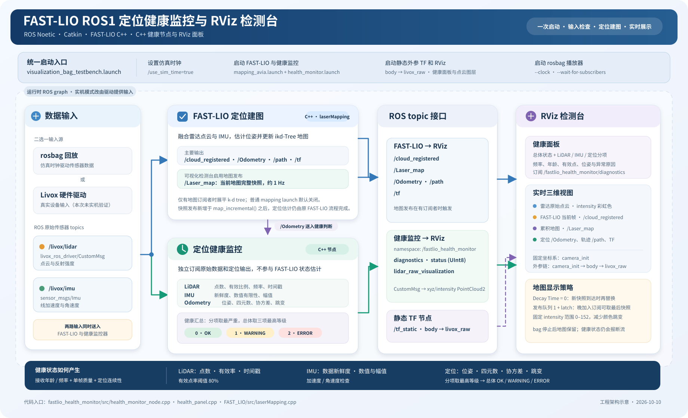

# 定位健康监控设计文档

本文下方记录V1历史设计。2026-10-12已实施V2判定、生命周期、追溯日志和通用接入，设计目标见[11](11_导师要求与健康监控后续执行方案.md)，实际实现/运行配置/限制见[12](12_V2重构实施与测试记录.md)。规划模板仍含未支持字段，不能直接加载。

## 目标与边界

在 ROS1 中独立运行 C++ 监控节点，通过订阅监控原始 LiDAR、IMU 和 `/Odometry`，把各输入状态和总体定位健康度公开给 ROS 诊断工具及简单订阅端。为展示建图结果，FAST-LIO 主循环在 `map_incremental()` 后增加按需地图快照发布；健康判定本身位于独立监控包。

## 数据流



可缩放的矢量图：[fastlio_health_architecture.svg](images/fastlio_health_architecture.svg)。

```text
/livox/lidar 或 PointCloud2 ─┐
/livox/imu                  ├─> fastlio_health_monitor_node
/Odometry                   ┘        ├─> DiagnosticArray（分项诊断）
                                     ├─> UInt8（总体 0/1/2）
                                     └─> PointCloud2（RViz 原始点云显示）
                 DiagnosticArray ──────> RViz C++ HealthPanel（总体与分项指标）
                 FAST-LIO topics ──────> RViz（注册点云、累积地图、Odometry、轨迹、TF）
```

## 可视化检测台

一键 launch 将 FAST-LIO、C++ 健康监控器、Avia 到 `livox_raw` 的静态外参和 RViz 放在同一 ROS graph 中。RViz 左侧 Qt 插件面板展示总体 OK/WARNING/ERROR，以及 LiDAR 原始输入与点云质量、IMU 输入质量、定位输出质量；右侧三维视图保留原始雷达和 FAST-LIO 当前帧的 intensity 彩虹显示，并显示同样按 intensity 着色的累积地图 `/Laser_map`、Odometry、轨迹和 TF。三个点云图层均保持最新消息直到下一份到达，累积地图约每墙钟秒更新。Livox `CustomMsg` 由监控节点转成 xyz/intensity `PointCloud2` 供 RViz 消费，不引入 Python 运行时模块。

bag 回放时需在节点启动前设置 `use_sim_time:=true`，并使用 `rosbag play --clock`。静态外参发布至 `/tf_static`，不依赖 bag 时钟。可视化检测台的现场验证截图和指标见[验证记录](02_验证记录.md#5-可视化检测台运行验证)。

为减少手动启动顺序错误，`visualization_bag_testbench.launch` 将仿真时间、整套检测台和 rosbag player 合并为单条 `roslaunch`；播放器等待 LiDAR/IMU 订阅建立后才发布数据。bag 默认路径及回放速率可通过 `bag`、`rate` 参数覆盖。

累积地图默认不在普通 FAST-LIO launch 中展开；可视化检测台设置 `publish/map_pub_en=true`，且仅当 `/Laser_map` 有订阅者时按配置间隔展平并发布 k-d tree 地图，避免无 RViz 订阅时增加计算和带宽。每条 `/Laser_map` 消息是完整快照，发布队列为 1 并启用 latch；RViz 设置 `Decay Time=0`，收到新快照时才替换旧快照，避免按 ROS 时间过期清空导致频闪。地图固定 intensity 显示范围 0–152，防止自动范围变化引起全图变色。原始输入及当前帧也恢复 intensity 彩虹显示，通过图层名称/topic 区分。地图保留与健康断流判定独立，bag 结束后保留图像时监控仍应报告 ERROR。

## 判定项

| 对象 | 检查内容 | WARNING 示例 | ERROR 示例 |
|---|---|---|---|
| LiDAR | 收包年龄、窗口频率、点数、有效点率、点字段/缓冲区、时间戳 | 低于最低点数/频率，有效率偏低，时间戳不递增 | 未收到数据、超时、无有效点、消息结构错误、时间戳无效 |
| IMU | 收包年龄、窗口频率、加速度/角速度模长、时间戳 | 低于配置频率或超物理量级 | 未收到数据、超时、数值非有限、时间戳无效 |
| 定位输出 | 收包年龄、位姿有限性、四元数模长、协方差、位姿速度 | 四元数轻微偏离单位值、协方差偏大、速度突增 | 未收到数据、超时、姿态/协方差无效、严重位姿跳变 |

各输入/定位项用最严重问题作为该项状态；总体取三项中的最高级别。数字状态定义为 `0=OK`、`1=WARNING`、`2=ERROR`。`DiagnosticArray` 同时保留分项原因和指标。

## 时间策略

新消息的接收间隔和数据新鲜度采用 `ros::WallTime`，因此暂停 rosbag 或上游断流时仍会超时。消息头时间戳用来判定有效性、顺序和 Odometry 位姿速度。bag 播放时需确保 FAST-LIO 与监控器订阅相同的仿真时钟设置。

## 配置策略

节点使用私有参数空间；`health_monitor.launch` 加载 YAML。默认 Avia topic 为 `/livox/lidar`、`/livox/imu`、`/Odometry`。Velodyne/Ouster 类 PointCloud2 输入使用 `lidar_type: pointcloud2`。所有速率、超时、点数、有效比例、量程、IMU 幅值、速度和协方差阈值均可调整。

### IMU 输入单位

2026-10-10 修复：IMU 加速度输入单位由私有参数 `imu_acceleration_unit` 指定，只接受 `g` 和 `mps2`。当前 Livox 默认使用 `g`，PointCloud2 配套 IMU 示例使用 `mps2`；单位独立于 LiDAR 类型，按实际 IMU 驱动配置。

监控先计算原始加速度模长；`g` 输入乘 9.80665，`mps2` 输入乘 1，再统一以 m/s² 显示并与 `maximum_acceleration_mps2` 比较。诊断同时保存原始模长、单位和换算系数，便于追溯。非法单位配置导致节点启动失败；非有限数值/换算结果按 ERROR 处理。原始 IMU 消息继续由原发布端提供，FAST-LIO 按原有流程消费。

## 风险与限制

- 点云“质量”依据结构、有效点数/比例、坐标有效性和量程判断；不替代传感器内建诊断，也不评估场景几何退化或点云覆盖盲区。
- 定位跳变基于消息时间戳下相邻 Odometry 平移速度的经验阈值；真实机器人应按平台最大速度和运动模型调整。bag 回放倍率直接改变墙钟接收频率及断流表现，不直接乘算正常消息时间戳下的位姿速度。
- 协方差阈值受 FAST-LIO 发布值和坐标定义影响，需要结合实际系统标定。
- 现有端到端证据来自 Livox CustomMsg outdoor bag；PointCloud2 分支已编译，尚未完成对应数据集或实体设备的端到端验证。健康等级反映输入及输出的检查结果，不能证明绝对定位精度。

## 文档入口

启动与操作见 [06_启动与操作说明](06_启动与操作说明.md)，完整阈值及硬编码判定见 [04_代码说明](04_代码说明.md)，交付范围和待验证项见 [07_项目完结归档](07_项目完结归档.md)。
