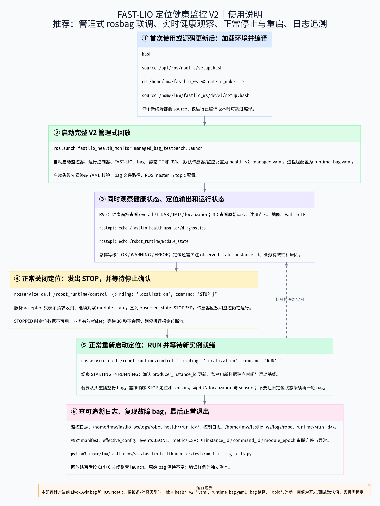
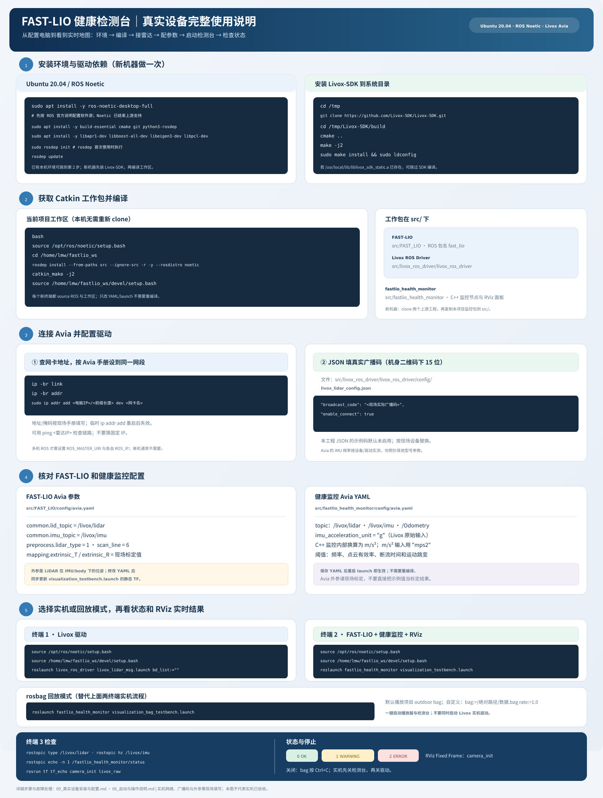
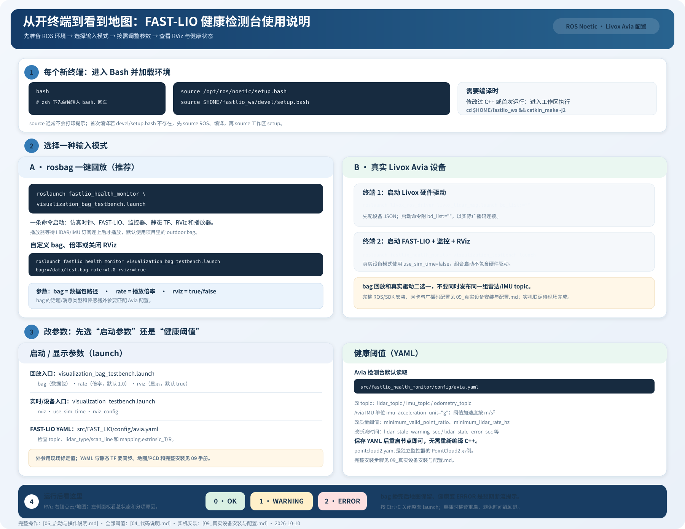

# 启动与操作说明

## 2026-10-12 V2入口（优先阅读）

普通一键回放现在默认运行V2；下面历史命令仍可用。V2正常关闭/重启演示请使用：

```bash
# 在已加载ROS和工作区的Bash中执行。
roslaunch fastlio_health_monitor managed_bag_testbench.launch
```

另一个加载环境的终端：

```bash
rosservice call /robot_runtime/control "{binding: 'localization', command: 'STOP'}"
# 等待任意时长；定位STOPPED，监控和传感器继续。
rosservice call /robot_runtime/control "{binding: 'localization', command: 'RUN'}"
```

[12_完整V2运行与测试说明](12_V2重构实施与测试记录.md)列出控制确认、日志、配置和故障副本；适配器接口、各消息类型的职责和新增接入方式见[13_适配器设计说明](13_适配器设计说明.md)。默认配置为`config/health_v2_avia.yaml`；旧平面`avia.yaml`只适用于V1节点。V2可用`health_config:=/绝对路径.yaml`传组合入口；`health_v2:=false`用于V1回归。C++起播协调器会确认FAST-LIO和监控都已订阅，先暂停启动bag，检查双方实际TCPROS连接后再恢复；不依赖“任意订阅者即可”的旧等待方式。

V2 实际演示含正常停止保持 30 秒再重启、`imu_stamp_regression` / `lidar_dropout` / `localization_jump` 故障包及日志查询；逐终端完整命令见[14_V2演示视频与命令复现](14_V2演示视频与命令复现.md)。

更新日期：2026-10-13（Asia/Shanghai）。适用：本机 ROS Noetic、Livox Avia 配置与现有 outdoor bag。

**实体设备从系统依赖、Livox-SDK、工作包安装/编译、网卡配置到完整启动命令，请先看[真实设备安装与配置](09_真实设备安装与配置.md)。** 本页保留常用启动、RViz 和 bag 操作速查。

V2 全项目模块关系见[技术架构图](images/fastlio_health_v2_architecture.svg)，首次启动、运行观察、正常停止/重启及日志查看步骤见下图和本页后续章节。



可缩放的[使用说明 SVG](images/fastlio_health_v2_usage.svg)与[Draw.io 可编辑文件](images/fastlio_health_v2_usage.drawio)；命令对应当前管理式 V2 配置。



可缩放的[SVG 原图](images/fastlio_health_device_guide.svg)。图中包含 ROS/SDK 依赖、Catkin 工作包编译、Avia 网络与广播码、FAST-LIO/健康参数、实机启动和 rosbag 一键回放入口；详细文字步骤见[09_真实设备安装与配置](09_真实设备安装与配置.md)。原有 rosbag 操作章节和速查图继续保留。



可缩放的[启动与参数设置速查图](images/fastlio_health_quickstart.svg)。

## 1. 终端环境与编译

本机默认 shell 是 zsh。先**单独输入**下面这一条命令，按回车，等 Bash 提示符出现：

```bash
bash
```

然后逐行执行，每行按回车：

```bash
source /opt/ros/noetic/setup.bash
source $HOME/fastlio_ws/devel/setup.bash
```

`source` 成功时通常没有输出。每个新终端都需要加载环境。首次使用或修改 C++ 后，在 Bash 中编译：

```bash
source /opt/ros/noetic/setup.bash
cd $HOME/fastlio_ws
catkin_make -j2
source $HOME/fastlio_ws/devel/setup.bash
```

## 2. rosbag 一键回放（推荐）

在已加载环境的 Bash 终端中执行：

```bash
roslaunch fastlio_health_monitor visualization_bag_testbench.launch
```

无需另外启动 roscore；没有可用 master 时 roslaunch 会启动 master。该入口设置 `/use_sim_time=true`，启动 FAST-LIO、C++ 健康监控、静态 TF、RViz 和 rosbag player，C++起播协调器暂停启动`rosbag play --clock`，确认双方实际TCPROS连接后通过pause_playback服务恢复。

默认 bag：`$HOME/datasets/fastlio/outdoor_Mainbuilding_10hz_2020-12-24-16-38-00.bag`。期望输入为 `/livox/lidar`（`livox_ros_driver/CustomMsg`）和 `/livox/imu`（`sensor_msgs/Imu`）。终端应出现 `Opening` 和播放器运行进度，RViz 随定位初始化逐渐显示地图。

### 一键回放支持的参数

| 参数 | 默认值 | 作用 |
|---|---|---|
| `bag` | 上述 outdoor bag 绝对路径 | 替换数据集；输入类型、topic 和外参仍需匹配 Avia 配置 |
| `rate` | `1.0` | 播放倍率；调低时接收频率降低，健康阈值可能需要调整 |
| `rviz` | `true` | `false` 时只启动后台节点与播放器 |
| `health_v2` | `true` | 使用V2；false用于旧节点回归 |
| `health_config` | `config/health_v2_avia.yaml` | V2配置路径；V1仍使用旧入口平面YAML |

指定另一份匹配数据集：

```bash
roslaunch fastlio_health_monitor visualization_bag_testbench.launch \
  bag:=/绝对路径/匹配的Avia数据.bag rate:=1.0
```

无界面运行：

```bash
roslaunch fastlio_health_monitor visualization_bag_testbench.launch rviz:=false
```

地图仅在存在 `/Laser_map` 订阅者时生成和发布；无 RViz 且无其他地图订阅端时不会展开地图。实时点云显示和 PCD 文件保存是两个功能：检测台默认关闭 `pcd_save_en`，不会自动保存 PCD。

V2一键入口在正常EOF确认后显示STOPPED，检测台与回放状态心跳继续运行，最后一份地图保留；空格暂停显示PAUSED。旧V1或不带状态桥接的直接rosbag回放仍按断流报告。按 `Ctrl+C` 结束整套 launch。重新回放前先结束当前 launch，再从头启动，避免 FAST-LIO 遇到时间戳倒退。

## 3. 真实 Livox Avia 设备

设备启动步骤供部署使用，本次归档未包含实体设备联调证据。先按设备实际序列号、网络及外参配置 Livox 驱动和 FAST-LIO；确认输入使用 CustomMsg。

终端 1，加载 ROS 环境后启动硬件驱动：

```bash
roslaunch livox_ros_driver livox_lidar_msg.launch bd_list:=""
```

先按[实机安装与配置手册](09_真实设备安装与配置.md)编辑 `livox_lidar_config.json` 中的真实广播码和 `enable_connect`。当前 launch 的 `bd_list` 默认值是示例占位串（驱动会判为非法并打印提示）；命令中的空值可让 JSON 成为设备选择的唯一配置来源。

终端 2，加载 ROS 环境后启动检测台：

```bash
roslaunch fastlio_health_monitor visualization_testbench.launch
```

该检测台设置 `/use_sim_time=false`。真实设备模式与 bag 回放应分开运行；两个入口都已包含 FAST-LIO 和监控器，无需重复启动它们。

检测台launch支持`rviz`、`use_sim_time`、`rviz_config`、`health_v2`、`health_config`、`data_reference`；V2接入说明见12。静态 TF 当前为 `body -> livox_raw`，平移 `[0.04165, 0.02326, -0.0284] m`、单位旋转；这是匹配当前 Avia 配置的固定值，**没有自动从 YAML 读取**。修改 `FAST_LIO/config/avia.yaml` 的外参时需同步修改 `visualization_testbench.launch` 中的静态变换。

真实设备部署的 ROS 安装、SDK、依赖、Catkin 工作包准备和 Avia 参数详见[09_真实设备安装与配置](09_真实设备安装与配置.md)。

## 4. 手动分步回放

需要单独操作播放器时，使用两个终端。每个终端先按第 1 节加载环境。

终端 1：

```bash
roslaunch fastlio_health_monitor visualization_testbench.launch use_sim_time:=true
```

终端 2：

```bash
rosbag play --clock --wait-for-subscribers \
  $HOME/datasets/fastlio/outdoor_Mainbuilding_10hz_2020-12-24-16-38-00.bag
```

`roslaunch` 和 `rosbag play` 都占用前台终端。播放器运行后，空格可暂停/继续；V2一键入口的空格由C++包装器处理，确认暂停后监控显示PAUSED；独立手工rosbag回放未提供暂停意图时，仍按墙钟报告超时。TF 与 FAST-LIO 数据处理使用 bag 仿真时钟。

## 5. RViz 画面与健康判断

Fixed Frame 使用 `camera_init`。初始化前短暂没有该 frame，收到同步的 LiDAR/IMU 并产生定位输出后再检查。

| 图层/面板 | 数据来源 | 含义 |
|---|---|---|
| FAST-LIO 健康检测台 | `/fastlio_health_monitor/diagnostics` | 总体状态、原始输入、三项质量指标及原因 |
| 雷达原始点云 | `/fastlio_health_monitor/lidar_raw_visualization` | 未进行 FAST-LIO 配准的传感器点云，Livox reflectivity 转 intensity |
| FAST-LIO 当前帧 | `/cloud_registered` | 当前帧经过 FAST-LIO 处理、配准到世界坐标后的点云 |
| FAST-LIO 累积地图 | `/Laser_map` | 当前 k-d tree 地图完整快照，默认约每墙钟秒更新 |
| 定位输出 / 定位轨迹 | `/Odometry` / `/path` | 位姿与轨迹 |
| TF | `/tf`、`/tf_static` | `camera_init -> body -> livox_raw` 坐标链 |

原始、当前帧、地图均使用 `Intensity`、`intensity` 通道和彩虹配色。三层 `Decay Time=0` 保留最新消息直到下一份到达；地图 intensity 固定范围 0–152。不同图层点云可能重叠，检查地图时可暂时只勾选“FAST-LIO 累积地图”。

| 状态 | 状态码 | 阅读方法 |
|---|---:|---|
| OK | 0 | 三项均通过当前规则 |
| WARNING | 1 | 查看分项原因，如点云有效率低于 80%、接收频率偏低或数据延迟 |
| ERROR | 2 | 查看缺失输入、超时、非有限数值或严重定位跳变等原因 |

总体取三个分项的最高等级。`sample_status`、`sample_message` 保留最近样本质量，`age_sec` 是距离最后接收的墙钟时间，不能当作传感器到处理端的端到端传输延迟。完整默认阈值见[代码说明](04_代码说明.md#默认阈值与判定)。

## 6. 查看节点、Topic 与 TF

在第三个已加载环境的终端执行：

```bash
rosnode list
rostopic list
rostopic type /livox/lidar
rostopic type /livox/imu
rostopic info /Laser_map
rostopic echo -n 1 /fastlio_health_monitor/status
rostopic echo -n 1 /fastlio_health_monitor/diagnostics
rostopic echo -n 1 /Odometry
rosrun tf tf_echo camera_init livox_raw
```

正常一键回放应包含 `/laserMapping`、`/fastlio_health_monitor`、`/body_to_livox_raw`、`/fastlio_health_testbench_rviz` 与 `/fastlio_test_bag_player`。bag 结束后播放器节点退出，`rviz:=false` 时没有 RViz 节点。持续查询命令用 `Ctrl+C` 结束。

## 7. 常见现象与处理

### IMU 单位配置与本次修复生效

`fastlio_health_monitor/config/avia.yaml` 当前设置 `imu_acceleration_unit: "g"`，适用于本项目 Livox 驱动/bag；`pointcloud2.yaml` 的通用 IMU 示例设置 `imu_acceleration_unit: "mps2"`。按实际 IMU 输入单位选择，不能根据 LiDAR 类型判断。

`g` 输入乘 9.80665 后显示并判断 m/s²，`mps2` 输入保持数值。`maximum_acceleration_mps2` 始终以 m/s² 设置；角速度始终按 rad/s。非法单位字符串会导致监控节点启动报错退出。

已完成 C++ 编译及注入/完整 bag 实测。若检测台正在运行，先在原 launch 终端按 `Ctrl+C` 结束整套程序，再按第 1、2 节重新启动；RViz 插件和监控节点均需重新加载。面板新增原始加速度数值/单位，并显示换算后的 m/s² 模长。修复后的[新截图](images/imu_units_bag_testbench.png)和[实测记录](02_验证记录.md#11-imu-单位修复实测2026-10-10)已归档。

如果左侧健康面板只显示 topic/频率而看不到加速度，通常是停靠区高度不足截断了多行文字；在 RViz 的 Panels 菜单关闭 Displays，或拖动分隔线扩大健康面板高度，再查看完整指标。新截图采用隐藏 Displays 的布局，未调整数据和判定阈值。

### 故障定位表

| 现象 | 检查与处理 |
|---|---|
| 输入 `source` 后没有输出 | 通常正常；随后运行 `rospack find fastlio_health_monitor` 确认包可查到 |
| 只出现 Bash 提示符，bag 没有运行 | 确认进入 Bash 后实际逐行执行了 source 与 roslaunch；推荐第 2 节的一键命令 |
| 播放器一直等待订阅者 | 用 `rosbag info` 检查 bag 的全部 topic；`--wait-for-subscribers` 等待所播放 topic 的订阅连接，含其他无人订阅 topic 的 bag 可能一直等待；现有默认 bag 只有两路匹配输入 |
| 初始化时健康为 ERROR | 确认数据正在播放；未收到三路数据时按规则报告 ERROR |
| 有点云但没有累积地图 | 检查 `/Odometry`、`/Laser_map` 发布/订阅，使用检测台入口与专用 RViz 配置；普通 FAST-LIO launch 默认不展开地图 |
| 地图频闪或颜色不符 | 三个点云 Decay Time 设为 0；颜色选 Intensity；地图关闭自动 intensity 范围并设 0–152，检查是否加载旧 RViz 配置 |
| bag 结束后地图还在、面板为 ERROR | 预期行为：地图是缓存快照，输入已经停止 |
| 换设备或 topic 后不匹配 | 单独监控可通过 `health_monitor.launch config:=...` 加载 YAML；V2组合入口可透传health_config，其他雷达需同时适配 FAST-LIO、topic 和 TF |

已解决问题及真实证据见[问题复盘](03_问题复盘.md)和[验证记录](02_验证记录.md)。

## 2026-10-14：暂停/EOF状态已接入

一键入口支持空格及 `/fastlio_bag_playback/pause` 服务，正常EOF显示STOPPED；managed入口同步源暂停/完成并检查实际定位节点存活。完整命令、作用范围、日志与关键截图见[17](17_回放暂停恢复与正常结束优化.md)。


## 2026-10-15：自采RSLidar/MAVROS副本专用roslaunch

```bash
bash -c '
source /opt/ros/noetic/setup.bash &&
source $HOME/fastlio_ws/devel/setup.bash &&
export ROS_MASTER_URI=http://127.0.0.1:33522 &&
exec roslaunch -p 33522 fastlio_health_monitor recorded_bag_health.launch
'
```

默认使用桌面 `.recovered.bag` 副本，1倍速，监控、RViz与C++回放控制器同时启动；EOF界面保留，Ctrl+C关闭。专用参数源为 `$HOME/fastlio_ws/src/fastlio_health_monitor/config/health_v2_rslidar_mavros.yaml`，修改后重启。三路为 `/rslidar_points`、`/mavros/imu/data_raw`（SI单位）、`/Odometry`；显示包内已有定位/配准点云，不重新建图。

暂停服务 `/recorded_bag_playback/pause`，调用端需同一 `ROS_MASTER_URI`。完整参数、空格/服务操作、日志位置、初始数据缺失与EOF过渡限制、编译及未新增运行验证的范围，见[19第8节](19_自采Bag副本修复与原生回放测试.md#8-日常使用roslaunch常驻检测台2026-10-15新增)。


### 2026-10-15后续：日志按bag时间显示并自动封存

上述 `recorded_bag_health.launch` 命令不变，重启后新日志时间只保留 `bag_elapsed_sec`、`source_stamp_sec`、`steady_elapsed_sec`，分别表示bag进度、消息头时间和本进程单调运行秒数。正常EOF确认后，健康/回放JSONL与CSV自动封存，界面继续保留，并显示“日志记录：已结束”。再次回放需重启创建新run。

可传 `finish_log_on_playback_complete:=false` 继续记录EOF后的状态。此开关在launch，不是健康YAML字段。/clock回放位置不等同于每条消息精确record time；初始化未就绪时新增bag时间为null。本次完整回放实测见[21](21_三时间字段回放实测与日志分析.md)；既有EOF过渡短暂告警没有在本次被消除。完整定义和范围见[20](20_日志时间对齐与回放结束封存.md)。
