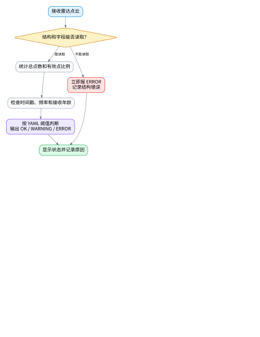
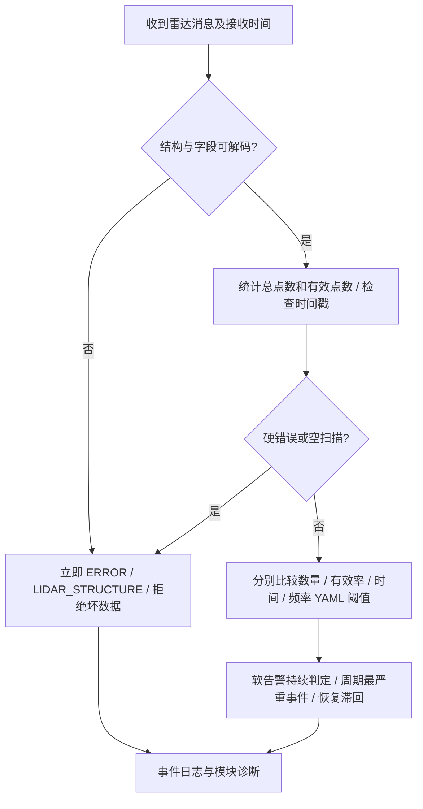
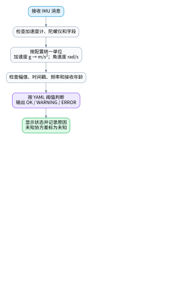
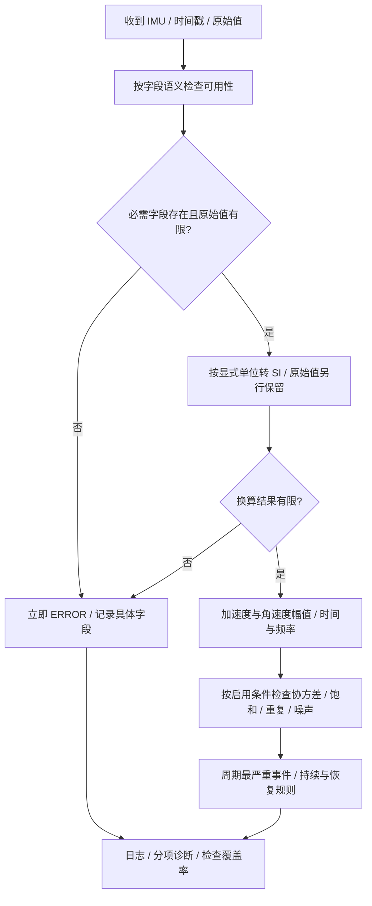
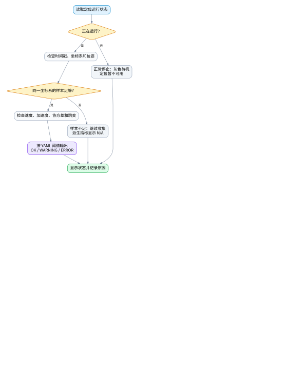
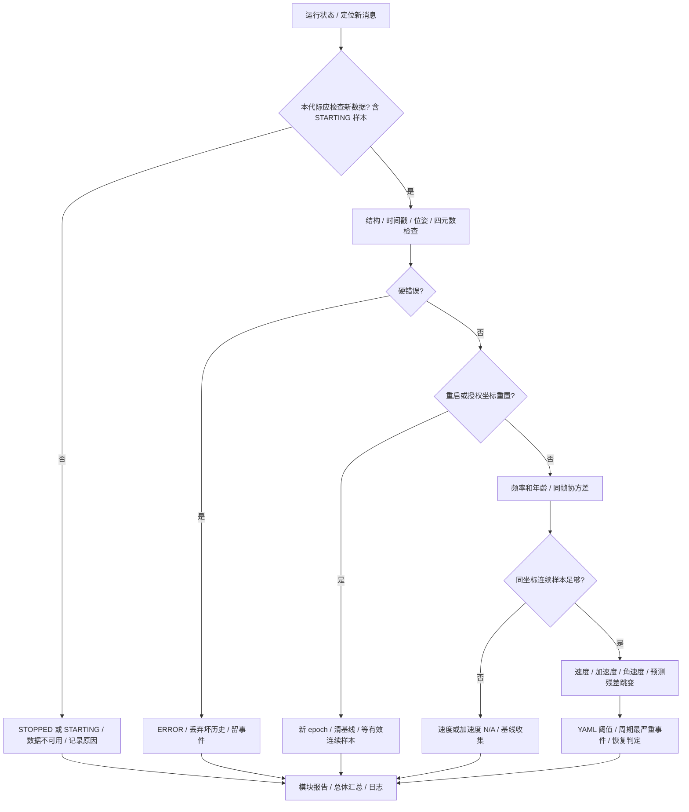
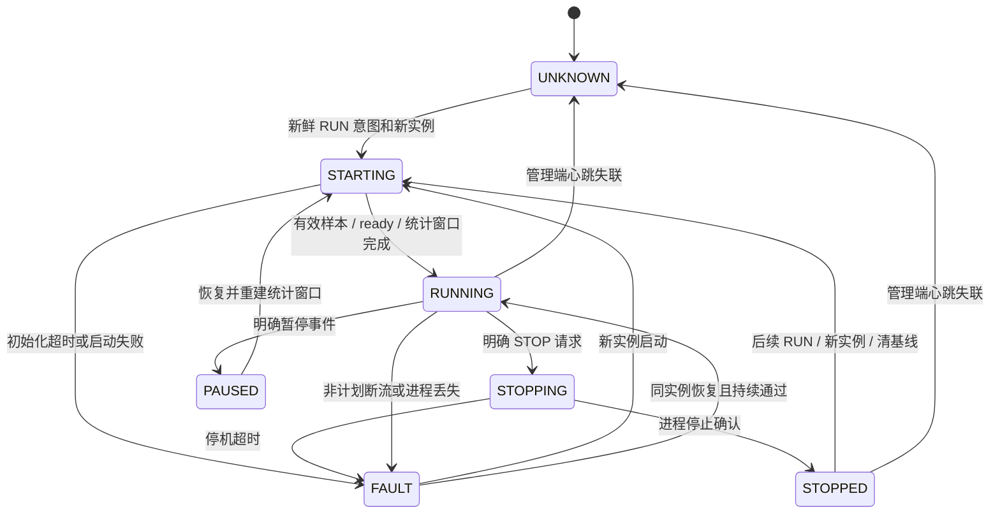
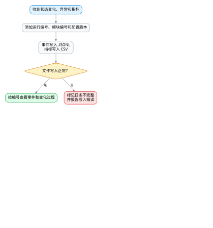
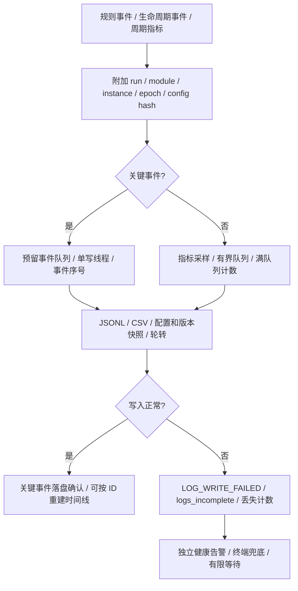

# 导师要求与健康监控后续执行方案

编写/调研日期：2026-10-12（Asia/Shanghai）<br>
适用工程：ROS1 Noetic / `$HOME/fastlio_ws`
状态：**本文保留完整设计目标与调研依据；2026-10-12 已实施 V2 核心、启停、日志及标准适配，实际实现/测试/运行配置见[12_V2重构实施与测试记录](12_V2重构实施与测试记录.md)。** 本文中原“本次未实现/未执行”描述对应方案编写时状态；后续实现状态以12为准。下面的规划模板包含未支持字段，仍不能直接加载。

## 阅读入口

- 第 1–2 节：导师要求、当前差距与资料调研。
- 第 3–5 节：统一判定口径，雷达/IMU/定位检查表和流程图。
- 第 6 节：正常关闭、等待重启、异常断流及恢复监控。
- 第 7–8 节：C++ 类设计、其他定位/感知/规划节点接入，可追溯日志。
- 第 9–11 节：YAML 模板、实施步骤、验收场景与交付清单。

独立配置模板：[health_monitor_v2.example.yaml](planned_config/health_monitor_v2.example.yaml)。流程图提供 Mermaid 可编辑源，以及可直接查看的 SVG / PNG；索引见第 11 节。

## 1. 导师要求转成可交付事项

| 要求 | 当前实现 | 后续工作与完成条件 |
|---|---|---|
| 雷达数量、频率、时间 | 总点数、有效点率、最低接收频率、接收年龄、头时间戳 | 将总点数/有效点数、频率上下界、接收年龄/时间戳分别定义；每条规则对应 YAML 参数与规则 ID |
| IMU 加速度计、陀螺仪、时间戳、数据质量 | 单位换算、有限性、模长上限、最低接收频率与时间戳 | 加入字段可用性、饱和/重复数据/噪声的条件检查；明确输入单位、协方差含义和标定前禁用项 |
| 定位时间戳、频率、速度、加速度、协方差、跳变 | 位姿/四元数、时间戳、接收年龄、位置差分速度、混合协方差上限 | 补独立频率、加速度、角运动、位置/姿态协方差、预测残差跳变；明确坐标系和重定位策略 |
| 正常关闭一段时间再重启 | 仅按断流报 ERROR，没有关闭意图或重启代际 | 监控独立常驻；接收可靠运行意图；停机灰显，重启清空该模块历史，有限宽限后恢复正常判断 |
| 可追溯日志 | ROS 终端告警 + 部分测试 JSON | 事件 JSONL、周期指标、配置快照、版本/实例/会话 ID、轮转和日志失败自诊断 |
| 类的思想、通用节点接入 | 大部分逻辑集中在 `FastLioHealthMonitor` 类，名称/Topic 耦合 FAST-LIO | 将接入、规则、生命周期、汇总、日志和 UI 分离；用组合与 C++ 接口接入第二种定位及感知/规划实例 |

现有依据：[监控源码](../../../fastlio_health_monitor/src/health_monitor_node.cpp)、[RViz 面板](../../../fastlio_health_monitor/src/health_panel.cpp)、[代码说明](04_代码说明.md)、[优化评审](08_工程优化评审.md)。当前 `Odometry` 检查的最低频率传入 0，不具备独立定位频率阈值；没有加速度计算、关闭意图或事件日志。原 FAST-LIO [publish_odometry](../../src/laserMapping.cpp) 先发布再填协方差，需要先修正同帧顺序再做协方差验收。

## 2. 资料调研和采用方案

以下为本次实际读取的官方消息定义、ROS 源码和库作者文档。部分 ROS 文档站页面拒绝访问，消息/REP 使用官方 GitHub 源文件核对。**资料定义的是接口或已有机制，本文的阈值、状态机和类拆分属于针对本项目的设计建议。**

| 资料 | 查到的机制/约定 | 本项目采用方式 |
|---|---|---|
| [diagnostic_updater C++ 源码](https://github.com/ros/diagnostics/blob/noetic-devel/diagnostic_updater/include/diagnostic_updater/update_functions.h) | 频率、时间戳诊断与累计计数；相关实现使用 ROS 时间 | 借鉴任务/规则组织，保持标准诊断输出；断流和宽限自建单调时钟逻辑，不能照搬 ROS 时间计时 |
| [diagnostic_aggregator Analyzer](https://github.com/ros/diagnostics/blob/noetic-devel/diagnostic_aggregator/include/diagnostic_aggregator/analyzer.h) | 抽象类对诊断进行匹配、分析、汇总 | 通用模块输出标准诊断供上层汇总；聚合器不能替代原始消息质量检查 |
| [pluginlib ClassLoader](https://github.com/ros/pluginlib/blob/noetic-devel/pluginlib/include/pluginlib/class_loader.hpp) | 通过基类和插件声明加载 C++ 实例 | 第一阶段可用注册工厂；接口稳定后用 pluginlib 动态加载 Checker / Adapter |
| [ROS 时间实现](https://github.com/ros/roscpp_core/blob/noetic-devel/rostime/src/time.cpp) | ROS 时间可来自仿真；Linux 单调时钟与系统时钟不同 | watchdog/宽限用 `std::chrono::steady_clock` 或 `ros::SteadyTime`，墙钟仅用于日志日期 |
| [REP-103](https://github.com/ros-infrastructure/rep/blob/master/rep-0103.rst) | 单位、轴向和协方差约定 | 参数名带单位；内部统一 SI；输入适配层显式换算 |
| [REP-105](https://github.com/ros-infrastructure/rep/blob/master/rep-0105.rst) | odom 连续，map 可以有离散修正 | 连续里程计和全局重定位分开判断；不把全局修正当物理加速度 |
| [Imu.msg](https://github.com/ros/common_msgs/blob/noetic-devel/sensor_msgs/msg/Imu.msg) | 加速度/角速度单位，以及协方差未知/字段不存在标记 | 按字段可用性检查，再计算物理量；未知协方差不当作零噪声 |
| [Odometry.msg](https://github.com/ros/common_msgs/blob/noetic-devel/nav_msgs/msg/Odometry.msg)、[PoseWithCovariance.msg](https://github.com/ros/common_msgs/blob/noetic-devel/geometry_msgs/msg/PoseWithCovariance.msg) | 位姿与 twist 的坐标系不同；位姿协方差有规定的排列 | 不混用坐标系；速度来源显式配置，位置/旋转方差分别设置 |
| [DiagnosticStatus.msg](https://github.com/ros/common_msgs/blob/noetic-devel/diagnostic_msgs/msg/DiagnosticStatus.msg) | OK/WARN/ERROR/STALE 及键值指标 | 保留标准诊断兼容；用新增运行状态表达停机和初始化 |
| [spdlog 异步日志](https://github.com/gabime/spdlog/wiki/Asynchronous-logging)、[轮转 sink](https://github.com/gabime/spdlog/blob/v1.x/include/spdlog/sinks/rotating_file_sink.h) | 有界队列、阻塞/覆盖策略与轮转；多写线程可能改变顺序 | 进程日志可用 spdlog；关键事件另定义可靠队列和落盘确认，不把异步 flush 当作持久化保证 |
| [Kalibr IMU Noise Model](https://github.com/ethz-asl/kalibr/wiki/IMU-Noise-Model) | 噪声与慢变零偏分开，连续噪声密度不同于离散样本标准差 | 静态噪声阈值按采样率/滤波/工况标定，不能直接抄噪声密度来比较窗口方差 |

选型结论：ROS1 下保留现有诊断/RViz 使用方式，先开发可独立使用的 C++ 核心类和适配器，再补运行控制协议与日志。当前仅需要 ROS1，生命周期逻辑由本项目定义，不把它表述为 ROS1 自动提供的功能。

## 3. 判定前先统一口径

### 3.1 健康等级、运行状态、有效性分开

每个模块同时输出：

1. `operating_state`：UNKNOWN / STARTING / RUNNING / STOPPING / STOPPED / FAULT，以及回放 PAUSED。
2. `has_data_health`、`data_health_level`：是否具备当前有效数据的健康判断，以及 OK/WARNING/ERROR。
3. `operational_valid`：是否处于要求的运行状态、数据足够新鲜、关键检查通过，可以被下游使用。
4. `required`、`expected_active`、`checks_available`：业务是否需要此模块、当前是否应输出、哪些检查有数据依据。

正常停止为 `STOPPED + expected_active=false + operational_valid=false`，面板灰显“正常停止”，不能显示绿色“定位有效”。新报告保留完整语义；旧 UInt8 接口建议将 STARTING/STOPPING/STOPPED/PAUSED 映射为 WARNING=1，并带原因，避免停止时输出旧含义的 OK=0。处于 RUNNING 的数据错误或非计划断流仍为 ERROR=2；未知状态不能默认认定为正常关闭。标准诊断的 STALE 是单独枚举值，不能直接把其数字 3 混入原三等级接口。[标准诊断定义](https://github.com/ros/common_msgs/blob/noetic-devel/diagnostic_msgs/msg/DiagnosticStatus.msg)。

兼容映射的优先级：本周期已收到的明确硬错误/控制故障先输出 ERROR=2；没有该类故障时，非 RUNNING 状态才映射 WARNING=1；RUNNING 按规则最高等级输出。这样 STARTING 的 NaN 不会被初始化显示掩盖，STOPPED 又不会被冒充有效 OK。

### 3.2 时间与频率定义

| 指标 | 定义 | 时钟/前置条件 |
|---|---|---|
| `receive_age_sec` | 当前单调时间 - 最后消息接收单调时间 | 断流、新鲜度与 watchdog；暂停 bag 仍增长 |
| `receive_rate_hz` | 固定接收窗口内事件数 / 有效窗口长度 | 单调接收时间；窗口每次诊断都裁剪，断流会降为 0 |
| `source_rate_hz` | 同一数据代际中 `(N-1)/(最后头时间戳-最初头时间戳)` | 至少 3 条严格递增时间戳；源频率不随正常回放倍率改变 |
| `stamp_delta_sec` | 相邻消息头时间戳之差 | 顺序、重复、间隔异常；不与接收间隔混用 |
| `transport_delay_sec` | 接收端同域时间 - 映射后的源时间戳 | 只有同一时钟域或经过可靠时钟映射才能启用 |
| `execution_age_sec` | 最后一次成功算法更新的接收年龄 | 需要节点显式提供更新成功信息；不能只靠频繁心跳 |

源数据时间、ROS 仿真时间、系统 UTC 和本机单调时间分别记录。单调时钟用于等待/超时，源时间用于运动差分；系统时间调整不应改变 watchdog。依据 [ROS 时间源码](https://github.com/ros/roscpp_core/blob/noetic-devel/rostime/src/time.cpp)。

**当前 bag 的特别边界：** 已有实测 JSON 中 IMU `header.stamp` 为约 597–738 秒，不能直接与 UTC 或 bag 的 `/clock` 当成同域做年龄减法。新版 Avia 示例声明设备相对时钟，默认关闭绝对传输延迟检查；同代际的时间戳顺序和源频率仍可检查。要检查真实传输延迟，先提供经验证的时间映射。依据[已有源消息配对数据](evidence/imu_units_validation.json)，这是本项目的输入情况，并非所有 Livox/ROS 数据都使用这种时钟。

频率判断需完成最小采样数与统计覆盖时长，样本不足标记 WARMING_UP。断流没有新消息时也要裁剪窗口；源频率不能一直作为“当前仍在输出”的证据。bag 模式推荐用源频率判定采样速率，并另查接收年龄；2 倍播放的接收频率约为 2 倍，不能直接套 1 倍的接收频率上界。

### 3.3 规则执行与告警保留

- 数值非有限、消息结构错误、必需字段不存在等硬错误立即记录事件，不用启动宽限掩盖。
- 点数/频率/幅值等软阈值采用可配置持续时间和恢复滞回；阈值触发等号使用统一规范：下界 `<`、上界 `>`，断流 `>`。保持区间内才算通过。
- 存储“最新样本判断”和“本诊断周期最严重事件”两套状态，异常不能被之后正常样本覆盖而完全漏报。
- 同一诊断周期所有激活且应检查的规则取最高严重度，并列出全部原因；一次异常也进入事件日志，软告警尚未达到持续时间时记录为候选事件。
- 无法计算的指标输出 null/N/A 和原因，不把首帧速度/加速度填 0 后宣称测量正常；停机模块没有当前数据健康判断。
- 分项判定后再做依赖和总体汇总；定位正常停机只暂停定位输出规则，雷达/IMU 若继续运行仍独立监控。总体另公开 `all_required_modules_active=false`，避免“传感器 OK”被误认为定位可用。

## 4. 雷达与 IMU 的规则和流程

### 4.1 雷达

| 规则 ID | 检查与算法 | WARNING | ERROR | 新版 YAML 路径 |
|---|---|---|---|---|
| `LIDAR_COUNT` | 分别统计 `points_total` 和 `points_valid`，后者须满足结构/有限性/量程条件 | 少于各自 warning 下界 | 空扫描、无有效点或少于 error 下界 | `modules[].quality.points_total / points_valid` |
| `LIDAR_RATIO` | `points_valid / points_total`，空扫描先处理，不能除 0 | 小于 warning 下界 | 小于 error 下界或无有效点 | `modules[].quality.valid_ratio` |
| `LIDAR_STRUCTURE` | 字段、类型、字节序、行步长、缓冲区，尺寸乘加防溢出；Livox 数组与数量核对 | 非致命元数据不一致可配级别 | 解码/长度不合法，不转发该坏消息 | `modules[].quality.structure` |
| `LIDAR_FREQUENCY` | 选定源/接收频率，检查上下界 | 超 warning 区间持续指定时长 | 超 error 区间持续指定时长；完全断流由 AGE 处理 | `modules[].stream.frequency` |
| `LIDAR_AGE` | 距最后接收时间 | 超 warning 秒数 | 超 error 秒数 | `modules[].stream.receive_age_sec` |
| `LIDAR_STAMP` | 非零、重复、回退、相邻间隔 | 重复或间隔超 warning | 非法；未授权回退/跨代际使用 | `modules[].stream.stamp` |
| `LIDAR_DRIVER_FIELDS` | Livox line/tag/offset_time 和设备状态 | 驱动异常比例超阈值 | 硬件错误或必需字段不可用 | `modules[].adapter_options`，二期按设备扩展 |

原始坐标有效率与 FAST-LIO 预处理可用率是两种指标；blind 距离、tag/line、抽稀会影响后者，不能直接把地图点数或下采样点数拿来要求满足原始数量阈值。点数上限首先用于资源约束，不应没有设备依据就把“很多点”判断为坏雷达。





### 4.2 IMU

ROS 的标准加速度单位为 m/s²、角速度为 rad/s；当前 Livox 驱动原始 g 已由监控显式换算。IMU 协方差全零表示未知；某项矩阵首元素 -1 表示对应估计不可用，必须先按消息语义处理，而非把它一律当“负方差坏数据”。[官方 Imu 定义](https://github.com/ros/common_msgs/blob/noetic-devel/sensor_msgs/msg/Imu.msg)。

| 规则 ID | 检查与算法 | WARNING | ERROR | 配置/边界 |
|---|---|---|---|---|
| `IMU_ACCEL_AVAILABLE` | 加速度计字段是否存在且被声明可用 | 可选字段不可用 | 必需加速度计不可用 | `quality.required_measurements.acceleration` |
| `IMU_GYRO_AVAILABLE` | 陀螺仪字段是否存在且被声明可用 | 可选字段不可用 | 必需陀螺仪不可用 | `quality.required_measurements.angular_velocity` |
| `IMU_FINITE` | 六个原始分量及换算后的量是否有限 | 无软降级 | NaN/Inf/换算溢出立即 ERROR | `quality.require_finite` |
| `IMU_ACCEL_NORM` | g 或 mps2 输入统一到 m/s² 后求模长，含重力分量 | 超 warning 上限 | 超 error 上限 | `quality.acceleration_norm_mps2` |
| `IMU_GYRO_NORM` | rad/s 求模长；deg/s 仅在后续显式适配时允许 | 超 warning 上限 | 超 error 上限 | `quality.angular_velocity_norm_rps` |
| `IMU_STAMP / AGE / FREQUENCY` | 与通用时间/频率规则一致 | 重复、低/高频、迟到 | 非法时间戳、未授权回退、断流 | `stream` |
| `IMU_COVARIANCE` | 可用性 + 有限性 + 对称/半正定；g² 方差换算时乘系数平方 | 未知或方差偏大，按配置降级/仅记录 | 被声明有效的矩阵非法 | `quality.covariance` |
| `IMU_STUCK` | 窗口内多轴长期完全重复/近零，结合独立运动证据和量化分辨率 | 持续可疑才 WARNING | 明确设备故障可 ERROR | `quality.stuck`，示例默认关闭 |
| `IMU_NOISE / SATURATION` | 标定工况下噪声/零偏、接近传感器量程、夹死比例 | 超标定区间 | 硬件声明错误/持续严重饱和 | `quality.noise / saturation`，标定前关闭 |

静止时陀螺仪接近 0 通常正常；加速度模长接近 0 也不能脱离运动情境直接宣称传感器坏掉。运动证据不能只取 `/cmd_vel` 指令：有指令不代表实际运动。噪声检查先使用静止数据标定，不能用运动中的方差直接当静态噪声。当前 Avia 常无有效协方差，默认未知仅记录检查覆盖不足，不解释为“噪声为零”。

数据质量阈值的落实步骤：先记录设备型号/量程/分辨率、源采样率、滤波设置、温度和加速度是否已去重力；采集人工确认的静止段与正常运动段，逐轴计算均值、去均值后的标准差/重复比例。静止陀螺仪可估计偏置，加速度逐轴偏置需要已知姿态/重力参考，不能单凭模长约 1 g 推断三轴偏置。将工况、样本文件/hash、单位、统计窗口、候选阈值和标定版本放进 `calibration_profile`，再用独立正常/异常数据统计误报与漏报。

噪声密度和离散样本方差不能直接混用，采样率与滤波设置变化时标定配置需重新确认；可借鉴 [Kalibr 噪声模型说明](https://github.com/ethz-asl/kalibr/wiki/IMU-Noise-Model)，但短段静止统计不能被称为已经完成长期零偏随机游走标定。没有标定依据的噪声/stuck/饱和检查保持禁用，明确公开检查覆盖不足。





## 5. 定位输出判断与计算

### 5.1 时间、频率、速度、加速度、协方差、跳变

| 规则 ID | 判断标准 | YAML 路径/前置条件 |
|---|---|---|
| `LOC_STAMP / LOC_AGE` | 必须新鲜、同代际时间戳递增；正常停止不查输出断流，非计划缺失正常查 | `stream.stamp / receive_age_sec` + 生命周期 |
| `LOC_FREQUENCY` | 独立定位频率上下界；算法持续更新不能仅以传感器频率代替 | `stream.frequency` |
| `LOC_POSE / QUATERNION` | 位姿有限、坐标系可解释；四元数非零，模长误差比较 warning/error 上界 | `quality.quaternion_norm_error` |
| `LOC_SPEED` | 连续坐标系中的平移速度；明确是差分值或可信 twist | `quality.kinematics.speed_mps`、`velocity_source` |
| `LOC_ACCELERATION` | 同源、同坐标、有效时间间隔下的速度差分；至少需要 3 个位置样本 | `quality.kinematics.acceleration_mps2` |
| `LOC_ANGULAR_MOTION` | 四元数短弧角差 / 时间；q 与 -q 代表同一姿态，不算翻转 | `quality.kinematics.angular_speed_rps` |
| `LOC_COVARIANCE` | 原始矩阵有限/对称/半正定；位置与旋转分开比较；未知按源契约处理 | `quality.covariance.position_variance_m2 / orientation_variance_rad2` |
| `LOC_JUMP` | 平移/姿态突变和预测残差；连续里程计、重定位修正使用不同策略 | `quality.jump`、适配器连续性声明 |

`Odometry` 中位姿参考 `header.frame_id`，twist 参考 `child_frame_id`，不能把二者的向量直接混作同一坐标。位姿协方差按 x/y/z/绕 X/Y/Z 排列，位置方差为 m²、旋转方差为 rad²；不能用一个无单位的 100 混合评价。[Odometry 定义](https://github.com/ros/common_msgs/blob/noetic-devel/nav_msgs/msg/Odometry.msg)、[协方差排列](https://github.com/ros/common_msgs/blob/noetic-devel/geometry_msgs/msg/PoseWithCovariance.msg)。

### 5.2 差分与跳变公式

在同一 `producer_instance_id + module_epoch + frame_epoch` 内，先保证位置/姿态有效，再计算：

```text
dt_i = t_i - t_(i-1)，必须在 [dt_min_sec, dt_max_sec] 内
v_i  = (p_i - p_(i-1)) / dt_i                 单位 m/s，保持向量
tau_i = (t_i + t_(i-1)) / 2                  差分速度对应的时间中点
a_i  = (v_i - v_(i-1)) / (tau_i - tau_(i-1)) 单位 m/s²
theta_i = 2 * acos(clamp(abs(dot(q_i,q_(i-1))), 0, 1))
omega_i = theta_i / dt_i                     单位 rad/s
p_predict = p_(i-1) + v_(i-1) * dt_i
jump_residual = norm(p_i - p_predict)         单位 m
```

四元数计算用已经检查过的单位化副本，原数据的归一化误差仍报告。加速度使用速度向量差，不能只对速度模长作差，否则会漏掉等速转弯。已发布 twist 只有在适配器声明有效、坐标变换完成后才可使用；现有 FAST-LIO 没有填充可信 twist，默认用连续位置差分。

第一帧速度 N/A；前两帧加速度 N/A。重复/回退时间戳、严重异常位姿、重启或坐标系改变时停止跨边界差分，记录原因并建立新连续段；坏样本不能作为下一帧有效历史基线。大间隔跨帧不做强行微分，先进入重建基线流程。后续可加滤波抑制差分噪声，但要记录滤波延迟，并保留未滤波突跳检查。

`jump_policy` 建议分两类：

- `continuous_odometry`：FAST-LIO 当前 `camera_init` 输出作为本数据段的连续估计，平移残差与角差超阈值正常告警；授权 reset 另开 frame_epoch。
- `global_localization`：map 可能随回环/重定位离散修正。需要显式重定位事件/实例关联；物理速度与加速度优先取连续 odom 或可信 twist。无连续源时将这些检查标记不可用，不能把 map 的跳变当机器人突然超速。

odom 与 map 的区别依据 [REP-105](https://github.com/ros-infrastructure/rep/blob/master/rep-0105.rst)。即使跳变被授权，也要留下 `RELOCALIZATION / FRAME_RESET` 事件，不能默默抹掉历史。

### 5.3 定位流程

初始化阶段收到本代际的新样本，也必须走结构/硬错误检查；只有正常停机或尚无可关联的新数据时保留 STOPPED/STARTING 的不可用状态。样本不足只影响派生量和 ready，不屏蔽 NaN 等异常。





## 6. 正常关闭后如何持续监控并正常重启

### 6.1 必须增加可观察的运行意图

仅看到没有 Odometry，无法确定是人为正常停止、进程崩溃、算法卡死或上游停止。退出码 0 / 收到 SIGINT 也不能单独证明符合当前任务的关闭计划。**正常关闭必须经明确控制请求，或接入已有管理端的同等状态协议。**

建议分三个常驻/受控部分：

```text
health_supervisor.launch           常驻：健康监控 / 日志 / 运行控制 / 可选 RViz
localization_runtime.launch        可停止/重启：FAST-LIO 或其他定位算法
sensor_runtime.launch              按设备独立管理：LiDAR / IMU 驱动
```

当前一键 launch 同时包含定位和监控，整体 Ctrl+C 会把监控一并关闭，不能实现“关闭定位后监控继续观察”。迁移时保留原一键演示入口，同时提供分离的正式运行入口。监控本身或 ROS master 被关闭后不能靠自己继续观察，需另一个独立接收端/系统管理端判断其心跳。

### 6.2 建议接口契约

未来 C++ `RuntimeController` 或已有任务管理端发布 `/robot_runtime/module_state`，含：

| 字段 | 用途 |
|---|---|
| `module_id` / `controller_instance_id` | 区分目标与管理端重启 |
| `producer_instance_id` | 每次目标进程启动的新 UUID；不能只靠相同 node name |
| `command_id` / `event_seq` | 关联 STOP/RUN 请求、确认及顺序，重复请求幂等 |
| `desired_state` / `observed_state` | 用户希望停止/运行，与实际进程状态分开 |
| `reason` / `expected_active` | 维护、正常停机、bag 完成、暂停等明确原因 |
| `module_epoch` / `frame_epoch` | 拒绝跨启动代际、跨坐标重置计算 |
| `heartbeat` / `stop_confirmed` | 管理端状态新鲜度与真正停机确认 |

协议由管理端周期发布并 latched 最近状态，但监控以单调接收年龄判断是否新鲜；管理端失联不能永久沿用 latched STOP 掩盖故障。`desired_state=STOPPED` 经确认后可无限等待下次 RUN，只要管理端心跳仍有效，不设一个静默后自动改 ERROR 的固定停机超时。

**停机请求和宽限的顺序：** 管理端先发 STOP 意图 → 监控接收并记录 command_id、明确停机阶段 → 在配置期限内完成进程退出/停机确认。请求处理超时或进程仍应退出却持续运行，为 STOP_FAILED；收到停机请求不等于已经停机。控制/日志失败按单独事件报告，不能无期限宽限。

### 6.3 状态与恢复标准

| 状态 | 行为与判定 | 转移条件 |
|---|---|---|
| UNKNOWN | 管理意图未知、心跳失联或实例关系未确认；数据有效性 false | 新鲜管理状态重新确认 |
| STARTING | 新实例、新 epoch；清本模块频率/时间/位姿/速度/恢复缓存；等待有效输入，显示初始化；收到坏数据立即发布数据 ERROR | 连续有效样本、初始化 ready 和必要检查窗口都完成 → RUNNING；启动失败或超过 startup_deadline → FAULT |
| RUNNING | 全规则按配置执行，允许数据健康 OK/WARNING/ERROR | STOP 请求 → STOPPING；非计划断流/崩溃 → FAULT |
| STOPPING | 有明确 STOP 意图，暂不把正常停止中的输出减少当异常；记录过程 | 确认停机 → STOPPED；stop_deadline 超时 → FAULT |
| STOPPED | 目标正常停止，灰显；不计算其输出断流，不提供有效定位 | 新 RUN + 新实例 → STARTING；管理状态失联 → UNKNOWN |
| PAUSED | 仅由明确回放/任务暂停事件进入；不提供实时定位有效性 | RESUME → 重新收集窗口；暂停未被授权仍按断流告警 |
| FAULT | 非计划断流/进程丢失、初始化/停机超时等运行故障；日志保留 | 新启动实例 → STARTING；同实例输出恢复后满足恢复条件且意图仍 RUN → RUNNING |

宽限只用于“暂时没有足够数据”，收到 NaN/坏结构等硬错误仍立即报告。不要因为刚启动就屏蔽所有异常。运行状态与数据等级独立：进程持续输出但数值坏时，可以是 RUNNING + 数据 ERROR；STARTING 收到坏数据也立即报数据 ERROR，而非等到宽限结束才报警。重启只清目标模块及依赖它的派生基线，未重启的 LiDAR/IMU 保留自己的监控历史；原故障历史留在日志，不从文件里清除。

标准 Odometry 没有进程 UUID；重连时需要控制端实例确认、清理旧回调/缓存、重建订阅并等待新样本。不能拿 latched 旧地图或旧诊断当新定位 READY。对无法关联新旧实例的自定义输入，适配器应报告关联不足，而非承诺仅凭 header.seq 可辨别所有重启。

管理端心跳规则在任意阶段执行，包括 STARTING/STOPPING/PAUSED；失联进入 UNKNOWN 并报告控制状态错误。下图展开常见停机/重启路径，RUNNING/STOPPED 的失联箭头为这一公共规则的示例。




### 6.4 导师场景的可复现实例

1. 定位 RUNNING、监控常驻；记录旧实例 A 的 epoch=1 和有效指标。
2. 发 STOP 请求，记录意图/确认；目标停止，定位灰显 STOPPED，`operational_valid=false`；传感器仍运行时继续独立检查。
3. 等待 30 秒或更长；管理端持续确认 expected_active=false，定位不因没有 Odometry 被误报故障。
4. 发 RUN 请求，管理端启动实例 B，epoch=2；监控清定位差分和时间基线，进入 STARTING，不跨 A/B 比较跳变。
5. B 的第一帧仅建立位姿基线；至少两帧才能求速度，三帧才能求加速度；完成配置的连续样本/统计窗口后进入 RUNNING。
6. 如果 B 到期限仍没有定位输出，为 STARTUP_TIMEOUT；没有 STOP 意图而直接 kill 定位时，为 UNEXPECTED_STALE / PROCESS_LOST。

这些是后续协议的验收步骤，本次没有实现或执行。bag EOF 如果未来被管理端明确标为任务完成，可进入 STOPPED；当前旧入口没有该协议，EOF 报 ERROR 是现有断流行为，不能直接宣称它已支持正常任务完成分类。

## 7. C++ 类设计与跨节点接入

### 7.1 单一职责与组合


| 类/接口 | 职责 | 可复用性 |
|---|---|---|
| `ConfigLoader / ConfigValidator` | 解析 schema、单位、阈值、规则开关和跨字段关系；形成有效配置及 hash | 所有模块 |
| `IClock / SteadyClock / ManualClock` | 单调时间和源时钟映射；测试可注入时间 | 不依赖 FAST-LIO |
| `StreamTracker` | 接收窗口、源窗口、年龄、时间戳事件与 epoch 重置 | 雷达/IMU/定位/其他流 |
| `IInputAdapter` | ROS 消息/单位/坐标/可用性 → 统一样本；保留输入元数据 | 每种消息类型一个 C++ 适配器 |
| `IHealthChecker` | 对样本和快照执行规则，返回规则结果，不负责启动进程/画 UI | 插件基类 |
| `LidarChecker / ImuChecker / LocalizationChecker` | 各领域检查；调用共有 StreamTracker 与规则组件 | 定位算法换名无需改这些通用规则 |
| `KinematicsTracker / CovarianceChecker` | 同坐标有效段的运动差分、协方差验证 | 多种定位输出 |
| `LifecycleTracker` | STOP/RUN、确认、宽限、实例代际和恢复状态机 | 所有受管理模块 |
| `RuntimeController` | 发意图、控制目标进程/接入已有管理端、确认实例状态 | C++，独立于目标进程常驻 |
| `RuleLatch / RecoveryGate` | 周期异常保留、持续判定、恢复滞回 | 所有 Checker |
| `HealthRegistry / DependencyAggregator` | 根据配置实例化模块、汇总依赖与业务有效性 | 不硬编码三项数量 |
| `EventRecorder / MetricsRecorder` | 事件、周期指标、配置和日志可靠性 | 所有模块共享 |
| `DiagnosticPublisher / HealthPanel` | 输出标准诊断/完整报告；按 module_id 显示列表与独立接收超时 | UI 不解析固定 FAST-LIO 名称 |

接口草案（仅展示设计，C++14）：

```cpp
class IHealthChecker {
 public:
  virtual ~IHealthChecker() = default;
  virtual void configure(const ModuleConfig& config) = 0;
  virtual void onSample(const NormalizedSample& sample) = 0;
  virtual ModuleReport evaluate(const EvaluationContext& context) = 0;
  virtual void reset(const EpochInfo& epoch) = 0;
};
```

`NormalizedSample` 使用带类型标签的 C++14 结构/Boost variant，不假定当前工程已经支持 C++17 `std::variant`。Checker 组合通用组件；避免一个巨大继承树把所有消息字段塞进基类。ROS 回调更新有界样本/事件队列，诊断线程读取不可变快照，日志线程写文件；给共享状态明确同步方案，不能把当前 `ros::spin()` 直接改多线程而保留无锁对象。

### 7.2 建议包和文件结构

```text
src/
  robot_health_core/          C++ 核心：clock/stream/rules/kinematics/lifecycle
  robot_health_msgs/          ModuleHealth / RuntimeState / HealthEvent / 控制服务
  robot_health_monitor/       ROS1 接入、C++ 插件、日志、运行控制、通用 RViz 面板
  fastlio_health_monitor/     保留旧入口和 FAST-LIO 适配配置，逐步转为兼容层
```

消息/服务名是规划接口，尚未存在。第一步可在原包的 include/src 内拆出类，再在验收通过后独立成库/包，避免同时改包名、接口和行为而难以定位回归。pluginlib 使用方式参考[官方类加载器](https://github.com/ros/pluginlib/blob/noetic-devel/pluginlib/include/pluginlib/class_loader.hpp)。

### 7.3 接入其他节点的实际边界

| 对象 | 配置和适配 | 业务规则 |
|---|---|---|
| 其他建图/定位 | 标准 Odometry 只改 Topic/坐标/频率/连续性；PoseStamped 不含协方差，标记检查不可用；自定义输出编写 C++ Adapter | ready、位置/姿态/速度/加速度/跳变与质量 |
| 感知 | 先接 PointCloud2 或已有 DiagnosticArray；检测框/目标列表需适配相应消息类型 | 时间/频率、数据有限性、框尺寸、坐标、跟踪 ID；没有目标可以正常，不能统一以数量 0 报错 |
| 规划 | 接 Path、规划结果/状态和明确 goal_id/任务状态 | 无目标时 IDLE；有目标时才启用结果超时、成功率、计算耗时、路径连续性/碰撞有效性规则 |
| 第三方已有诊断 | `DiagnosticRelayAdapter` 保留来源/名称/更新时间 | 上层聚合及诊断失联；只收到 OK 心跳不能证明算法数据正确 |

YAML 配置可以实例化已经实现的 Adapter/Checker，**不能仅写一个任意消息类型名就自动理解其语义**。新消息须编译依赖和 C++ 适配代码；新领域还需要业务指标，频率/时间这一组公共检查不足以评价感知精度或规划可行性。[ROS Analyzer 的匹配/汇总机制](https://github.com/ros/diagnostics/blob/noetic-devel/diagnostic_aggregator/include/diagnostic_aggregator/analyzer.h)可复用到已生成的诊断层。

## 8. 可追溯日志设计

### 8.1 文件、字段与关联

每次监控启动创建新 `monitor_run_id`，每次目标重启创建新 `producer_instance_id/module_epoch`。建议输出：

```text
logs/<monitor_run_id>/
  manifest.json              软件版本、构建/二进制 hash、机器/时钟/数据集信息
  effective_config.yaml      解析并补齐默认值后的不可变配置快照
  config_source.yaml        原配置文件副本
  events.000.jsonl           按事件轮转；主追溯材料
  metrics.000.csv            周期指标，非逐点/逐条 IMU 全量复制
  process.000.log            人可读运行日志
```

关键事件至少包含 `event_seq`、`wall_time_utc`、`steady_elapsed_sec`、`source_stamp_sec` 和时钟域、`monitor_run_id/module_id/producer_instance_id/epoch`、`rule_id`、metric/value/unit、阈值与持续时间、before/after 等级/状态、reason、command_id、`effective_config_sha256`、源 topic/frame 与检查覆盖率。主 Git commit 之外还记录 dirty 状态/差异摘要和监控二进制 hash，否则本地改动后的运行不能只靠 commit 定位代码。

事件类型包括：RUN_BEGIN、CONFIG_APPLIED、WARNING_CANDIDATE、RULE_TRIGGERED、RULE_RECOVERED、STOP_REQUESTED、STOP_CONFIRMED、START_REQUESTED、READY、STARTUP_TIMEOUT、FRAME_RESET、RELOCALIZATION、CLOCK_MAPPING_CHANGED、LOG_WRITE_FAILED、RUN_END。

示例事件（设计样例，非真实测量日志）：

```json
{"event_seq":42,"monitor_run_id":"run-demo","module_id":"localization","producer_instance_id":"instance-B","module_epoch":2,"event_type":"RULE_TRIGGERED","rule_id":"LOC_SPEED","metric":"speed_mps","value":16.2,"unit":"m/s","warning_limit":15.0,"error_limit":50.0,"from_level":"OK","to_level":"WARNING","operating_state":"RUNNING","effective_config_sha256":"example-config-hash","source_stamp_sec":709.6,"stamp_domain":"device_relative","steady_elapsed_sec":12.3,"wall_time_utc":"2026-10-12T02:00:00Z"}
```

非有限数值记录 JSON null + `raw_value_text: "NaN"`/`"Inf"`，不能生成不符合 JSON 的裸 NaN。事件序号在单一 run 内单调，模块 ID/实例/代际用于跨重启关联；不能按可能跳变的系统日期简单排列全部事件。

### 8.2 可靠性、容量与性能

- 常规指标降频采样；同一故障反复出现合并计数，但保留首次/最后时间、最严重值、恢复与再触发，不静默吞掉短暂异常。
- 队列有界，普通指标满队列可以丢弃并计数；关键生命周期/告警事件使用预留容量和单写线程。完全过载或磁盘满仍可能失去记录，必须输出 `logs_incomplete=true`、丢失计数和 LOG_WRITE_FAILED，不能保证任何情况下“绝不丢日志”。
- 不能在高频 IMU/点云回调中同步逐条写磁盘。异步后顺序/溢出策略需明确；库默认队列满行为和多工作线程顺序不能凭猜测。[spdlog 作者说明](https://github.com/gabime/spdlog/wiki/Asynchronous-logging)。
- 控制端确认正常停机前，对 STOP_REQUESTED/STOP_CONFIRMED 等关键事件提供写线程确认和有期限的持久化处理；普通 `flush()` 不等同于已经执行 fsync。日志机制失败另报，而不是一直等到系统不能关闭。
- 按文件大小/数量及总配额轮转；保留 manifest/config，不能删除日志的一半却声称完整。保留异常片段或引用原 bag，完整原始传感器数据由 rosbag 按需求记录，事件日志不替代 bag。
- 启停/配置/日志失败即刻生成事件，周期统计可以降频；写文件异常由监控自身健康项报告。无写权限、磁盘不足、写线程卡死都有预定处理。





## 9. YAML 配置规范与迁移

### 9.1 文件分工

- 当前可用文件：[avia.yaml](../../../fastlio_health_monitor/config/avia.yaml)、[pointcloud2.yaml](../../../fastlio_health_monitor/config/pointcloud2.yaml)。本次只补中文注释，不改变生效参数值。
- 新设计模板：[health_monitor_v2.example.yaml](planned_config/health_monitor_v2.example.yaml)。含通用框架、日志、生命周期、雷达/IMU/定位，以及感知/规划预留配置。**当前 C++ 不解析这套嵌套 schema；禁止直接传给现有 health_monitor.launch。**
- 新模板中的阈值是开发/回放起点，不是 ROS 标准规定、不是 Livox 硬件规格、更不是已完成的平台标定。启用依赖工况的检测前先收集数据、审阅参数来源。

### 9.2 注释必须说明的六项

每个可配置规则至少解释：①单位；②判断对象与公式；③超限比较方向；④WARNING/ERROR；⑤持续/恢复/启停条件；⑥例值来源或未标定状态。未知协方差策略、时钟域、连续性、是否已有实现也要明确。

规则还需声明是否 `required_for_valid`：必需测量不可用会使业务有效性 false；未标定、被禁用或可选协方差检查只能显示 N/A/覆盖不足，不能声称它已通过。当前 Avia 没有估计的 IMU 协方差作为可选检查；其他业务可要求定位协方差必须可用，再调整模板中的对应开关。

例：

```yaml
speed_mps:
  warning_above: 15.0  # m/s；连续位置差分向量的模长 > 15 且满足软告警持续时间为 WARNING。
  error_above: 50.0    # m/s；> 50 为 ERROR；样例沿用原工程经验值，须按平台最大速度标定。
```

启动校验：schema_version、所有数字有限、非负时长、error 下界 < warning 下界、warning 上界 < error 上界、比例在 [0,1]、单位枚举、epoch/时钟映射是否有来源、模块 ID 唯一、依赖无环、所需插件存在。未支持字段/拼错字段不得静默忽略；第一阶段配置只在启动时加载，后续热更新必须校验后原子替换并记录 config hash，不允许半份规则用旧值、半份用新值。

## 10. 后续实施步骤与验收

以下以“工作日顺序”给出依赖安排，不承诺已执行或固定工期；每阶段完成后更新工作进度、代码说明、验证记录、问题复盘，工作日结束前补当日总结。

| 阶段 | 工作 | 主要文件/类 | 完成门槛 |
|---|---|---|---|
| P0：标准与样本 | 确认时钟域/单位/连续性/平台运动和传感器规格；冻结规则 ID/配置 schema | 本文、模板、样本目录 | 导师能逐项对应四要求；参数来源和禁用项明确 |
| P1：核心拆分 | 提取 StreamTracker、规则、epoch 和单调时钟；保留旧入口 | `robot_health_core` 或原包独立类 | 原有 g/mps2 结果保持；短暂事件不漏记，断流频率刷新 |
| P2：字段与运动 | 补定位频率/加速度/角差/同帧协方差；时钟映射和跳变策略 | Checker/Adapter/KinematicsTracker | 首帧/重启不假填零、不跨帧域差分；协方差来自同帧 |
| P3：日志 | session/instance/config hash、JSONL/CSV、轮转、写失败告警 | EventRecorder/MetricsRecorder | 可重建告警触发-恢复和启停全过程；丢失可见 |
| P4：正常启停 | 独立常驻监控 + 控制协议；STOP/RUN/确认/代际/有界宽限 | LifecycleTracker/RuntimeController/launch | 停止等待30秒以上无故障误报；重启自动恢复；非计划停止仍报错 |
| P5：跨节点与 UI | 第二种定位输入、感知与规划实例；通用面板列表/心跳超时 | Registry/插件/HealthPanel | 不改核心源码可更换已支持类型的 Topic；非定位实例具有业务检查 |
| P6：联调交付 | 回放/故障注入/性能采样/截图视频/归档 | 验证记录与证据 | 全验收矩阵有结果，不把未覆盖实机或精度评估写成通过 |

### 验收矩阵（后续测试计划，当前未执行）

| 编号 | 场景 | 期望 |
|---|---|---|
| T01 | 雷达空扫描、全无效、低数量、有效率边界 | 按规则区分 WARNING/ERROR，除零/越界被拒绝；日志带点数与阈值 |
| T02 | 雷达/IMU/定位各自低频、高频、断流 | 独立频率判断；窗口过期，年龄超限；短暂异常留事件 |
| T03 | device_relative header 与 UTC/clock 不同 | 不错误做绝对年龄相减；源频率仍可算；延迟检查标记不可用 |
| T04 | 时间戳重复/回退/零、明确 epoch 重启 | 非授权错误报告；授权重启清基线，不跨代际产生假跳变 |
| T05 | IMU g/mps2、NaN/Inf、cov -1/零/非对称矩阵 | 不重复换算；非法值报错；字段不存在与未知噪声分开 |
| T06 | 静止、转弯、零运动指令但实际运动 | 不把正常静止判 stuck；向量加速度识别转弯；运动证据有效 |
| T07 | 定位速度/加速度边界、首帧及大 dt | 无足够样本为 N/A；有效样本按单位阈值判定 |
| T08 | map 回环修正与连续 odom 突跳 | map 授权事件另开基线；odom 异常不被全局跳变豁免 |
| T09 | 正常 STOP、等待30秒、RUN 实例 B | 停机灰显且无有效定位；新实例重新初始化，稳定后恢复 |
| T10 | 未发 STOP 就 kill；STOP 确认超时；管理端失联 | 分别故障/STOP_FAILED/UNKNOWN，不能永久忽略断流 |
| T11 | 新实例收到旧 latched 地图/缓存消息 | 不以旧缓存判 READY，不跨会话求速度/加速度 |
| T12 | 监控程序停止而 RViz 仍开 | 面板独立诊断超时，旧 OK 失效 |
| T13 | 日志不可写/满盘/队列满/写线程延迟/轮转 | 日志自身告警和丢失计数；正常回调不无限阻塞 |
| T14 | 同一名称多实例、重启后新 config | 事件可按实例/epoch/hash 对齐；配置变更可追溯 |
| T15 | 更换标准 Odometry 节点；自定义消息接入 | 前者配置切换、后者编译 Adapter；无算法名硬编码 |
| T16 | 感知没有目标；规划没有 goal / 有 goal 超时 | 合法空感知不误报；规划 IDLE 不查结果频率，有任务才检查 |
| T17 | 改单位枚举/错参数/NaN阈值/依赖环 | 配置启动失败且原因可见，不静默套默认 |

## 11. 交付清单与首次执行顺序

| 交付物 | 路径/说明 |
|---|---|
| 执行主文档 | 本文，含规则、公式、状态、类、日志与验收 |
| 注释完整的现有配置 | `fastlio_health_monitor/config/avia.yaml`、`pointcloud2.yaml`，值不变 |
| 新版配置设计模板 | [health_monitor_v2.example.yaml](planned_config/health_monitor_v2.example.yaml)，未实现 |
| 雷达流程图 | [SVG](images/health_v2_lidar_flow.svg) / [PNG](images/health_v2_lidar_flow.png) / [Mermaid](flowcharts/health_v2_lidar_flow.mmd) |
| IMU 流程图 | [SVG](images/health_v2_imu_flow.svg) / [PNG](images/health_v2_imu_flow.png) / [Mermaid](flowcharts/health_v2_imu_flow.mmd) |
| 定位流程图 | [SVG](images/health_v2_localization_flow.svg) / [PNG](images/health_v2_localization_flow.png) / [Mermaid](flowcharts/health_v2_localization_flow.mmd) |
| 正常关闭/重启状态图 | [SVG](images/health_v2_lifecycle_flow.svg) / [PNG](images/health_v2_lifecycle_flow.png) / [Mermaid](flowcharts/health_v2_lifecycle_flow.mmd) |
| 追溯日志流程图 | [SVG](images/health_v2_log_flow.svg) / [PNG](images/health_v2_log_flow.png) / [Mermaid](flowcharts/health_v2_log_flow.mmd) |
| C++ 架构图 | [SVG](images/health_v2_architecture.svg) / [PNG](images/health_v2_architecture.png) / [Mermaid](flowcharts/health_v2_architecture.mmd) |

第一次执行建议先完成 **P0 参数/时钟契约 → P1 规则类拆分 → P2 补定位指标 → P3 事件日志 → P4 独立启停**。P5 的插件加载、感知/规划业务适配随后接入，避免一开始同时改所有接口。P1 起维护旧接口兼容和回归记录；本次文档仅为可评审、可按步骤执行的方案，不能把图和 YAML 模板视为已完成代码。
