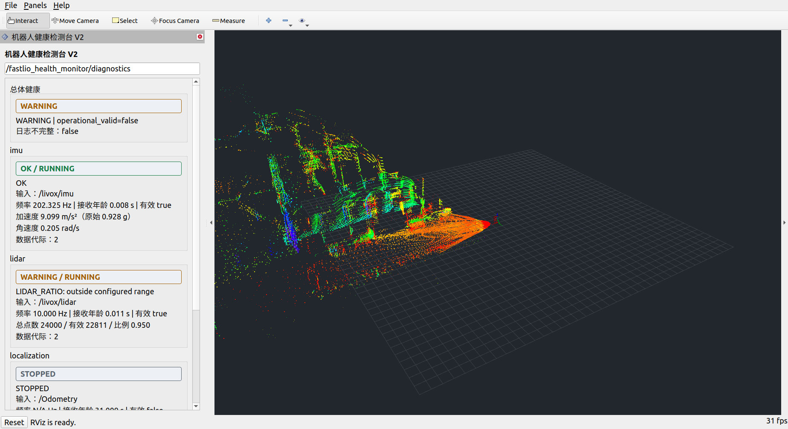
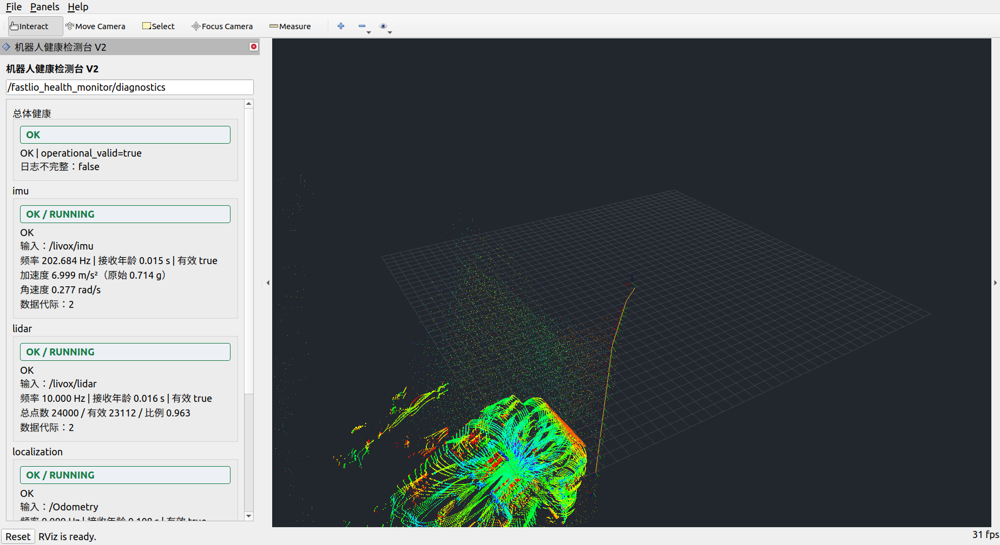
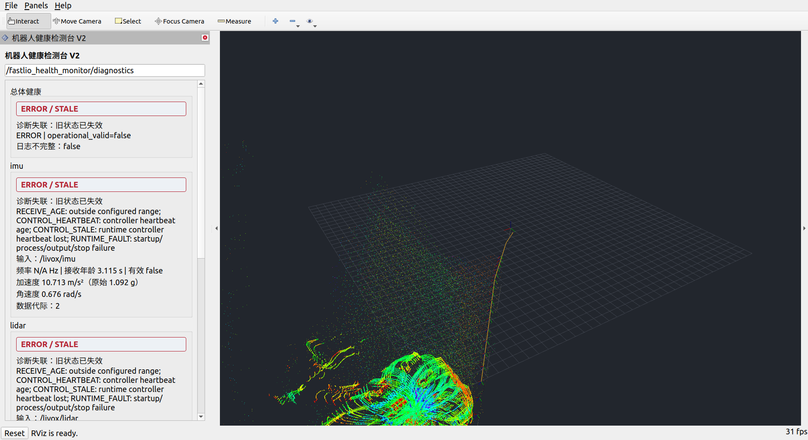

# V2 重构实施与测试记录

日期：2026-10-12；工作区：`$HOME/fastlio_ws`。本文记录实际实现和实测，设计目标及调研资料见[11](11_导师要求与健康监控后续执行方案.md)。

全项目模块与数据流见[FAST-LIO V2 技术架构图](images/fastlio_health_v2_architecture.svg)，启动、监控、STOP/RUN 和日志查看步骤见[FAST-LIO V2 使用说明图](images/fastlio_health_v2_usage.svg)。PNG 预览、DOT 图源和 Draw.io 可编辑文件均位于 `images/fastlio_health_v2_{architecture,usage}.*`。

适配器的类关系、统一 `Sample` 契约、各消息解析/转换、生命周期重连及新增适配器步骤，另见[13_适配器设计说明](13_适配器设计说明.md)。

另存了 [Image2 架构视觉稿](images/fastlio_health_v2_architecture_image2.png)和 [Image2 使用流程视觉稿](images/fastlio_health_v2_usage_image2.png)。这是图像模型生成的展示稿，具体技术文本可能出现拼写或省略，执行命令及模块关系以本记录和可编辑架构图为准。

## 1. 本次交付

| 导师要求 | 已实施内容 | 边界 |
|---|---|---|
| 清楚的检测标准和 YAML | 雷达数量/有效率/频率/时间；IMU 单位/可用性/有限性/幅值/协方差；定位频率/速度/向量加速度/角速度/协方差/跳变 | 全部阈值有中文单位和比较说明；设备噪声、零偏、stuck、真实饱和量程尚未标定 |
| 正常关闭再重启 | 独立 C++ 控制器、RUN/STOP、退出确认、常驻监控、实例与坐标代际、单调时钟宽限 | 使用控制服务关闭目标；单纯断流不自动判作正常关闭 |
| 可追溯日志 | JSONL 事件、CSV 指标、配置与构建快照、源/二进制/核心库/数据文件 hash、run/instance/epoch/command_id | 日志受容量与磁盘条件影响，丢失明确公开；不宣称绝不丢日志 |
| 类设计和其他节点接入 | 通用核心库、规则和适配器工厂；已支持标准定位、诊断转发、任务驱动的 Path 检查 | 新消息需要 C++ Adapter；当前不是动态 pluginlib Checker 加载，也不是感知精度或规划碰撞评估 |

功能模块使用 **C++14**；Python 仅用于构建元数据、生成测试 bag 和执行验收。原始 bag 未修改，V1 可执行文件和平面 YAML 保留用于对照。

## 2. 代码结构与职责

源码目录：[fastlio_health_monitor](../../../fastlio_health_monitor)。

| 文件/类 | 已实现职责 |
|---|---|
| [health_core.h](../../../fastlio_health_monitor/include/fastlio_health_monitor/health_core.h)、[health_core.cpp](../../../fastlio_health_monitor/src/health_core.cpp) | 不依赖 ROS 消息的 C++ 核心库；ConfigLoader、StreamTracker、RuleLatch、CovarianceChecker、KinematicsTracker、领域 Checker、LifecycleTracker、ModuleMonitor |
| [input_adapters.h](../../../fastlio_health_monitor/include/fastlio_health_monitor/input_adapters.h)、[input_adapters.cpp](../../../fastlio_health_monitor/src/input_adapters.cpp) | IInputAdapter 与注册工厂；Livox/PointCloud2/Imu/Odometry/PoseStamped/DiagnosticArray/Path+TaskState 的实际适配 |
| [robot_health_monitor_node.cpp](../../../fastlio_health_monitor/src/robot_health_monitor_node.cpp) | HealthRegistry、依赖有效性汇总、诊断与 UInt8 发布；按 module_id 实例化，不写死三个 FAST-LIO 名称 |
| [event_recorder.h](../../../fastlio_health_monitor/include/fastlio_health_monitor/event_recorder.h)、[event_recorder.cpp](../../../fastlio_health_monitor/src/event_recorder.cpp) | 有界独立事件/指标队列、单写线程、轮转、JSON 转义、关键 fsync 确认、写失败诊断 |
| [bag_playback_node.cpp](../../../fastlio_health_monitor/src/bag_playback_node.cpp) | C++起播协调器，确认两方订阅、播放器暂停等待实际TCPROS连接后恢复起播，避免开头消息漏收；代理进程管理播放器退出 |
| [runtime_controller_node.cpp](../../../fastlio_health_monitor/src/runtime_controller_node.cpp) | C++ 启动配置命令，监督子进程，显式 RUN/STOP/RESET_FRAME，5 Hz 非 latched 管理心跳 |
| [health_panel.cpp](../../../fastlio_health_monitor/src/health_panel.cpp) | 可配置诊断 Topic、动态模块列表、滚动/换行、灰色正常停机、Qt 单调超时，旧诊断超过2秒失效 |
| [RuntimeState.msg](../../../fastlio_health_monitor/msg/RuntimeState.msg)、[ControlModule.srv](../../../fastlio_health_monitor/srv/ControlModule.srv) | 控制意图、确认、实例、递增序号、坐标代际、控制日志状态/路径、数据引用与 hash |
| [TaskState.msg](../../../fastlio_health_monitor/msg/TaskState.msg) | 规划 goal_id/active/state；无目标 IDLE，任务状态仍需要新鲜心跳 |
| [laserMapping.cpp](../../src/laserMapping.cpp) | 先填本帧滤波协方差，再发布 Odometry；同时修复EOF/暂停后正常退出：WallRate、实时检查ros::ok及仅设置sig_atomic_t的信号处理；未调整点云颜色 |

仍采用串行 ROS 回调保护模块状态，文件写入独立线程；没有把无锁对象直接交给多线程 spinner。点云质量遍历仍在接收回调中执行，极大扫描/重负载下的发布隔离是后续性能事项。

核心库 `robot_health_core` 可由其他 C++ 节点链接；导出 Eigen 包含路径。现包仍携带 Livox 编译依赖和 FAST-LIO 演示入口；其他已支持的标准输入不需要运行 FAST-LIO。完全独立的通用包拆分可后续实施。

## 3. 实际判定标准

### 3.1 共同规则

- 接收年龄/超时使用 `std::chrono::steady_clock`，发布使用 ROS `SteadyTimer`，不受 `/clock` 暂停影响。
- 接收频率为窗口内数量/有效接收窗口长度，诊断时主动裁剪；源频率为同代际 `(N-1)/(末stamp-首stamp)`。
- 至少3条样本及配置的覆盖时长后检查频率；不足为 N/A，不填0冒充测量。
- 当前 Avia 相对设备 stamp 与 `/clock` 不同域，绝对传输延迟显示 N/A；没有实现未经验证的时间偏移猜测。
- 下界用 `<`、上界用 `>`，等于边界不触发该级别。
- 普通软告警持续0.5秒才激活；恢复需要连续通过1秒。每个诊断周期保留最严重事件，候选异常也写入日志。
- 非有限数值、结构错误、缺必需字段立即 ERROR。**定位运动达到 ERROR 上界也立即报告**，确保单帧严重跳变可见；这是首轮故障测试发现漏报后落实的规则。
- RUNNING 可以同时存在数据 ERROR；启动阶段不会掩盖 NaN。健康等级、运行状态、数据可用性和业务有效性分别公开。

### 3.2 默认 Avia 阈值

| 对象 | 指标 | WARNING | ERROR/处理 |
|---|---|---|---|
| 雷达 | 总点数/有效点数 | <100点 | 无点/无有效点立即 ERROR |
| 雷达 | 有效率 | <0.8 | <0.5；软持续规则 |
| 雷达 | 源频率 | <8或>12 Hz | <5或>20 Hz |
| 雷达 | 接收年龄 | >0.5 s | >1.5 s |
| IMU | 源频率 | <160或>260 Hz | <50或>400 Hz |
| IMU | 接收年龄 | >0.15 s | >0.6 s |
| IMU | 加速度模长（含重力） | >100 m/s² | >200 m/s²；g输入乘9.80665，SI不再换算 |
| IMU | 角速度模长 | >35 rad/s | >70 rad/s |
| 定位 | 源频率 | <5或>15 Hz | <1或>30 Hz |
| 定位 | 接收年龄 | >0.3 s | >1.0 s；非计划断流 FAULT/ERROR |
| 定位 | 四元数模长误差 | >0.02 | >0.1；零/非有限立即错误 |
| 定位 | 平移速度 | >15 m/s | >50 m/s立即 ERROR |
| 定位 | 向量加速度 | >10 m/s² | >30 m/s²立即 ERROR |
| 定位 | 角速度 | >3 rad/s | >10 rad/s立即 ERROR |
| 定位 | 位置方差 | >1 m² | >4 m² |
| 定位 | 姿态方差 | >0.1 rad² | >0.5 rad² |
| 定位 | 预测残差跳变 | >0.5 m | >2 m立即 ERROR |
| 定位 | 姿态短弧跳变 | >0.3 rad | >1 rad立即 ERROR；q/-q同姿态 |

以上是开发例值，**不等于硬件规格或已完成的平台标定**。例如当前 bag 部分雷达帧有效率低于0.8，会保持 WARNING；当前帧有效率恢复到0.8以上但仍处于1秒恢复等待时，界面仍显示此前告警，事件日志保留触发值与阈值。

### 3.3 定位和协方差计算

- 首帧速度 N/A；至少两帧求位置差分速度，三帧求速度向量变化/速度中点时间差，能够识别转弯加速度。
- dt 小于0.001秒或大于1秒时不差分；坐标变化未经 RESET_FRAME 为 ERROR，重启/授权坐标代际变化清历史。
- `velocity_source: twist` 时将 child_frame 下的线速度旋转到 pose 参考系；FAST-LIO 默认采用位置差分，不能拿默认零 twist 判静止。
- `global_localization` 必须使用可信 twist，禁止把 map 离散修正差分为物理运动；当前未接连续 odom 辅助流，global模式的向量加速度、map角差运动和预测残差跳变标N/A，不能把坐标修正误判为真实加速度。这一覆盖边界要按实际算法补适配。
- IMU 协方差全零表示未知，首项 -1 表示测量不可用；必需加速度计/陀螺仪不存在立即错误。已声明有效的矩阵查有限、对称、半正定；g² 输入协方差乘9.80665²。
- Odometry 全零协方差按本适配器契约标未知；可选择 WARNING 或仅记录；`required_for_valid: true` 时未知阻止业务有效。
- 当前验证检查了收到消息的协方差可用性/数值合法性；本帧发布顺序已从源码修正，未新增内部 P 与每条外发消息的逐帧对齐探针。

完整设计流程图沿用[11 第11节](11_导师要求与健康监控后续执行方案.md#11-交付清单与首次执行顺序)；其中设备标定、动态插件、时钟映射等图示目标不表示本次已经实现。

## 4. 新旧配置与接入

| 文件 | 实际用途 |
|---|---|
| [health_v2_avia.yaml](../../../fastlio_health_monitor/config/health_v2_avia.yaml) | 普通一键回放/独立监控；无管理端时自动 STARTING，不能推断正常停机 |
| [health_v2_managed.yaml](../../../fastlio_health_monitor/config/health_v2_managed.yaml) | `strict_intent: true`，必须接常驻控制器，缺管理心跳 UNKNOWN/ERROR |
| [runtime_bag.yaml](../../../fastlio_health_monitor/config/runtime_bag.yaml) | 控制器命令列表；定位、bag输入分组管理，替换 command 接其他进程 |
| [health_v2_pointcloud2.yaml](../../../fastlio_health_monitor/config/health_v2_pointcloud2.yaml) | 标准 PointCloud2、mps2 IMU、odom/base_link 示例，频率需按设备调整 |
| [health_v2_extensions.yaml](../../../fastlio_health_monitor/config/health_v2_extensions.yaml) | 感知诊断转发与 Path+TaskState 示例，无 FAST-LIO Topic 依赖 |
| [avia.yaml](../../../fastlio_health_monitor/config/avia.yaml)、[pointcloud2.yaml](../../../fastlio_health_monitor/config/pointcloud2.yaml) | V1 平面配置，数值未改；仍由旧可执行文件读取 |
| [规划模板](planned_config/health_monitor_v2.example.yaml) | 完整设计目标，含未支持字段；不能直接加载到 V1 或当前 V2 |

当前 V2 对未知字段、非法单位、非有限/反向阈值、缺插件/重复 ID/依赖环启动失败；配置只在启动时加载。已有 Adapter/Checker 改 Topic 与契约即可接入；自定义消息还需 C++ 注册适配器。

## 5. 启动与正常停止/重启

### 5.1 推荐导师演示入口

先单独输入 `bash` 并回车，出现 Bash 提示符后再执行：

```bash
source /opt/ros/noetic/setup.bash
cd $HOME/fastlio_ws
catkin_make -j2
source $HOME/fastlio_ws/devel/setup.bash
roslaunch fastlio_health_monitor managed_bag_testbench.launch
```

启动监控、控制器、FAST-LIO、bag、TF 和 RViz。目标进程由控制器管理，监控/控制器常驻。bag路径和速率在 `runtime_bag.yaml` 的 command 数组配置；使用独立配置通过 `runtime_config:=/绝对路径.yaml` 传入，监控配置通过 `config:=/绝对路径.yaml` 传入。`rviz:=false` 可关闭界面。

在另一个加载环境的 Bash 终端执行：

```bash
# 正常关闭定位，保留传感器回放和监控。
rosservice call /robot_runtime/control "{binding: 'localization', command: 'STOP'}"

# 可等待30秒或更久：定位灰显STOPPED，业务有效false，管理心跳维持正常。
# 后续正常重启定位：产生新实例，重新建立基线。
rosservice call /robot_runtime/control "{binding: 'localization', command: 'RUN'}"
```

正常步骤为 STOPPING → 退出确认 → STOPPED → 新RUN实例 → STARTING → 连续样本/窗口完成 → RUNNING。STOPPED 的旧 UInt8 等级为WARNING=1，数据不可用；硬错误和控制日志失败优先 ERROR=2。正常停止不因没有 Odometry 产生断流故障。

`STOP` 服务响应仅表示意图已接收，**真正停止以 RuntimeState 的 STOPPED 为准**；超期强制结束为FAULT。控制器管理前台命令/ROS launch，目标命令应由此入口独占，不使用后台化/脱离监管的 daemon。进程活着但算法不输出，依然按数据断流判错。

```bash
rostopic echo /robot_runtime/module_state
rostopic echo /fastlio_health_monitor/diagnostics
```

非计划 `rosnode kill /laserMapping` 没有 STOP 意图，定位 FAULT/ERROR。控制器心跳失联超过3秒 UNKNOWN/ERROR，旧STOP不永久豁免。重复/过期序号、已退休实例/控制器和回退的 frame_epoch 被拒绝。

### 5.2 其他入口

```bash
# 原有一键回放命令现在默认使用V2；bag/rate/rviz参数继续有效。
roslaunch fastlio_health_monitor visualization_bag_testbench.launch rate:=2.0

# 单独V2监控；按实际数据类型换配置。
roslaunch fastlio_health_monitor health_monitor_v2.launch \
  config:=$HOME/fastlio_ws/src/fastlio_health_monitor/config/health_v2_pointcloud2.yaml

# V1回归入口。
roslaunch fastlio_health_monitor visualization_bag_testbench.launch health_v2:=false
```

普通入口没有控制器，bag EOF继续按断流ERROR，留图不代表定位有效。管理入口仅把传感器 bag 的退出0按配置识别为任务完成；定位仍预期RUN时，没有输入/输出会FAULT，需显式STOP定位。重放整份 bag 应先停止定位和传感器，再依次 RUN localization / sensors；不要只重放传感器而复用旧滤波状态。

RViz V2 默认展示健康面板与三维结果，点云强度颜色、地图保持策略不改。需要图层设置时使用 Panels → Add New Panel → Displays；诊断Topic可在面板输入框回车修改。屏幕较小时模块内容可纵向滚动，定位停机图见第7节。

定位 Adapter 要求非latched输入并在新代际重建订阅；这样不会以 latched 旧快照READY。标准消息缺少逐帧 producer_instance_id，不能承诺辨别任意第三方缓存/重定位行为；严格关联需生产者接口配合。

### 5.3 感知和规划示例

```bash
roslaunch fastlio_health_monitor health_monitor_v2.launch \
  config:=$HOME/fastlio_ws/src/fastlio_health_monitor/config/health_v2_extensions.yaml
```

- 感知模块订阅 `/perception/diagnostics`：生产者可以对“场景没有目标”发布正常诊断；空 DiagnosticArray 是没有有效诊断，不能当作OK。
- 规划订阅 `/planner/path` 与 `/planner/task_state`；TaskState.active=false 为IDLE且不要求路径频率，任务心跳仍要新鲜。有goal时等待配置的路径期限，未收到新路径则ERROR，路径到达且恢复通过后可用。
- 更换goal清旧路径ready，按goal开始stamp过滤早于任务的路径；Path本身没有goal_id，时间戳关联不能替代严格任务身份。需要严格关联时新增自定义带goal_id的 C++ Adapter。任务与路径stamp必须同域。
- 已检查路径有限性、坐标一致性、相邻点距离、结果新鲜度；没有评估碰撞、最优性或执行安全。

## 6. 可追溯日志的使用

```text
$HOME/fastlio_ws/logs/robot_health/<monitor_run_id>/
  manifest.json               时间策略、主机、编译器、监控/核心库/数据hash
  source_build_manifest.json  编译进核心库的源文件hash与FAST-LIO Git/diff摘要
  config_source.yaml          原配置
  effective_config.yaml       合并配置、流阈值默认值、数据引用和launch覆盖
  events.0.jsonl              按事件轮转
  metrics.0.csv               周期采样
```

控制器日志在 `$HOME/fastlio_ws/logs/robot_runtime/<run_id>/`。RuntimeState及监控事件context包含 `controller_run_id/controller_log_directory`，可以沿同一 instance/command_id 将 RUN请求、子进程确认、监控READY、告警与恢复串起来。控制器将实际bag命令中的文件引用及SHA写入记录；普通回放入口自动把 `bag` 参数传给监控作为数据引用。实机未提供文件时明确记录unspecified。

按“模块ID → producer_instance_id → module_epoch → command_id → source_stamp_sec”定位事件，再核对effective_config_sha256及构建/二进制hash。JSON中NaN/Inf为null并保留raw_value_text，文件可以由标准JSON解析器读取。CSV里的metrics_json为正确转义的一列。

常规写入异步且有界；关键控制请求/确认等待写线程及fsync最多2秒。失败后标记trace不健康，并经管理心跳传到监控的 CONTROL_TRACE ERROR，不冒充完整记录。主线程等待有上限，不宣称极端内核磁盘阻塞时析构join也有固定上限。

事件队列满计 dropped_events 并报日志ERROR；指标丢弃和轮转删除旧记录公开 logs_incomplete。单次run累计写入超预算会停止记录并报告失败。事件日志不替代原始bag；不保证任何磁盘/过载条件下永不丢失。

## 7. 实测结果与关键截图

### 7.1 C++ 核心与构建

- 监控节点、核心库、控制器、消息/服务、RViz插件构建通过；本轮监控包构建没有新增编译警告。
- FAST-LIO同帧协方差发布顺序修改已重新构建；上游原有PCL弃用警告保留。
- **30个核心测试通过**：阈值等号、相对时钟与2倍回放、断流频率裁剪、时间回退、短暂硬错误、软持续/恢复、向量加速度、q/-q、frame/dt、全局twist、协方差、正常启停、拒绝旧实例、STARTING硬错误、日志转义/不可写/队列满/轮转/预算以及配置非法、持续拒绝未经授权frame、规划正常停止、全局坐标修正不虚构加速度、正常停机不永久保留历史数据错误。

### 7.2 故障 bag 副本

[原始bag与13份副本清单/摘要](evidence/v2/fault_bag_manifest.json)、[实际结果](evidence/v2/fault_bag_results.json)。**13/13场景通过**。

| 副本 | 主要检查 |
|---|---|
| baseline_short | 正常IMU与确定性定位可RUNNING/OK |
| imu_nan_single | 单条NaN立即ERROR，在5Hz诊断中可见，恢复事件可追溯 |
| imu_overlimit | 加速度严重超限与恢复 |
| imu_unavailable | covariance首项-1，缺必需加速度计 |
| imu_bad_covariance | 非对称协方差硬错误 |
| imu_stamp_regression | 单条stamp回退，后续正常stamp不被错误基线污染 |
| lidar_empty | 空扫描立即ERROR |
| lidar_count_mismatch | point_num/数组不一致，结构错误不转发到RViz |
| lidar_dropout | 删除3秒雷达输入，年龄/数据断流 |
| lidar_low_frequency | 稀疏保留雷达帧，源频率告警 |
| localization_jump | 单帧严重速度/加速度/残差跳变可见 |
| localization_covariance | 非对称定位协方差错误与恢复 |
| quaternion_sign_valid | q/-q不误报姿态跳变 |

所有副本位于 `$HOME/datasets/fastlio/health_fault_cases/`，原始文件只读；manifest的source_sha256_before/after一致。副本截取原始前12秒，并新增 `/health_test/odom` 作为确定性规则测试输入；**它不是原bag定位结果或定位真值**。故障副本只喂监控，没有将损坏点云/IMU送入FAST-LIO算法。

首轮12/13通过，暴露单帧严重跳变被soft hold过滤；修正运动ERROR立即报告后重跑13/13通过。ROS反序列化的固定数组可能是tuple，生成脚本已先转list再改故障字段。验证记录保留实际失败与修正，不把第一次结果写成通过。

### 7.3 通用适配与非定位模块

[适配器结果](evidence/v2/adapter_results.json)：**24项检查全部通过**。覆盖组织点云/Float64/行填充/大端、尺寸乘法溢出拒绝、mps2不重复换算、未知/非PSD/缺测量IMU协方差、第二个定位模块ID/Topic、合法空场景诊断、空诊断数组拒绝、规划IDLE、活动goal超时、新Path恢复、任务心跳失联及恢复、非法诊断等级限定ERROR=2、活动goal必须有ID及其恢复。

初始化时发现规划示例没有频率覆盖项，旧解析检查将缺项误拒绝；已按默认值补齐，解析器仍拒绝未知字段。测试IMU使用200Hz源stamp，其他10Hz消息独立构造，不将测试源采样率错误套用到IMU阈值。

### 7.4 真实定位停止30秒再重启

[实际结果及时间标记](evidence/v2/managed_bag_results.json)：正常启动、STOP确认、等待≥30秒无误报、传感器持续监控、新实例重启、无跨实例假跳变、非计划停止ERROR、管理端失联UNKNOWN、地图、日志及面板诊断失联截图检查通过。








截图为实际窗口采集，没有绘制虚构运行结果。面板失联截图已保存并人工检查文字/状态；测试脚本检查截图成功，不将其表述为像素级自动UI断言。

### 7.5 完整原始 bag 回归和性能采样

完整原始bag回归已通过，数字和原始记录见[full_bag_results.json](evidence/v2/full_bag_results.json)。本节末尾汇总最终采样值。这是完整bag的短时运行采样，不是20小时压力测试或定位精度评估。

完整回归发现旧起播方式只等待任意订阅者，监控可能漏开头20条IMU；重复启动还观察到仅注册/固定等待不足，协调器改为先暂停、确认实际TCPROS连接后恢复。校验不是以任意订阅者或固定睡眠代替。验证中，外部统计与监控自身计数都收齐1414帧雷达/28595条IMU。原先FAST-LIO的ROS时间Rate在EOF无clock推进时阻塞退出，测试强制结束launch后可能残留进程；改WallRate并修正信号处理后重新验证。测试也修正为等待所有分项达到自己的EOF超时，而非以最先超时的IMU提前结束。

## 8. 复现测试

先在Bash加载ROS和工作区，使用独立master，避免向已有机器人话题发布故障输入：

```bash
source /opt/ros/noetic/setup.bash
source $HOME/fastlio_ws/devel/setup.bash
cd $HOME/fastlio_ws
catkin_make run_tests_fastlio_health_monitor -j2
catkin_test_results build/test_results/fastlio_health_monitor
```

生成错误副本（原始文件不覆盖）：

```bash
python3 $HOME/fastlio_ws/src/fastlio_health_monitor/test/generate_fault_bags.py
```

在另一终端启动独立master：

```bash
roscore -p 11328
```

在测试终端执行，脚本自行清理它启动的节点/播放器，但独立master需自己Ctrl+C结束：

```bash
export ROS_MASTER_URI=http://localhost:11328
python3 $HOME/fastlio_ws/src/fastlio_health_monitor/test/run_fault_bag_tests.py
# 下列测试各自运行，前一个结束后再启动下一个；不要与真实机器人共用master。
python3 $HOME/fastlio_ws/src/fastlio_health_monitor/test/run_adapter_tests.py
python3 $HOME/fastlio_ws/src/fastlio_health_monitor/test/run_managed_bag_test.py
python3 $HOME/fastlio_ws/src/fastlio_health_monitor/test/run_full_bag_test.py
```

管理测试需要桌面DISPLAY/PyQt5/xwininfo采集真实RViz窗口。测试脚本会覆盖各自固定名称的结果文件；不同轮的运行日志使用唯一run目录，必要时另复制快照归档。

## 9. 待继续事项和归档

- 设备噪声/零偏/stuck/饱和标定、跨时钟真实传输延迟映射、内部算法更新成功/残差/退化指标及真值精度评价仍未完成。
- global定位需连续运动输入或完整twist质量契约；严格逐帧实例/goal关联需要生产者配合；当前标准消息适配不提供这些消息本身没有的身份字段。
- 动态 pluginlib Checker、配置热更新、独立通用包拆分未实施；现阶段使用 C++ 注册工厂。
- FAST-LIO 长时计时数组、地图树快照并发保护、无界Path/内部队列等[原评审](08_工程优化评审.md)项目仍待专项修改与压力验收，未把健康模块重构当作已解决算法全部工程风险。
- 备份：`$HOME/fastlio_ws/优化备份/20261012_before_v2/`；包含重构前监控包、原地图源码及阶段构建记录。用户原有修改保留，没有提交/重置Git或覆盖原bag。
- 下班前持续维护[工作进度](工作进度.md)、[验证记录](02_验证记录.md)、[问题复盘](03_问题复盘.md)。历史视频和2026-10-09压缩包是此前快照，不代表本次V2界面或代码。


### 起播协调实现核对

协调器使用节点实际getBusInfo，按当前播放器URI确认两个Topic的入站连接均connected，然后通过播放器私有pause_playback服务恢复。ROS入站连接的peer是发布者URI，不能按发布者节点名直接匹配。XMLRPC非阻塞调用必须驱动dispatcher，executeCheckDone仅检查状态；本次按[ROS官方XmlRpcClient源码](https://github.com/ros/ros_comm/blob/noetic-devel/utilities/xmlrpcpp/src/XmlRpcClient.cpp)核对，并限制每次节点查询的轮询等待。ROS master自身查询/域名解析的极端阻塞尚未专项验证。


## 10. 最终验收数字（本轮实际采样）

| 项目 | 实际结果 |
|---|---|
| C++核心测试 | 30/30通过；[JUnit XML](evidence/v2/gtest-health_core_test.xml) |
| 故障bag | 13/13通过；故障区间诊断可见及事件/恢复核对 |
| 通用适配 | 24/24检查通过 |
| 正常停机等待 | 30.547秒，未误报断流，传感器继续监控 |
| 重启达到RUNNING | 2.103秒，新实例与新基线 |
| 完整原始输入 | 雷达1414帧、IMU28595条；监控自身计数与外部计数均匹配原bag |
| 诊断采样 | 370条，定位RUNNING期间OK 355 / WARNING 0 / ERROR 0 |
| 累积地图 | 69条，最后快照90751点，camera_init |
| 监控RSS采样最大值 | 23588 KiB（约23.04 MiB） |
| 诊断间隔最大值 | 0.202710秒（配置5Hz） |
| 日志完整性 | 本次完整回归未发现日志丢失；不推导为长期/极端负载保证 |

[监控构建日志](evidence/v2/health_build.log)、[FAST-LIO构建日志](evidence/v2/fastlio_build.log)、[完整回归日志快照](evidence/v2/full_runtime)、[启停监控日志快照](evidence/v2/managed_runtime)、[控制日志快照](evidence/v2/managed_controller_runtime_0)。

## 2026-10-13：日志状态改为正向显示

RViz健康面板由“日志不完整：false”改为“日志正常：True/False”。诊断新增 `logs_normal`，True条件为 `logs_enabled=true` 且 `logs_incomplete=false`；关闭日志、写入失败、事件/指标丢失或旧日志被删除时为False。已有 `logs_incomplete` 和各项丢失计数保留，日志告警等级沿用原规则。界面也支持旧V2诊断字段组合；字段不足以判断时显示N/A，不冒充正常。诊断字符串采用小写 `true/false`，界面显示 `True/False`。

源码更新后需重新编译，并重启监控节点和RViz加载新库。之前的截图、流程图是当时版本的历史记录。此次未新增或运行测试。

本次 `catkin_make --pkg fastlio_health_monitor -j2` 编译成功：[编译日志](evidence/v2/logs_normal_build_20261013.log)。未进行此次RViz运行验证。

## 2026-10-13：V2 演示视频与指定故障 bag 复测

- 制作[桌面 V2 演示视频]($HOME/Desktop/FAST-LIO_健康监控_V2_演示_2026-10-13.mp4)，118秒，1920×1080、15fps；展示实际 RViz/健康检测台截图、完整 CLI 命令、正常停止重启、三类故障 bag 与日志查询。等待在视频中压缩展示，实测 STOPPED 保持 30.649 秒。
- 独立 managed bag 实测中，STOP 返回 accepted，定位保持 STOPPED ≥30秒；期间 IMU 输入持续，无受控停止误报；RUN 后 1.603 秒恢复 RUNNING，生产者实例更新，未产生跨实例跳变误报，地图与日志均可用。详见[管理式结果 JSON](evidence/v2/demo_20261013/managed_cli_run/managed_bag_results.json)。
- 三个指定故障副本均检出预期规则：`imu_stamp_regression → STAMP_REGRESSION`、`lidar_dropout → RECEIVE_AGE`、`localization_jump → LOC_SPEED`；3/3 通过，诊断样本数分别为42/41/40，事件记录包含配置摘要并写入 RUN_END；原始输入 bag 的前后 SHA-256 相同。详见[故障测试汇总](evidence/v2/demo_20261013/faults_selected_run/fault_bag_results.json)。
- 完整终端命令、时间轴、日志目录及复现步骤见[14_V2演示视频与命令复现](14_V2演示视频与命令复现.md)。本次运行证据独立保存在 `evidence/v2/demo_20261013/`，未覆盖 2026-10-12 的归档结果。
- 按要求另行保留完整未剪辑桌面录屏：[完整运行测试视频]($HOME/Desktop/FAST-LIO_健康监控_V2_完整运行测试_2026-10-13.mp4)，100.062秒、1920×1080、H.264，1501帧全部解码。该次实际 STOPPED 30.649秒，RUN 后1.503秒恢复；启停检查8项通过，三个故障bag 3/3通过。元数据、结构化结果、终端/节点日志与事件日志在 `evidence/v2/full_runtime_20261013/`；此前118秒剪辑演示文件继续独立保留。
- 补齐三个故障 bag 发生时的 RViz 实时画面：[故障可视化补录]($HOME/Desktop/FAST-LIO_健康监控_V2_错误Bag_RViz实时检测_2026-10-13.mp4)，98.195秒；IMU 时间回退显示 `STAMP_REGRESSION/ERROR`、LiDAR 丢帧显示 `RECEIVE_AGE/WARNING`、定位跳变显示 `LOC_SPEED/ERROR`，同步显示实时原始点云。三例的 RViz 诊断可见性和故障检查均通过，截图、单例配置和日志归档于 `evidence/v2/fault_rviz_20261013/`。为便于读屏将恢复保持设为1.5秒，检测阈值及输入 bag 未改动。
