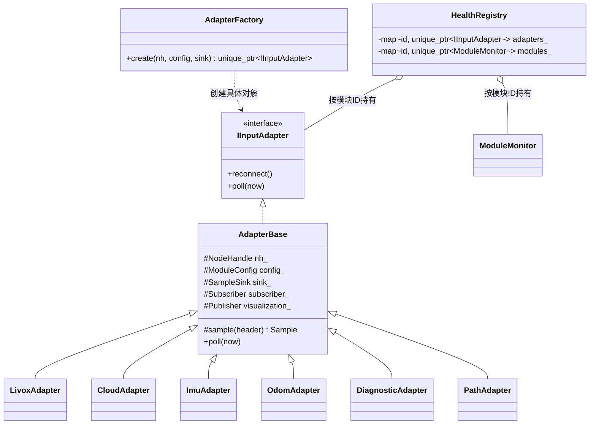

# 健康监控 V2 适配器设计说明

更新日期：2026-10-13  
适用版本：`fastlio_health_monitor` V2，ROS Noetic / C++14  
实现位置：[input_adapters.h](../../../fastlio_health_monitor/include/fastlio_health_monitor/input_adapters.h)、[input_adapters.cpp](../../../fastlio_health_monitor/src/input_adapters.cpp)

本文说明适配器的职责、C++ 类关系、消息转换流程、生命周期行为及新类型接入步骤。当前实现和实测结果以[12_V2重构实施与测试记录](12_V2重构实施与测试记录.md)为准。

## 1. 设计目的与边界

不同定位、传感器、感知和规划节点会发布不同 ROS 消息。适配器将这些消息解析为统一的 `robot_health::Sample`，供健康监控核心按照共同的数据结构执行检查。

```text
ROS消息 / 其他节点输出
        ↓
具体适配器：解析字段、检查消息契约、单位与坐标约定
        ↓  SampleSink 回调
统一 Sample
        ↓
ModuleMonitor / Checker / StreamTracker / KinematicsTracker
        ↓
健康等级、诊断、事件日志和指标
```

适配器是 ROS 接入层，包含 ROS 消息类型和 `ros::NodeHandle`；`Sample`、Checker 与持续时间/频率/定位运动等核心规则不依赖 ROS 消息。适配器做必要的消息结构检查和单位归一化，核心执行跨帧、时间窗口及状态汇总规则。部分输入自身的结构或业务约束（例如规划路径连续性）需要在适配器读取原始消息时检查。

适配器不替代传感器驱动或定位/规划算法，不对未提供的真值精度、感知目标语义、规划避障安全作推断。

## 2. 类结构与对象所有权



### 2.1 接口与基类

- `IInputAdapter` 是抽象接口，统一声明虚析构函数、纯虚 `reconnect()` 和 `poll(now)`。统一接口让调用方无需依赖具体 ROS 消息适配类。
- `AdapterBase` 实现公共成员及 `poll()` 默认空操作，并提供 `sample(header)`：读取消息源时间戳和 frame，以单调时钟记录接收时刻，构造统一样本。
- `AdapterBase` 没有实现 `reconnect()`，因此自身仍为抽象类；每个具体适配器按消息类型重建订阅。
- 具体类在 `input_adapters.cpp` 的匿名命名空间中定义，仅向外公开 `IInputAdapter` 和 `AdapterFactory`，隐藏回调和解析细节。

### 2.2 工厂与多态

`AdapterFactory::create()` 根据 `ModuleConfig.adapter` 字符串创建适配器，返回 `std::unique_ptr<IInputAdapter>`。`HealthRegistry` 用模块 ID 索引并持有这些智能指针。`unique_ptr` 表示单一所有权，注册表销毁时对象自动释放。

这是编译进当前程序的 C++ 工厂，按 YAML 在运行时选择已注册类型；它不是 `pluginlib` 动态插件系统。增加新的适配器需要编写 C++ 类并在工厂中注册。

### 2.3 回调解耦

创建适配器时传入 `SampleSink`，其类型为 `std::function<void(const Sample&)>`。适配器回调完成解析后调用 `sink_(sample)`，不直接依赖 `HealthRegistry` 或某一种 Checker。当前注册表注入的回调将样本值保留为日志上下文，并调用对应模块的 `ModuleMonitor::receive()`。

## 3. 统一 Sample 契约

`Sample` 定义在 [health_core.h](../../../fastlio_health_monitor/include/fastlio_health_monitor/health_core.h) 中，是适配器和健康核心之间的数据契约。常用字段如下：

| 字段 | 含义 | 适配器如何填写 |
|---|---|---|
| `stamp` | 消息源时间戳（秒） | 来自 ROS Header；合成周期样本由适配器按约定填写 |
| `received` | 单调时钟下的接收时刻 | 由公共 `sample(header)` 生成；用于接收年龄而非跨设备传输延迟 |
| `frame` / `child_frame` | 参考坐标系 | 来自消息 Header 或 Odometry 的 child frame |
| `total` / `valid_points` | 雷达总点数及有效点数 | 点云适配器逐点统计 |
| `acceleration` / `gyro` | 归一化后的 IMU 向量 | 加速度换成 m/s²，角速度使用 rad/s |
| `position` / `orientation` / `twist` | 定位状态 | 从 Odometry/PoseStamped 提取；速度语义由配置指定 |
| `covariance` / `covariance_available` | 定位协方差及可用性 | Odometry 提供 pose covariance；PoseStamped 明确标为不可用 |
| `findings` / `valid` | 当前消息的局部检查结果 | 结构、字段、数值或消息契约检查；供模块规则继续处理 |
| `values` | 可诊断/日志的键值 | 原始字段、单位、覆盖状态和附加解释信息 |

约定：适配器不把“未知”伪装成零。消息没有提供的协方差或测量保持不可用/未知语义；不属于当前计算条件的指标由核心报告 N/A。

## 4. 已实现的适配器

| 配置中的 `adapter` | C++ 类 | ROS 输入 | 主要转换与局部检查 |
|---|---|---|---|
| `LivoxCustomAdapter` | `LivoxAdapter` | `livox_ros_driver/CustomMsg` | 比较 `point_num` 与 points 数量，统计距离范围内的有效点；有显示订阅者时转 PointCloud2 |
| `PointCloud2Adapter` | `CloudAdapter` | `sensor_msgs/PointCloud2` | 检查维度、步长、缓冲区、xyz 字段类型/偏移/数量和字节序，再统计有效点 |
| `RosImuAdapter` | `ImuAdapter` | `sensor_msgs/Imu` | 单位转换、必需测量可用性、有限性与协方差状态/矩阵检查 |
| `OdometryAdapter` | `OdomAdapter` | `nav_msgs/Odometry` | 提取 pose、twist、协方差和 frame；检查四元数、有限性与坐标约定 |
| `PoseStampedAdapter` | `OdomAdapter` | `geometry_msgs/PoseStamped` | 提取 pose 并检查四元数/frame；明确协方差不可用 |
| `DiagnosticRelayAdapter` | `DiagnosticAdapter` | `diagnostic_msgs/DiagnosticArray` | 检查来源等级范围/空数组，将来源状态汇总为模块状态 |
| `PathAndTaskStateAdapter` | `PathAdapter` | `nav_msgs/Path` + 自定义 `TaskState` | 检查任务新鲜度、goal 和路径期限、路径有限性/frame/连续性 |

### 4.1 Livox CustomMsg

1. 读取 Header 并创建 `Sample`，点数取 `points.size()`。
2. 校验驱动 `point_num` 与数组长度一致性；遍历点云，按配置的距离上下限统计有效点。无效坐标、非有限半径或距离超限不计入有效点。
3. 将样本交给健康模块，由 `LidarChecker` 和 `StreamTracker` 继续检查点数/比例、源频率、时间戳与接收年龄。
4. 若配置了可视化 Topic 且当前确有订阅者，将点转换为 `PointCloud2`，`reflectivity` 写入 `intensity`。显示桥接不改变点坐标；可选择修改显示 Header frame，但这不是 TF 坐标变换。
5. 结构无效或没有 RViz 订阅者时不生成/发布显示点云，避免将无效布局继续传给显示端或做无用转换。

### 4.2 PointCloud2

适配器先在不读取点数据的情况下校验消息布局：`point_step` 非零；整行数据可以容纳 `width * point_step`；完整行缓冲长度可以容纳 `height * row_step`；存在唯一标量 x/y/z 字段，datatype 是支持的 ROS 标量类型，字段 offset 在单点记录范围内。

尺寸乘法使用 64 位中间值；字段范围使用减法边界检查，避免无符号乘法或加法溢出绕过检查。布局有效后，按 row_step 和 point_step 遍历，依据消息大小端与主机字节序读取 xyz 数值，再使用配置的距离范围统计有效点。布局无效时不进行逐点解引用。

若可视化 frame 与原 Header 不同，代码只改 Header frame 并发布副本；配置者必须确保这个 frame 的 TF 关系真实有效。该操作本身不旋转或平移点云。

### 4.3 IMU

- 根据 `quality.acceleration_unit` 归一化加速度：`g` 乘 `9.80665`，`mps2` 乘 `1`；角速度当前按 `rad/s` 处理。
- 原始模长、换算后模长、单位和系数写入 `values`，便于面板和日志追溯。
- 用协方差首元素 `-1` 识别 ROS 消息声明的该项估计不可用；必需性由 `required_measurements` 配置决定。可选且不可用的量标为 N/A，不伪造为零。
- 全零协方差按未知值处理；非零矩阵按配置检查有限性、对称性和半正定性。加速度协方差的单位为输入单位平方时乘以换算系数平方。
- 适配器先保证样本语义和数值可用；幅值阈值和频率/断流由 Checker 与 StreamTracker 执行。噪声、零偏、卡滞及饱和专项规则尚未标定/实现。

### 4.4 Odometry 与 PoseStamped

两个消息类型由 `OdomAdapter` 根据配置选择对应订阅回调。共享 `populate()` 提取位置和四元数，检查有限值、零四元数、四元数模长偏差和期望 pose frame。

Odometry 另外提取 child frame、twist 与 6×6 pose covariance，检查期望 child frame；若运动规则选用可信 twist，还检查 twist 有限性。twist 的坐标语义由核心和配置处理，FAST-LIO 当前默认使用位置差分，避免把未提供的可信速度当成零。

PoseStamped 不含协方差和速度，适配器显式设置 `covariance_available=false`。核心只能对存在的数据计算；缺少字段不能解释为零协方差/零速度。

定位消息通过 `ros::MessageEvent` 检查连接的 `latching` 标志，拒绝 latched 旧快照，以免新实例刚启动就把历史位姿判为 READY。标准 ROS 消息没有逐帧 producer instance ID，无法单凭消息本身识别所有第三方缓存或重定位行为。

### 4.5 DiagnosticArray 转发

遍历来源状态项，校验等级取值并收集非 OK 的名称与消息。源 OK/WARNING 保留，源 ERROR/STALE 映射为本模块 ERROR；非法等级和空数组自身也会形成错误。适配器只验证转发消息结构和等级，不验证来源节点的指标是否可靠。

### 4.6 Path 与任务状态

规划适配器同时订阅 Path 和 `TaskState`。任务状态变化时记录 goal 起始时间并清除旧路径 READY；周期 `poll()` 检查 TaskState 心跳新鲜度，有活动 goal 时才启动路径结果期限，无活动 goal 时将路径需求挂起为 IDLE。

Path 回调检查每个姿态的有限性/四元数、frame 一致性、相邻点距离、活动任务下路径非空，以及 Path 时间戳不早于 goal 起始时间。`Path` 标准消息没有 goal ID，因此依赖自定义 `TaskState.goal_id` 和同时间域时间戳做有限关联；这不能替代生产者在路径消息中携带 goal ID。未检查路径碰撞、全局最优性或实际执行安全。

## 5. 运行管理与重连

`HealthRegistry` 接收非 latched 的 `RuntimeState`。当 `ModuleMonitor::control()` 接受了有效控制状态/新代际时，注册表清理该模块的样本日志上下文，并调用对应适配器的 `reconnect()`。适配器先关闭旧 Subscriber，再重新订阅；`PathAdapter` 还会清理 task Subscriber、目标、路径和接收时间等内部状态。

重连只负责切换输入连接与清理适配器私有历史。实例 ID、frame epoch、READY 连续样本、旧实例拒绝、STOPPED/PAUSED 与断流语义由生命周期/健康核心管理。没有有效 STOP 意图的定位退出不会因适配器重连而自动变成正常停止。

典型流程：

```text
配置加载 → AdapterFactory 创建对象 → subscribe → ROS callback
                                      ↓
                               构造统一 Sample
                                      ↓ SampleSink
                             ModuleMonitor::receive

有效 RUN/新实例 → HealthRegistry 调用 reconnect → 建立新订阅与新基线
```

## 6. 配置示例

实际配置在 `fastlio_health_monitor/config/health_v2_*.yaml`。下面展示适配器选择和消息入口的关系；完整合法字段以当前实现的 YAML 为准：

```yaml
modules:
  - id: "lidar"                 # 稳定的业务模块 ID，不等于消息类型
    checker: "LidarChecker"
    adapter: "LivoxCustomAdapter"
    topic: "/livox/lidar"
    visualization_topic: "/fastlio_health_monitor/lidar_raw_visualization"

  - id: "imu"
    checker: "ImuChecker"
    adapter: "RosImuAdapter"
    topic: "/livox/imu"
    # quality 中声明 acceleration_unit、covariance 和必需测量项

  - id: "localization"
    checker: "LocalizationChecker"
    adapter: "OdometryAdapter"
    topic: "/Odometry"
```

更换定位器时，通常保持业务模块 ID 和下游依赖稳定，按实际消息类型、Topic、frame、单位、速度来源和协方差契约选择/开发适配器，并相应调整 Checker 配置。不要只改 `adapter` 名称而忽略消息字段语义。

## 7. 新增适配器的开发步骤

1. **确定输入契约：** 消息类型、Topic、header 时间域、frame、单位、字段可用性、latched 行为及生命周期来源。
2. **定义 Sample 映射：** 写清哪些 Sample 字段可以可靠提供；缺失值使用不可用/N/A 语义，不填入伪造的零值。
3. **实现 C++ 类：** 继承 `AdapterBase`，实现 `reconnect()` 和消息 callback；只在必要时覆写 `poll()` 处理无新消息也需更新的任务/心跳期限。
4. **做输入边界检查：** 先检查结构和索引范围，再读取消息数据；显式校验 NaN/Inf、单位、坐标和消息状态等级。
5. **交给统一出口：** callback 构造 `Sample`、增加 findings/values，并调用 `sink_(sample)`；不要在 Adapter 内直接发布最终总体状态。
6. **注册类型：** 在 `AdapterFactory::create()` 增加配置名到类的映射；配置拼写和未注册类型应由启动校验拒绝。
7. **编写检查与文档：** 为有效/无效/边界/恢复场景增加 C++ 或 ROS 适配检查，更新配置注释和本设计说明；使用真实 bag/消息验证时记录样本来源与时间条件。

示意骨架：

```cpp
class NewAdapter : public AdapterBase {
 public:
  using AdapterBase::AdapterBase;

  void reconnect() override {
    subscriber_.shutdown();
    subscriber_ = nh_.subscribe(config_.topic, 20,
                                &NewAdapter::callback, this);
  }

 private:
  void callback(const NewRosMessage::ConstPtr& msg) {
    Sample s = sample(msg->header);
    // 验证消息契约、转换字段到 Sample，记录 finding/value。
    sink_(s);
  }
};
```

代码骨架只说明类关系；实际消息类型、队列大小、字段校验、锁策略及所有权需按具体生产者设计。

## 8. 线程、资源与异常处理约定

- 当前监控节点采用串行 ROS 回调处理模块状态；不要在未经审查的情况下增加多线程 spinner 并让同一 Adapter/ModuleMonitor 并发修改。
- Subscriber、Publisher 按对象成员持有，析构/`shutdown()` 后随对象释放；回调通过捕获适配器 `this` 注册，适配器生命周期必须覆盖订阅生命周期。
- 点云转换仅在配置可视化且存在订阅者时执行；质量样本先交给监控路径处理，不依赖 RViz 是否打开。
- `reconnect()` 可重复调用：关闭已有订阅后再建立新订阅。适配器私有缓存也必须同时清空，防止新实例继承旧任务或旧数据。
- YAML 和 Adapter 名称在启动阶段校验；遇到未知类型/配置错误应启动失败，不能静默创建一个行为不确定的默认 Adapter。

## 9. 验收证据与限制

当前通用适配检查 **24 项通过**，覆盖 PointCloud2 组织布局、Float64 字段、行填充、大端和尺寸溢出、IMU 单位/协方差/不可用测量、第二定位模块 ID、诊断中继等级、规划 IDLE/goal deadline/Path 恢复和任务心跳恢复等。结果见[adapter_results.json](evidence/v2/adapter_results.json)及[12 第 7.3 节](12_V2重构实施与测试记录.md#73-通用适配与非定位模块)。

当前限制：

- 适配器工厂是静态 C++ 注册，不支持运行中动态加载新的共享库插件或热更新。
- 工程仍使用 ROS1；“ROS 无关核心”仅表示规则核心不直接依赖 ROS 消息，不代表整个包脱离 ROS。
- 标准 Odometry、PoseStamped、Path 等消息不含完整的逐帧生产者实例/goal 身份；严格关联需要生产者使用扩展消息/接口。
- PointCloud2 解析已做结构与算术边界检查，但高点数扫描仍在输入回调中逐点统计，极端负载下的回调隔离与压力预算尚未专项验证。
- 传感器噪声/卡死/饱和，感知语义精度、规划碰撞/可行性及定位真值精度不由当前适配器保证。
- 当前 V2 仍和 Livox/FAST-LIO 演示依赖处于同一 ROS 包；拆成独立通用库/插件包属于后续工程化工作。

## 10. 源码阅读顺序

1. [适配器统一接口与工厂声明](../../../fastlio_health_monitor/include/fastlio_health_monitor/input_adapters.h)
2. [统一 Sample 数据结构](../../../fastlio_health_monitor/include/fastlio_health_monitor/health_core.h)
3. [AdapterBase 与 Livox/PointCloud2/IMU 实现](../../../fastlio_health_monitor/src/input_adapters.cpp)
4. [HealthRegistry 的组合、注入和 RuntimeState 重连](../../../fastlio_health_monitor/src/robot_health_monitor_node.cpp)
5. [当前 Avia 与扩展示例配置](../../../fastlio_health_monitor/config/health_v2_avia.yaml)、[extensions](../../../fastlio_health_monitor/config/health_v2_extensions.yaml)
6. [适配检查结果](evidence/v2/adapter_results.json)及[测试脚本](../../../fastlio_health_monitor/test/run_adapter_tests.py)

