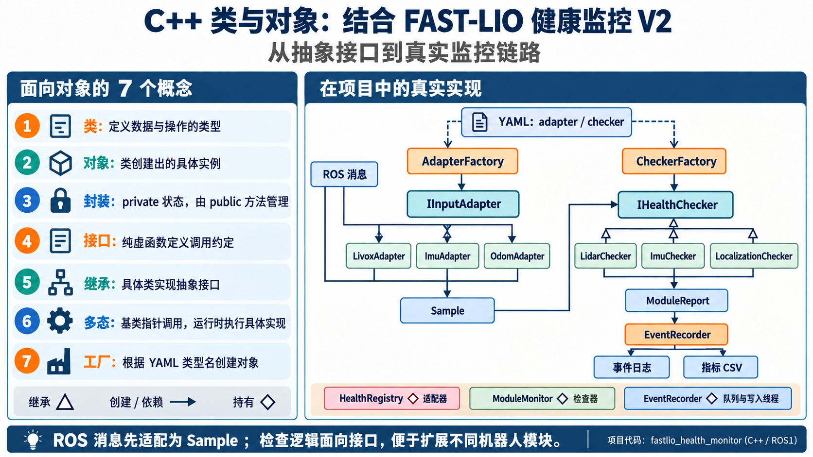

# ROS1、FAST-LIO 与定位健康检测台文档总入口

工作区：`$HOME/fastlio_ws`（ROS Noetic / Catkin） 
更新日期：2026-10-15（Asia/Shanghai）

本目录汇总已有 FAST-LIO 工程学习、C++ 定位健康监控、RViz 可视化检测台及 rosbag 一键回放的文档、关键截图与验证数据。功能模块由 C++ 实现，launch/YAML/RViz 文件负责配置。

## 阅读顺序

- **直接启动项目**：阅读 [06_启动与操作说明](06_启动与操作说明.md)。
- **首次部署到真实设备**：按 [09_真实设备安装与配置](09_真实设备安装与配置.md) 完成 ROS 环境、Livox-SDK、Catkin 包、网卡、广播码、FAST-LIO 参数和实机命令。
- **查看实际结果**：阅读 [02_验证记录](02_验证记录.md)，地图修复结果在第 8 节，IMU 单位修复实测在第 11 节，故障 bag 的 RViz 实时异常截图和补录结果在第 13 节。
- **交付与归档**：阅读 [07_项目完结归档](07_项目完结归档.md)，包含技术点对应材料、截图清单及待验证项。
- **学习与维护**：依次阅读使用文档、设计文档、代码说明及问题复盘。
- **按导师要求开展下一轮开发**：阅读 [11_导师要求与健康监控后续执行方案](11_导师要求与健康监控后续执行方案.md)，包含规则、启停、C++ 类、日志、六张流程图及带注释的新配置模板；完整目标与实际实施有差异，运行和测试以[12_V2重构实施与测试记录](12_V2重构实施与测试记录.md)为准。

- **使用本轮重构版本**：阅读[12_V2重构实施与测试记录](12_V2重构实施与测试记录.md)，包含V2配置、正常STOP/RUN、日志追溯、错误bag、通用接入和实际截图。
- **查看 V2 整体架构和操作流程**：打开[项目技术架构图](images/fastlio_health_v2_architecture.svg)与[项目使用说明图](images/fastlio_health_v2_usage.svg)，PNG 预览也可在图片目录查看；[Draw.io 文件](images/fastlio_health_v2_architecture.drawio)可直接编辑。
- **获取仅含 V2 的源码包**：桌面 ZIP 压缩包（本机文件，不随仓库发布），解压后按包内 README 放入独立 Catkin overlay 编译；不包含 FAST-LIO 上游代码和 V1 监控节点。

## 文档索引

| 序号 | 文档 | 路径 | 备注 |
|---|---|---|---|
| 1 | 使用文档 | [01_ROS1与FAST-LIO使用文档.md](01_ROS1与FAST-LIO使用文档.md) | Git、编译、节点、Topic、TF、launch/YAML、bag |
| 2 | 测试文档 | [02_验证记录.md](02_验证记录.md) | 编译、bag 与 RViz 检测台结果，含关键截图 |
| 3 | 问题记录文档 | [03_问题复盘.md](03_问题复盘.md) | 开发中遇到的问题及处理 |
| 4 | 代码文档 | [04_代码说明.md](04_代码说明.md) | 按目录讲解 C++ 节点/面板、关键代码、插件注册、launch/YAML 和健康判定 |
| 5 | 设计文档 | [05_健康监控设计.md](05_健康监控设计.md) | 监控项、状态机和接口 |
| 6 | 工作进度 | [工作进度.md](工作进度.md) | 按技术点持续更新及每日记录 |
| 7 | 启动与操作手册 | [06_启动与操作说明.md](06_启动与操作说明.md) | 一键回放、设备启动、参数、RViz 操作及排障 |
| 8 | 项目归档清单 | [07_项目完结归档.md](07_项目完结归档.md) | 技术点对应材料、截图证据与待验证项 |
| 9 | 监控包说明 | [包 README](../../../fastlio_health_monitor/README.md) | 包内快速使用入口 |
| 10 | 项目说明 | [仓库 README](../../../README.md) | 本次项目操作以本目录为准 |
| 11 | 工程优化评审 | [08_工程优化评审.md](08_工程优化评审.md) | 风险分级与改进顺序；O01 单位修复已实现、编译及实测通过 |
| 12 | 真实设备安装与配置 | [09_真实设备安装与配置.md](09_真实设备安装与配置.md) | ROS 环境、依赖/SDK、工作包安装编译、网络、广播码、FAST-LIO/监控参数和完整实机启动命令 |
| 13 | Mentor 项目汇报 | [10_项目汇报.md](10_项目汇报.md) | 项目目标、架构、实现、实测结果、限制及下一步计划 |
| 14 | 导师要求与后续执行方案 | [11_导师要求与健康监控后续执行方案.md](11_导师要求与健康监控后续执行方案.md) | 官方资料调研、判定标准、六张流程/架构图、正常关闭重启、追溯日志、通用C++类、配置与验收 |
| 15 | V2重构实施与测试 | [12_V2重构实施与测试记录.md](12_V2重构实施与测试记录.md) | C++核心/控制器/适配器/日志、运行配置与回归证据 |
| 16 | V2适配器设计说明 | [13_适配器设计说明.md](13_适配器设计说明.md) | 类结构、消息适配职责、Sample契约、生命周期重连和新增适配器步骤 |
| 17 | 健康检测流程图与指标说明 | [13_健康检测流程图与指标说明.md](13_健康检测流程图与指标说明.md) | 当前V2实际监测逻辑、默认指标、正常启停及可直接插入飞书的PNG/SVG/PDF |
| 18 | V2 演示视频与命令复现 | [14_V2演示视频与命令复现.md](14_V2演示视频与命令复现.md) | 桌面演示视频、完整启动/STOP/RUN/故障回放命令、日志路径与实测结果 |
| 19 | V2工程优化评审 | [15_V2工程优化评审.md](15_V2工程优化评审.md) | 静态审查：时间间隔漏报、进程清理、调度、日志语义、配置与独立包交付 |
| 20 | IMU时间探针错误bag测试 | [16_IMU时间探针错误Bag测试与视频.md](16_IMU时间探针错误Bag测试与视频.md) | 0.1/0.2秒超时四组实测、批量回放边界、完整录屏与复现 |
| 21 | 回放暂停恢复与正常结束 | [17_回放暂停恢复与正常结束优化.md](17_回放暂停恢复与正常结束优化.md) | 空格/服务显式PAUSED、EOF确认STOPPED、心跳及故障优先、截图与验证 |
| 22 | 桌面自采Bag只读测试 | [18_桌面自采Bag只读测试.md](18_桌面自采Bag只读测试.md) | 原文件不修改；缺索引/尾块截断检查、真实雷达/MAVROS IMU/定位输出检测及截图 |
| 23 | 自采Bag副本修复与原生回放 | [19_自采Bag副本修复与原生回放测试.md](19_自采Bag副本修复与原生回放测试.md) | 授权后修复独立副本、完整块字节校验、原生播放器与C++监控、接收计数和EOF验证 |
| 24 | 日志时间对齐与回放结束封存 | [20_日志时间对齐与回放结束封存.md](20_日志时间对齐与回放结束封存.md) | bag时间/消息头时间/单调时间分别记录，正常EOF封存JSONL/CSV，界面保留 |
| 25 | 三时间字段回放实测与日志分析 | [21_三时间字段回放实测与日志分析.md](21_三时间字段回放实测与日志分析.md) | 精简JSONL/CSV、完整1倍速回放、暂停恢复与EOF封存核验 |

## 使用 Demo 视频

当前回放的空格暂停/EOF行为以[17_最新优化](17_回放暂停恢复与正常结束优化.md)为准；此前视频里的EOF断流ERROR是当时版本或直接rosbag回放的历史记录。

2026-10-14新增[IMU时间探针完整错误bag测试视频与实测记录](16_IMU时间探针错误Bag测试与视频.md)，保留四组实际回放，验证下一条IMU到来前的两级告警。

### V2 演示（2026-10-13）

桌面 MP4 演示视频（本机文件，不随仓库发布），118 秒、1920×1080、15 fps。包含实际 managed launch、STOPPED 保持 30.649 秒后 RUN 新实例、`imu_stamp_regression` / `lidar_dropout` / `localization_jump` 三个故障 bag、规则诊断和 JSONL/CSV 日志查看。完整命令、时间轴、实测结果及日志目录见[14_V2演示视频与命令复现](14_V2演示视频与命令复现.md)。

同时保留完整未剪辑运行测试录屏（本机文件，不随仓库发布），约 100 秒，1920×1080、H.264/约15fps，连续记录 ROS/RViz、STOP/RUN、三个故障 bag 和事件日志查看。视频已完整解码 1501 帧；元数据、SHA-256 及原始测试结果归档在[完整录屏证据目录](evidence/v2/full_runtime_20261013/)。

故障触发期间的 RViz 实时状态另有补录视频（本机文件，不随仓库发布），约 98 秒，完整显示三个 bag 的原始点云和健康面板异常；IMU 时间回退、LiDAR 丢帧、定位跳变截图及日志结果见[补录证据目录](evidence/v2/fault_rviz_20261013/)。三个案例均确认 RViz 直接收到了对应异常诊断。该隔离监控回放不启动 FAST-LIO 建图节点，因此画面没有注册点云和累积地图。

managed 正常 bag 画面中 LiDAR 有效点比例为 0.946，当前配置据此显示 WARNING；视频保留实际诊断状态。

### V1 历史演示

桌面 MP4 演示视频（本机文件，不随仓库发布），约 91 秒，1920×1080，真实 2 倍速 rosbag 回放录屏，含中文字幕、无配音。覆盖 Bash 环境准备、启动命令、雷达/IMU/定位指标、建图和回放结束断流提示。演示隐藏 Displays 停靠面板以完整展示健康指标，不改变数据或健康阈值；详情见[项目汇报](10_项目汇报.md)。

## 完结归档

| 技术点 | 使用文档 | 测试文档 | 问题记录 | 代码文档 | 设计文档 |
|---|---|---|---|---|---|
| ROS1 / FAST-LIO2 熟悉 | [01](01_ROS1与FAST-LIO使用文档.md) | [02](02_验证记录.md) | [03](03_问题复盘.md) | [FAST-LIO 源码](../../) | [仓库 README](../../../README.md) |
| 定位健康监控 | [包 README](../../../fastlio_health_monitor/README.md) | [02](02_验证记录.md) | [03](03_问题复盘.md) | [04](04_代码说明.md) | [05](05_健康监控设计.md) |
| RViz 检测台与 rosbag 集成 | [06](06_启动与操作说明.md) | [02](02_验证记录.md) | [03](03_问题复盘.md) | [04](04_代码说明.md) | [05](05_健康监控设计.md) |

## 进度摘要

- [x] 在现有 FAST-LIO2 checkout 和 Catkin 工作区上开展；上游 remote 为 `https://github.com/hku-mars/FAST_LIO.git`。
- [x] ROS Noetic 下 `catkin_make -j2` 编译通过，新建 `fastlio_health_monitor` C++ 包。
- [x] 启动 `laserMapping` 和健康监控节点，查看 ROS 节点、Topic、TF。
- [x] 实际 bag 完整回放；端到端观测到 OK、WARNING、ERROR，LiDAR 低有效点率会显示样本 WARNING，断流后综合为 ERROR。详见[验证记录](02_验证记录.md)。
- [x] 一键 RViz 可视化检测台运行正常；[最新建图截图](images/visualization_mapping_no_flicker.png)记录 LiDAR/IMU/定位指标和地图。该截图总体为 WARNING（雷达有效点率低于阈值），IMU 和定位为 OK。
- [x] 原始雷达、当前帧和地图均恢复 intensity 彩虹着色；三个点云图层 Decay Time=0 保持最新消息，地图强度范围固定 0–152，队列 1 且 latch 开启。
- [x] 地图频闪对照验证：2 倍速回放 20 对画面中旧设置空图 10 次、当前设置空图 0 次；停止输入并推进时钟 10 秒后地图仍保留，监控按断流报告 ERROR。见[原始采样数据](evidence/map_flicker_validation.json)。
- [x] 本次工作进展和结果已记入[工作进度](工作进度.md)，含按四个项目阶段整理的日报记录（日期遵循实际开发记录）。后续每个工作日结束前继续补充当日记录。
- [x] 2026-10-10 修复 IMU 单位并实测通过：12 组 g/mps2 场景、非法单位退出及完整 bag 回放；接收全部 28595 条 IMU，287 条诊断换算逐条核对通过。见[实测记录](02_验证记录.md#11-imu-单位修复实测2026-10-10)。
- [x] 2026-10-13 完成 V2 STOP/RUN 与三类故障 bag 演示；管理式重启实测 PASS，`imu_stamp_regression`、`lidar_dropout`、`localization_jump` 均通过，日志/命令和视频归档见[14](14_V2演示视频与命令复现.md)。

实测数据来自 Livox CustomMsg bag；PointCloud2 设备端到端验证、实体设备联调及绝对定位精度评估尚未完成。完整交付范围见[项目完结归档](07_项目完结归档.md)。

## IMU 单位修复后的实测界面

完整 bag 回放中采集，总体与三个分项均为 OK；IMU 显示 `8.467 m/s²（原始 0.863 g）`。为完整展示指标，此截图隐藏了 Displays 停靠面板；输入、阈值和点云图层不变。两种显示值分别舍入，换算核对使用未舍入的原始消息。

## 建图联调历史界面（IMU 单位修复前）

本节真实截图来自单位修复前的运行，IMU 加速度标签曾错误使用 m/s²，历史原始值应按 g 理解。旧配色截图也仅作为历史问题记录保留，更多对照材料见[归档证据清单](07_项目完结归档.md#4-关键结果与证据清单)。

## 技术架构图

### V2 全项目架构

可缩放的[SVG](images/fastlio_health_v2_architecture.svg)、[Draw.io 可编辑文件](images/fastlio_health_v2_architecture.drawio)和[Graphviz DOT 图源](images/fastlio_health_v2_architecture.dot)。图中覆盖数据源、起播协调、运行控制、FAST-LIO、ROS 适配器、ROS 无关 C++ 判定核心、生命周期、RViz、诊断和日志。

### C++ 类与对象：项目实现映射

该 Image2 知识图对应 V2 的真实接口和职责：`IInputAdapter` / `IHealthChecker` 抽象接口、具体适配器与检查器、`AdapterFactory` / `CheckerFactory`、`Sample` 数据契约，以及 `HealthRegistry`、`ModuleMonitor` 和 `EventRecorder` 的持有关系。桌面原图：C++类与对象项目映射图（本机文件，不随仓库发布）。

### V1 历史架构参考

原始矢量图：[fastlio_health_architecture.svg](images/fastlio_health_architecture.svg)。该图包含 bag/实机两种输入方式、ROS topics、FAST-LIO 和监控器、健康汇总、静态 TF、RViz 图层与地图保留策略。

## 使用说明图

### V2 启动、观察、停止与重启

可缩放的[SVG](images/fastlio_health_v2_usage.svg)、[Draw.io 可编辑文件](images/fastlio_health_v2_usage.drawio)和[Graphviz DOT 图源](images/fastlio_health_v2_usage.dot)。命令对应当前 managed launch、STOP/RUN 服务和日志目录；完整步骤见[启动与操作手册](06_启动与操作说明.md)及[V2 实施记录](12_V2重构实施与测试记录.md)。

另有 [Image2 架构视觉稿](images/fastlio_health_v2_architecture_image2.png)和 [Image2 使用流程视觉稿](images/fastlio_health_v2_usage_image2.png)。图像生成结果用于展示风格；精确模块连线、命令和配置以可编辑 Draw.io/SVG 图及正文说明为准。

### 真实设备与 rosbag 回放

新图：[PNG 预览](images/fastlio_health_device_guide.png) · [可缩放 SVG 原图](images/fastlio_health_device_guide.svg)，覆盖安装、编译、设备配置、实机启动和 rosbag 一键回放；逐步说明见[09_真实设备安装与配置](09_真实设备安装与配置.md)。

### 启动与参数设置速查

配套文字步骤见[06_启动与操作说明](06_启动与操作说明.md)，阈值全集见[04_代码说明](04_代码说明.md#默认阈值与判定)。

## 文档维护

2026-10-10 的优化评审、架构图、使用速查图、真实设备安装配置手册和工作进度增量已同步本目录；2026-10-09 文档压缩包保留为当日交付快照，不包含本次增量。

每个技术点产生结果时同步更新工作进度、验证记录与问题复盘；修改实现或配置时同步代码说明、设计与启动手册。每天工作结束前追加当日记录。真实运行截图放入 `images/`，结构化验证数据放入 `evidence/`，注明采集条件和实际健康状态。
