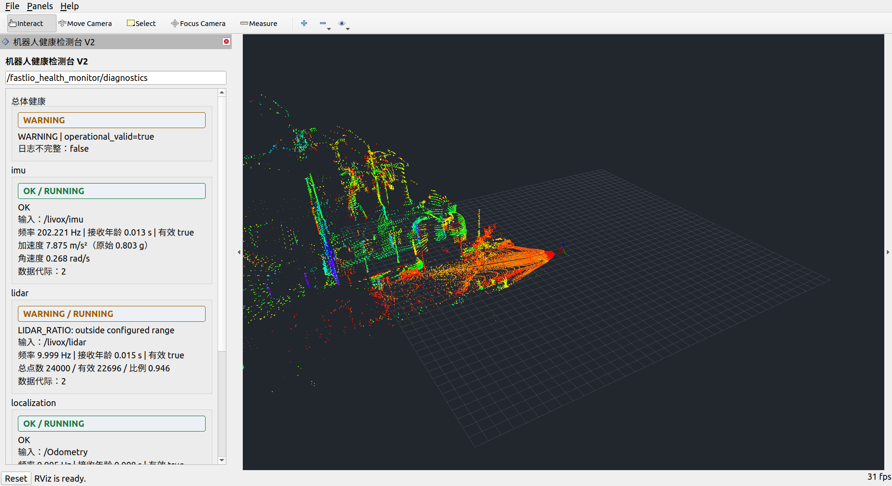
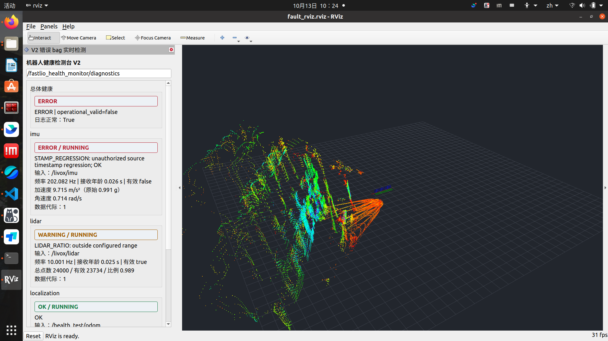
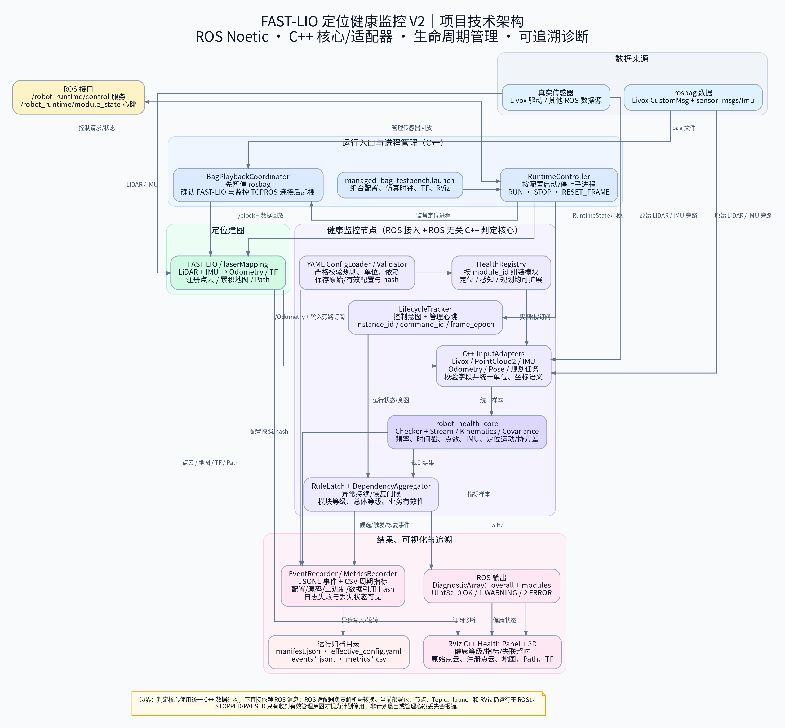
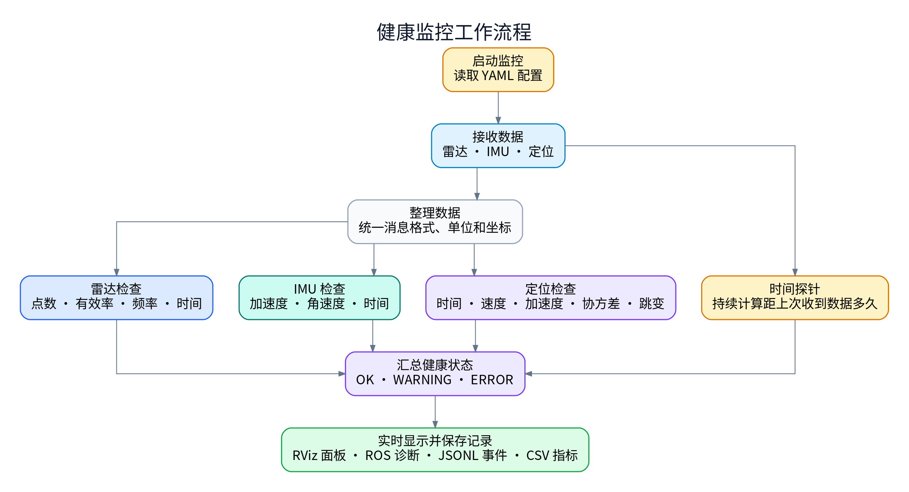

# Robot Data Health Monitoring Module

ROS 1 / C++14 项目：在 FAST-LIO 建图运行时监控 LiDAR、IMU 和定位数据，并通过 RViz 面板、ROS diagnostics 与 JSONL/CSV 日志呈现结果。仓库包含 FAST-LIO 工程修改、V2 健康监控包和 Livox ROS 驱动源码；V2 核心使用统一的 C++ 数据结构和检查器，ROS 消息解析由适配器完成。

## 项目效果

V2 面板会同时显示总体健康等级、各模块状态、接收年龄、频率、IMU 单位换算、定位指标和实时点云。下面是仓库中的运行截图：



故障回放时，面板可显示对应规则和等级，右侧继续显示实时点云：





### 健康监控主流程



主图概括配置、数据接入、分项检查、状态汇总和结果显示。定位正常停止与重启过程见[状态图](FAST_LIO/doc/ros1_workspace/images/health_v2_lifecycle_flow.png)。

## 目录结构

| 路径 | 内容 |
| --- | --- |
| `FAST_LIO/` | FAST-LIO ROS 包、Avia 配置、启动文件和当前工程修改 |
| `fastlio_health_monitor/` | V2 C++ 监控核心、ROS 适配器、生命周期控制、日志记录和 RViz 面板 |
| `livox_ros_driver/` | Livox ROS Driver 2 源码 |
| `FAST_LIO/doc/ros1_workspace/` | 设计、配置、启动、验证和项目进度文档；截图位于 `images/` |

## 运行环境

- Ubuntu 20.04 x86_64
- ROS 1 Noetic、Catkin、C++14
- Livox ROS Driver 2 和 Livox-SDK
- FAST-LIO 当前配置面向 Livox Avia；切换雷达型号前要同时核对驱动消息类型、FAST-LIO 参数和监控 YAML。

> ROS Noetic 于 2025-05-31 结束官方支持。此仓库保留 ROS1/Noetic 实现用于现有设备和工程复现；新部署应自行评估系统维护方案。[ROS 项目公告](https://discourse.ros.org/t/ros-noetic-end-of-life-may-31-2025/43160)

## 安装与编译

先安装 Ubuntu 20.04、ROS Noetic desktop 环境和基础开发工具。以下命令假设工作区位于 `~/fastlio_ws`：

```bash
sudo apt update
sudo apt install -y git build-essential cmake python3-rosdep \
  libyaml-cpp-dev libeigen3-dev libboost-filesystem-dev \
  libboost-system-dev libssl-dev qtbase5-dev

# rosdep 只需在这台机器上初始化一次
sudo rosdep init
rosdep update

mkdir -p ~/fastlio_ws/src
cd ~/fastlio_ws/src
git clone https://github.com/spacethroughing/Robot-Data-Health-Monitoring-Module.git

# 仅在 src/CMakeLists.txt 尚不存在时运行
catkin_init_workspace
cd ~/fastlio_ws
source /opt/ros/noetic/setup.bash
rosdep install --from-paths src --ignore-src --rosdistro noetic -r -y
catkin_make -j2
source devel/setup.bash
```

Livox ROS Driver 需要 Livox-SDK。若系统尚未安装 SDK，可按 [Livox-SDK 官方说明](https://github.com/Livox-SDK/Livox-SDK)构建并安装；驱动源码的安装说明也在 `livox_ros_driver/README_CN.md`。之后重新运行 `rosdep install` 和 `catkin_make`。

每个新终端都要加载 ROS 和工作区环境：

```bash
source /opt/ros/noetic/setup.bash
source ~/fastlio_ws/devel/setup.bash
```

## 配置文件位置

健康检测参数位于 `fastlio_health_monitor/config/`：

| 文件 | 用途 |
| --- | --- |
| `health_v2_avia.yaml` | Livox CustomMsg、IMU、Odometry 的 Avia 配置；默认启动配置 |
| `health_v2_pointcloud2.yaml` | PointCloud2 与 SI 单位 IMU 的适配器配置 |
| `health_v2_extensions.yaml` | 感知 diagnostics、规划 Path/TaskState 扩展模块示例 |
| `health_v2_managed.yaml` | 需要运行控制器心跳和生命周期状态的 managed 配置 |
| `runtime_bag.yaml` | managed 模式下定位进程、传感器回放命令和控制器日志目录 |

雷达、IMU、定位的输入话题和阈值在各 YAML 的 `modules` 下配置。IMU 单位通过 `quality.acceleration_unit` 声明；Livox Avia 原始输入使用 `g`，标准 SI 输入使用 `mps2`。无数据告警阈值在 `stream.receive_age_sec.warning_above` 和 `error_above`；它根据本机单调时钟的接收年龄判定，不等待下一条消息的源时间戳。调整阈值前按目标设备的实际频率和规格标定。

日志路径在每个配置文件的 `logging.directory` 中。示例配置使用 `/tmp/robot_health_monitor/...` 便于快速启动；需要长期留存时，请改成目标机器上有写权限且空间充足的绝对路径。managed 控制器的日志目录单独由 `runtime_bag.yaml` 的 `log_directory` 配置。

FAST-LIO 的雷达型号、IMU 与雷达外参和地图参数位于 `FAST_LIO/config/avia.yaml`。组合启动文件为 `fastlio_health_monitor/launch/visualization_testbench.launch`；bag 一键回放使用 `visualization_bag_testbench.launch`。

## 启动方式

### 1. 只启动 V2 健康监控

需要 ROS master 和对应传感器/定位话题已经发布：

```bash
roscore
```

另开终端并运行：

```bash
source /opt/ros/noetic/setup.bash
source ~/fastlio_ws/devel/setup.bash
roslaunch fastlio_health_monitor health_monitor_v2.launch \
  config:=$(rospack find fastlio_health_monitor)/config/health_v2_avia.yaml
```

### 2. 启动实机建图检测台

Livox 驱动已启动并发布 `/livox/lidar`、`/livox/imu` 时，运行：

```bash
source /opt/ros/noetic/setup.bash
source ~/fastlio_ws/devel/setup.bash
roslaunch fastlio_health_monitor visualization_testbench.launch rviz:=true
```

这个 launch 会启动 FAST-LIO、V2 健康监控、静态 TF 和 RViz。设备驱动由用户单独启动。

### 3. 一条命令启动 rosbag 回放与 RViz 检测台

仓库不包含 rosbag。先将 bag 放在本机可访问的位置，再完整执行：

```bash
source /opt/ros/noetic/setup.bash
source ~/fastlio_ws/devel/setup.bash
BAG="$HOME/datasets/fastlio/outdoor_Mainbuilding_10hz_2020-12-24-16-38-00.bag"
rosbag info "$BAG"
roslaunch fastlio_health_monitor visualization_bag_testbench.launch \
  bag:="$BAG" rate:=1.0 rviz:=true
```

`bag` 参数必须指向实际存在的 Livox bag；`rate` 为回放倍速。若只看监控诊断，可使用 `rviz:=false`。

### 4. managed 模式的正常停止与重启

先编辑 `fastlio_health_monitor/config/runtime_bag.yaml`：将传感器组命令中的 `_bag:=/path/to/your.bag` 改成实际 bag 路径。然后启动：

```bash
source /opt/ros/noetic/setup.bash
source ~/fastlio_ws/devel/setup.bash
roslaunch fastlio_health_monitor managed_bag_testbench.launch rviz:=true
```

另开终端，分别停止和重新启动定位进程：

```bash
source /opt/ros/noetic/setup.bash
source ~/fastlio_ws/devel/setup.bash
rosservice call /robot_runtime/control "{binding: 'localization', command: 'STOP'}"
rosservice call /robot_runtime/control "{binding: 'localization', command: 'RUN'}"
```

传感器回放组与定位组分别管理。收到确认的 `STOPPED` 状态后，定位输出停止不会误报为定位节点意外崩溃；`RUN` 会启动新实例并重新建立该代的时间/位置基线。

## 故障 bag 回放

可以从自己的原始 bag 生成独立故障副本。脚本不会覆盖源 bag：

```bash
source /opt/ros/noetic/setup.bash
source ~/fastlio_ws/devel/setup.bash
BAG="$HOME/datasets/fastlio/outdoor_Mainbuilding_10hz_2020-12-24-16-38-00.bag"
FAULT_DIR="$HOME/datasets/fastlio/health_fault_cases"
python3 ~/fastlio_ws/src/Robot-Data-Health-Monitoring-Module/fastlio_health_monitor/test/generate_fault_bags.py \
  --source "$BAG" --output "$FAULT_DIR" --duration 12
```

分别回放三类故障案例：

```bash
roslaunch fastlio_health_monitor visualization_bag_testbench.launch \
  bag:="$FAULT_DIR/imu_stamp_regression.bag" rate:=1.0 rviz:=true

roslaunch fastlio_health_monitor visualization_bag_testbench.launch \
  bag:="$FAULT_DIR/lidar_dropout.bag" rate:=1.0 rviz:=true

roslaunch fastlio_health_monitor visualization_bag_testbench.launch \
  bag:="$FAULT_DIR/localization_jump.bag" rate:=1.0 rviz:=true
```

每次回放前确认上一次的 launch 已退出。故障 bag 只用于监控检测，不应作为 FAST-LIO 算法输入验证建图质量。

## 查看日志

每次监控运行都会在 `logging.directory/<monitor_run_id>/` 下生成配置快照、事件 JSONL 和指标 CSV。事件包含触发规则、阈值、输入来源、配置 hash 和 run/module 标识。

```bash
LOG_ROOT=/tmp/robot_health_monitor/robot_health
find "$LOG_ROOT" -mindepth 1 -maxdepth 1 -type d -printf '%T@ %p\n' | sort -nr | head -1
tail -f "$LOG_ROOT/<monitor_run_id>/events.0.jsonl"
less "$LOG_ROOT/<monitor_run_id>/metrics.0.csv"
```

将 `<monitor_run_id>` 替换为 `find` 输出的目录名。若配置里改过 `logging.directory`，同步替换 `LOG_ROOT`。

## 文档与代码入口

- [ROS1 / FAST-LIO / V2 文档索引](FAST_LIO/doc/ros1_workspace/README.md)
- [健康监控设计与实施方案](FAST_LIO/doc/ros1_workspace/11_健康监控后续实施方案.md)
- [V2 重构与验证记录](FAST_LIO/doc/ros1_workspace/12_V2重构实施与测试记录.md)
- [适配器设计说明](FAST_LIO/doc/ros1_workspace/13_适配器设计说明.md)
- [演示与命令复现说明](FAST_LIO/doc/ros1_workspace/14_V2演示视频与命令复现.md)
- [V2 工程优化评审](FAST_LIO/doc/ros1_workspace/15_V2工程优化评审.md)

程序包内的主要 C++ 文件：`health_core.cpp` 实现规则、时间流和状态汇总；`input_adapters.cpp` 将 ROS 消息适配为通用样本；`robot_health_monitor_node.cpp` 提供 ROS 节点入口；`event_recorder.cpp` 负责事件和指标日志；`runtime_controller_node.cpp` 管理受控子进程和运行状态。

## 数据、视频与限制

仓库不包含个人 rosbag、运行期日志目录、构建目录或 MP4 录屏。请使用自己的 bag，并按设备重新校准各 YAML 阈值。README 中的截图是项目实测画面；设计图、测试记录和命令说明保存在 `FAST_LIO/doc/ros1_workspace/`。
