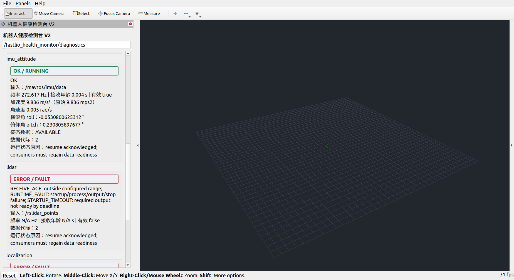
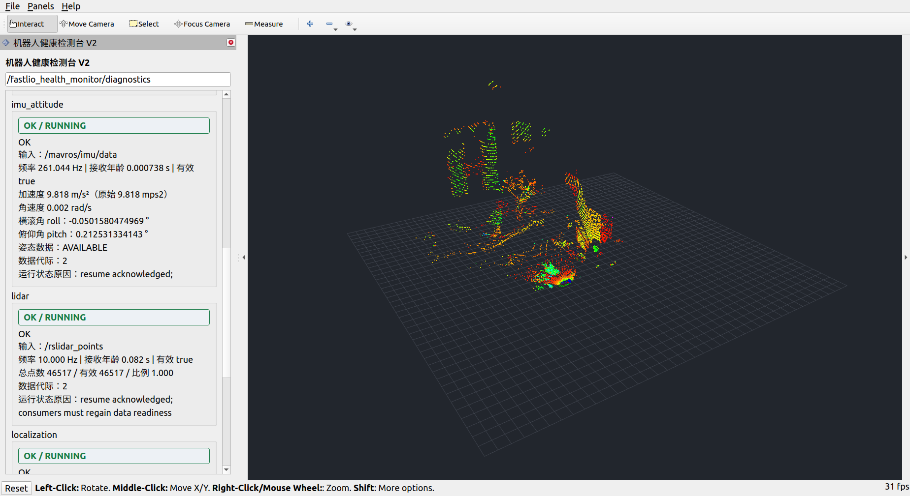
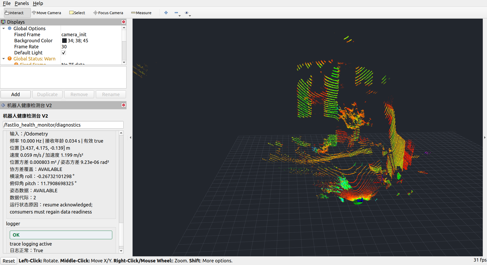
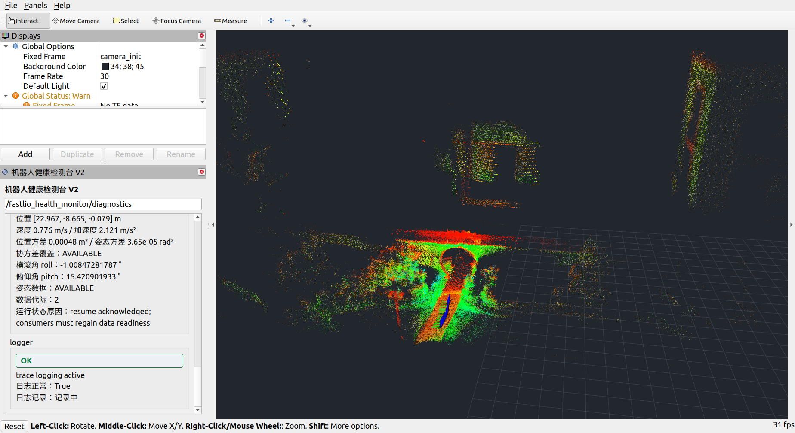

# 2026-10-21 更新说明

## 1. 发布内容

健康ROS包源码和两份运行YAML来自桌面当前版本。仓库继续保留FAST-LIO、Livox驱动、仓库目录说明与同时支持仓库/桌面布局的安装脚本。

### 独立事件日志过滤

```yaml
logging:
  enabled: true
  events:
    include_event_types: []
    exclude_rule_ids: []
    exclude_module_ids: []
```

上面是记录全部的写法。当前按桌面实际设置发布：health_robot.yaml记录全部；health_bag.yaml的include_event_types为[RULE_TRIGGERED]，只记录触发。两份配置的规则/模块黑名单均为空。非空白名单只允许对应事件类型，规则/模块黑名单优先；使用区分大小写的完整名称。配置说明见[过滤指南](日志事件过滤配置.md)，字段编号见[event_type和rule_id](日志event_type与rule_id字段说明.md)。

筛选在C++统一事件入队入口执行，包含RUN_BEGIN/RUN_END等事件；主动筛掉的durable事件不等待写盘确认，封存仍排空并刷盘。诊断新增event_filter_active与filtered_events，主动排除不会单独降低日志健康状态。CSV与ROS诊断不经过筛选。

### 桌面当前实机参数

同步health_robot.yaml中的现有调整：最短频率统计覆盖0.5秒、恢复保持0.5秒，位置协方差WARNING/ERROR为0.01/0.04m²，姿态协方差为0.002/0.008rad²。其余设置以对应YAML为准。

### RViz回放显示

显示布局新增Displays侧栏、当前配准点云和最近5秒显示缓存，强度固定0～255。原始点云与已配准点云不通过修改frame_id强行叠加；缓存不代表新的完整地图。

## 2. 构建与验证范围

- 过滤代码对应的桌面源码在已有Ubuntu 20.04 + ROS Noetic环境下完成GUI及三个C++节点编译。
- 本次发布未新增或运行单元/回放测试；之前47项核心用例的结果属于此前版本。
- 在过滤代码更新之前，针对同一显示布局的实测已完成286.366622秒修复副本的两轮完整回放：原布局1倍速、改善布局2倍速，两轮均确认正常EOF。
- 全包已配准点云2,223帧，全部非空、XYZ有限、frame为camera_init。实际回放接收2,421帧原始雷达和2,223帧已配准点云。
- 该bag原始雷达约在第44.30秒开始，已配准点云约在第64.13秒开始；此前无配准画面来自数据录制时段。
- 上述结果限定为回放/显示链路，不表示bag的所有健康指标都正常，也不代表定位精度验证。

[全包点云数据检查](evidence/rviz_20261021/bag_cloud_audit.json) · [显示实测汇总](evidence/rviz_20261021/results.json)。完整本地运行材料仍保存在桌面离线交付包。

## 3. 实测画面

启动初期无已配准点云：



原布局约120秒，只显示最新帧：



改善后约76秒，显示侧栏和有限历史：



改善后约201秒，后段点云持续显示：



截图与回放汇总产生于事件过滤代码更新之前，不能作为新增过滤逻辑的运行测试。
