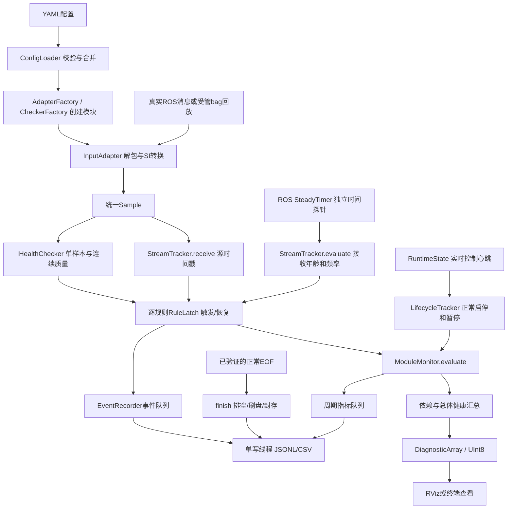

# 代码与数据流说明

## 1. 两条检查路径，一条汇总路径

图形编辑版见[数据流drawio](flowcharts/26_可选规则与数据流.drawio)。

## 2. 从哪里读代码

| 文件 | 先看哪些函数 | 负责什么 |
| --- | --- | --- |
| src/health_core.cpp | ConfigLoader::load / bounds / ruleEnabled | 配置选择、合并、校验；不补隐藏阈值 |
| src/input_adapters.cpp | 各类callback / AdapterFactory::create | 把ROS消息变成Sample；结构检查、单位换算、保留精确时间 |
| src/health_core.cpp | StreamTracker::receive / evaluate | receive等消息查STAMP_GAP；evaluate独立查RECEIVE_AGE |
| src/health_core.cpp | LidarChecker / ImuChecker / AttitudeTracker / RangeChecker / LocalizationChecker | 各传感器和定位的C++业务规则 |
| src/health_core.cpp | RuleLatch::apply / published | 逐条触发、消抖、恢复，短暂硬错误至少发布一次 |
| src/health_core.cpp | LifecycleTracker::control / evaluate | 区分运行、准备、计划暂停、计划停止、异常退出 |
| src/health_core.cpp | ModuleMonitor::receive / evaluate | 单模块把上述对象组合起来，不把所有逻辑堆进ROS回调 |
| src/robot_health_monitor_node.cpp | HealthRegistry / RobotHealthMonitor::tick | 依赖汇总、总体等级、标准Topic、指标采样、EOF封存 |
| src/event_recorder.cpp | enqueueEvent / metrics / worker / finish | 精简日志、双队列、刷盘、轮转、预算、结束封存 |
| src/bag_playback_node.cpp | ready / setPause / tick | 受管回放、空格与服务确认、正常EOF判断 |
| src/runtime_controller_node.cpp | start / stop / reap / publish | 真正拥有进程的显式启停与心跳 |
| src/health_panel.cpp | callback / updateModule / checkTimeout | 只显示诊断；不另外判一次阈值 |

源文件头部写有本文件的数据流；函数前写有作用说明；include头文件说明类的职责；config、launch、msg、srv、rviz均补注释。Python只生成构建元信息或测试材料；运行功能是C++。

## 3. 一个IMU断流例子

1. 上次IMU回调保存source stamp=1秒、接收单调时间=t0。
2. 后面没有新消息，SteadyTimer仍每约10ms执行tick。
3. 当前单调时间-t0>.1秒时，RECEIVE_AGE为WARNING；>.2秒时为ERROR。
4. 2秒那条新消息到来，receive才知道源时间间隔为1秒，可另报STAMP_GAP。
5. 若此期间收到已确认的计划PAUSED，数据需求告警暂停；不能仅凭没有消息自行猜测暂停。

## 4. 接其他节点

已有标准消息时只需要换YAML的topic/adapter/checker。新增消息格式实现IInputAdapter；新增业务规则实现IHealthChecker，再注册工厂。不要让核心依赖FAST-LIO内部变量，也不要直接比较未对齐参考系/时间的IMU角度与定位角度。
