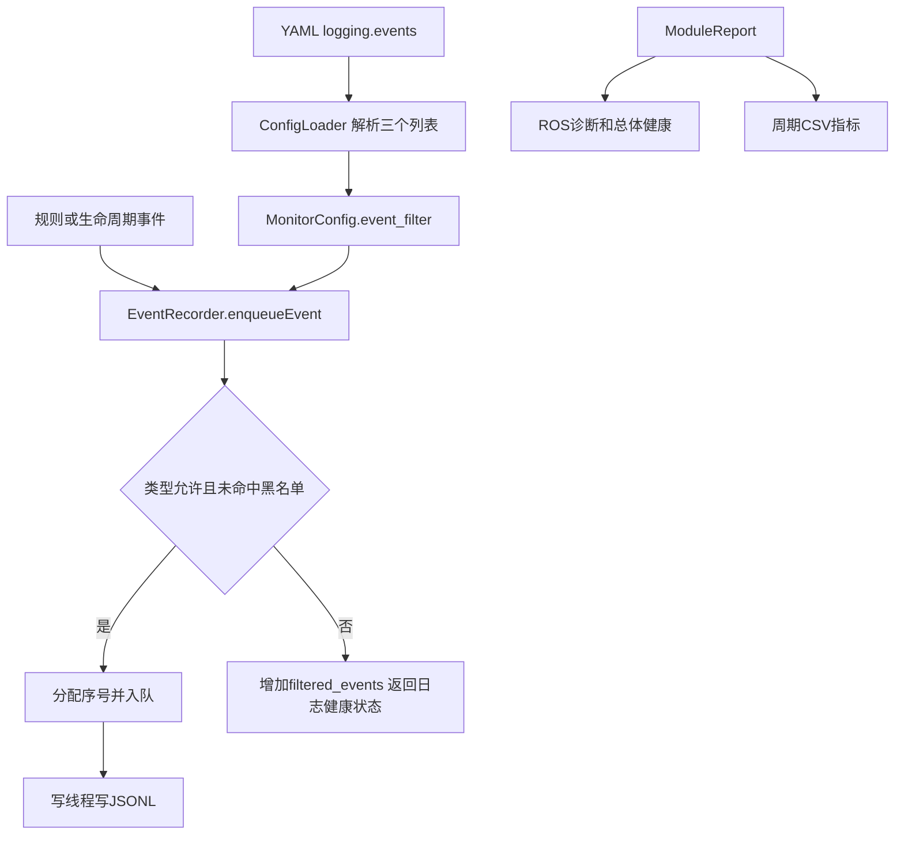

# 日志事件过滤配置

更新日期：2026-10-21。适用于本仓库2026-10-21更新后的健康监控程序。

## 1. 当前仓库配置与全部记录方式

本次按桌面当前内容发布，软件对空列表的缺省含义仍是全部记录：

| 配置 | 当前事件类型白名单 | 当前效果 |
| --- | --- | --- |
| [health_robot.yaml](../fastlio_health_monitor/config/health_robot.yaml) | [] | 记录全部事件 |
| [health_bag.yaml](../fastlio_health_monitor/config/health_bag.yaml) | [RULE_TRIGGERED] | 只记录触发事件 |

两份配置的规则/模块黑名单均为空。需要恢复全部记录时，改成下面这样：

```yaml
logging:
  enabled: true
  events:
    include_event_types: []
    exclude_rule_ids: []
    exclude_module_ids: []
```

三个列表为空，表示不筛选，所有原有事件类型、规则和模块继续记录。原来的目录、CSV周期、队列、轮转设置仍保留在同一个logging块中。编辑现有字段即可，不要在文件后面再创建第二个logging块。

删除/注释events块，或省略某个列表，也使用对应的“不筛选”默认值；null同样表示空列表。列表不是检测规则，不需要额外的enabled字段。logging.enabled仍是全部日志总开关。

## 2. 常用修改方式

### 只记录触发事件

```yaml
  events:
    include_event_types: [RULE_TRIGGERED]
    exclude_rule_ids: []
    exclude_module_ids: []
```

只在健康事件文件中保留event_type等于RULE_TRIGGERED的行。RUN_BEGIN、RUN_END、恢复和控制等其他事件也会按此配置被筛掉，没有强制保留例外。即使RUN_END不写，程序仍会排空队列、刷盘、封存文件。没有符合条件的事件时，事件文件可能为空。

### 保留各类事件，只屏蔽某条规则

```yaml
  events:
    include_event_types: []
    exclude_rule_ids: [IMU_ATTITUDE_RATE]
    exclude_module_ids: []
```

该规则继续检测、报警和参与总体健康判断，只筛掉顶层rule_id正好等于IMU_ATTITUDE_RATE的事件行。其触发、恢复、等级变化等事件都会被筛掉。其他事件的reason/context、CSV和诊断仍可能提到该规则，这不是全文内容删除。

### 两种条件一起用

```yaml
  events:
    include_event_types: [RULE_TRIGGERED]
    exclude_rule_ids: [IMU_ATTITUDE_RATE]
    exclude_module_ids: []
```

先要求类型为RULE_TRIGGERED，再排除该规则；黑名单优先。

### 屏蔽一个模块的事件

```yaml
  events:
    include_event_types: []
    exclude_rule_ids: []
    exclude_module_ids: [imu_attitude]
```

这里填日志顶层module_id，与配置模块的id相同，例如imu、imu_attitude、lidar、localization、ground_range。不是Topic、checker类名或显示标题。只屏蔽该模块自己的事件行，其他模块/总体状态记录与CSV不一起隐藏。

也可以保留触发和恢复两个类型：`include_event_types: [RULE_TRIGGERED, RULE_RECOVERED]`。

## 3. 配置作用范围

- 健康配置中的logging.events控制健康监控节点写入自己目录的`events.*.jsonl`。
- 不改变ROS诊断、UInt8总体等级、RViz显示、消息订阅或规则阈值。
- 不筛选`metrics.*.csv`，不删除历史日志，不修改原始bag。
- 独立的回放控制器和托管进程控制器使用自己的日志参数，未接入这份健康配置的过滤策略；它们的控制日志仍按原方式记录。
- 类型、规则和模块名称均区分大小写，按完整字符串匹配；不支持通配符或正则。
- 白名单命中任意一个类型即可；规则/模块黑名单命中任意一项即排除。
- 字段必须写成列表，空值用`[]`；直接写`include_event_types: RULE_TRIGGERED`会在加载时报配置错误。

## 4. 如何确认正在筛选

诊断中的`Robot health/logging`新增：

| 字段 | 含义 |
| --- | --- |
| event_filter_active | 任一列表非空时为true；默认三个空列表时为false |
| filtered_events | 本次运行按用户配置主动筛掉的事件数，开始/结束事件也可能计入 |
| dropped_events | 队列满、写入异常等导致的非预期事件丢失；与主动筛选分开 |

主动筛选不会单独使logs_incomplete变true，也不会单独降低总体健康等级。真实磁盘失败、队列丢失和日志轮转删除等仍按原有规则报告。logs_normal表示本次配置下记录器正常，不表示已经记录未选择的所有事件。

每次run的config_source.yaml和effective_config.yaml保存配置，effective_config会把三个列表完整展开；manifest.json记录event_filter_active和筛选语义，便于回看。

## 5. 代码和数据流



- `EventLogFilter`在health_core.h中独立保存策略，用集合做精确匹配。
- `ConfigLoader::load`读取并验证logging.events，拒绝未知字段、错误列表结构、空名称、空白字符和通配符。
- `EventRecorder::enqueueEvent`在序号分配、入队和durable等待前统一筛选，避免主动排除关键事件后等待不存在的写入确认。
- `finish`即使排除了结束事件，也照常排空、flush/fsync并关闭日志。

## 6. 更新和生效

本次修改涉及C++。更新工作区源码后重新编译，再重启健康节点。只修改YAML过滤列表时，重启加载即可。下面以独立工作区`~/robot_health_ws`为例，替换成自己的安装目录，在Bash终端执行：

```bash
source /opt/ros/noetic/setup.bash
cd ~/robot_health_ws
catkin_make -j2 -DPYTHON_EXECUTABLE=/usr/bin/python3 \
  -DCATKIN_ENABLE_TESTING=OFF -DBUILD_HEALTH_RVIZ_PANEL=ON
source devel/setup.bash
```

无图形机器人将BUILD_HEALTH_RVIZ_PANEL设为OFF。安装方式见[真实安装使用指南](真实安装使用指南.md)。当前运行的包位置可用`rospack find fastlio_health_monitor`确认。

## 7. 构建与验证范围

对应桌面源码已在Ubuntu 20.04 + ROS Noetic环境完成GUI和三个C++节点编译。过滤功能最初以三个空列表构建；本次发布随后采用用户桌面现有配置，实机保留全部、回放仅选RULE_TRIGGERED，同时同步实机参数调整。本次过滤更新未新增或运行单元/回放测试。既有47项用例及RViz完整回放证据属于过滤更新之前的实测。详见[交付与构建记录](交付与构建记录.md)。
