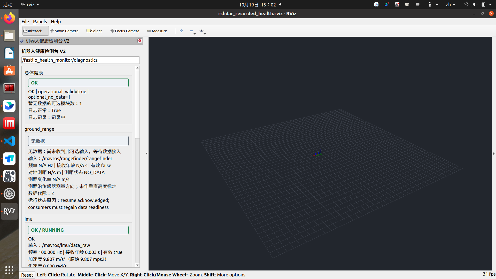

# 本版测试报告

日期：2026-10-19。对象：健康监控V2可选规则版，package.xml版本0.4.0。

## 1. 结果

表中的构建日志、XML、JSON和rosbag路径指桌面离线交付包中的 `evidence/` 原始材料；GitHub仓库只保留本报告和下方的代表性截图，不包含完整运行日志或测试bag。报告中的测试结果来自对应版本的实际执行记录。

| 验收 | 实际结果 | 证据 |
| --- | --- | --- |
| 原工作区核心用例 | 47/47 | evidence/workspace_unit.xml |
| 独立图形构建后的核心用例 | 47/47 | evidence/gui_unit.xml |
| 独立无界面构建后的核心用例 | 47/47 | evidence/headless_unit.xml |
| 工作区合成错误bag | 26/26 | evidence/workspace_synthetic/results.json |
| 删除可选规则后回放同类错误bag | 24/24 | evidence/workspace_disabled/results.json |
| 标准点云、IMU协方差、感知、规划适配器 | 24/24 | evidence/workspace_adapter/adapter_results.json |
| 原286.366622秒修复副本，原速完整回放 | 15/15 | evidence/workspace_real_full/results.json |
| 桌面交付源码独立构建后错误bag回放 | 26/26 | evidence/packaged_release/results.json |
| 桌面最终程序删除规则后回放 | 24/24 | evidence/packaged_disabled_release/results.json |

图形版和无界面版在新/tmp工作区构建，标准模式只加载/opt/ros/noetic，不依赖FAST-LIO或Livox。另行验证--livox可选构建成功，此项使用已有Livox驱动工作区。所有构建保留输出；没有运行apt安装。

同一套47个核心用例在不同构建环境重复执行，表中没有把它们当成141个不同用例。

## 2. 本次覆盖了什么

- 最小配置、省略运行块、删除每个质量规则块、模块enabled:false、未知字段拒绝。
- WARNING/ERROR独立阈值、enabled:false、null取消继承、枚举规则开关、全部提供的V2配置可加载。
- 协方差对称/半正定布尔子检查省略不启用，显式true才执行；新增用例覆盖此边界。
- 独立IMU无数据探针：.1秒WARNING、.2秒ERROR，不等待下一条消息。
- IMU与定位roll/pitch、测距初始NO_DATA与首帧自动接入、测距跳变/断流、点云空帧、IMU NaN。
- 协方差无效/未知、PointCloud2组织形式/浮点64/行填充/大端序/越界维度。
- 通用定位模块ID、感知诊断空数组/非法等级、规划无目标IDLE/有目标超时/新路径恢复/任务心跳。
- 有确认的PAUSED不报断流ERROR，恢复后重建准备；正常EOF为STOPPED。
- JSONL顶层和context、manifest、CSV列及嵌套值不存在指定五个字段；CSV旧epoch列也已去掉。
- EOF只写一次RUN_END；封存后观察1.2秒文件大小和修改时间不变，诊断仍发布。

## 3. 时间探针的实际事件

合成bag在6.00到6.80秒停止发送原始IMU，最后一帧源时间为1792396805.990000000。第一次工作区验收记录：

| 规则 | bag_elapsed_sec | 接收年龄/间隔 | 结论 |
| --- | ---: | ---: | --- |
| RECEIVE_AGE WARNING | 6.090708038 | .109465823秒 | 下一条IMU还没有来，就已触发 |
| RECEIVE_AGE ERROR | 6.191807696 | .209348997秒 | 同样不等待下一条消息 |
| STAMP_GAP ERROR | 6.797276453 | .809999943秒 | 下一帧6.80秒到达后才知道源间隔 |

/clock与回调接收存在调度差异，因此相对bag位置与接收年龄不是同一个时钟量。100Hz是理想10ms检查间隔，不承诺硬实时精确10ms。

删除这些规则后，对应告警不再出现；故意注入的NaN仍被基础有限值守卫报告。说明“规则关掉”和“传感器质量完整检查通过”是不同的状态。

## 4. 真实修复副本结果如何理解

只读完整回放：`/home/lmw/Desktop/2026-10-14-15-19-35_修复副本/2026-10-14-15-19-35.recovered.bag`，时长286.366622秒。

雷达、原始IMU、融合IMU姿态、定位均达到过RUNNING；包内没有测距，ground_range保持NO_DATA，未阻塞其余模块。最终验证EOF后STOPPED并封存。

“验收通过”表示监控行为、日志与结束处理符合要求，不表示这个bag所有数据都健康。实际仍记录了：雷达/定位开头晚到造成的启动超时、雷达首帧零时间戳、定位加速度告警、融合IMU姿态角速度/跳变告警，以及EOF确认前短暂接收年龄告警。其中融合IMU姿态角速度规则触发27次，需结合时间间隔、设备姿态参考系与平台阈值继续标定，不能仅凭告警认定飞行故障。

正常EOF确认有一个验证窗口，最后一帧与STOPPED确认之间仍可能出现短暂年龄告警；本次没有改成静默屏蔽它。完整控制台/诊断快照原件位置保留在evidence/workspace_real_full/完整证据位置.txt；交付包附原始健康事件、CSV和结果，不重复放大体积逐帧控制台。

## 5. 真实运行截图

下图来自本次独立交付包运行的RViz桌面截图。画面使用合成数据：前3秒测距未发送，显示“无数据”，其余输入正常时总体OK。这不是实体机器人试飞截图；合成bag不含真实场景建图结果。



## 6. 本次修正的测试边界

初轮单元用例发现“可选配置块缺失时yaml-cpp无效Node赋值”的异常，改为先构造安全空映射后通过。可选Livox安装初轮发现加载/opt环境覆盖了已source的驱动工作区；--livox分支改用--extend继承，再次从新工作区构建通过。初轮控制台在对应初始构建日志保留；最终结果以本表指向的结果文件为准。

## 7. 用户自己重跑

先编译安装本包。以下命令在Bash执行，工作区名与安装命令一致：

```bash
source /opt/ros/noetic/setup.bash
source "$HOME/robot_health_ws_20261019/devel/setup.bash"
cd "$HOME/robot_health_ws_20261019"
catkin_make -j2 -DCATKIN_ENABLE_TESTING=ON health_core_test
./devel/lib/fastlio_health_monitor/health_core_test
```

若测试依赖缺失，可明确安装libgtest-dev、ros-noetic-rospy、python3-yaml。标准GUI运行依赖见安装脚本。

```bash
/usr/bin/python3 src/fastlio_health_monitor/test/run_optional_rules_integration.py \
  --package "$HOME/robot_health_ws_20261019/src/fastlio_health_monitor" \
  --output "$HOME/health_test_new_run" --port 33529
```

输出目录必须是新的。加`--disabled-rules`验收删除规则；GUI环境可加`--rviz`保存真实截图。此脚本自行创建隔离master和小型错误bag，结束时只关闭自己的进程。要只读回放真实包可加`--real-bag /真实路径/包.bag`。默认真实回放等待上限380秒，测试用更长的包时需调整脚本上限。

## 8. 当前限制

原始bag.active与修复副本的SHA-256均与升级前已有参考值一致，证明未修改输入（evidence/input_integrity.json）。

没有进行实体机器人联调或ARM设备编译；目标机需源码编译。姿态阈值、物理量程、传感器外参、飞行状态门控仍需现场确认。关闭某规则就不再提供该项告警保障。实机没有可信正常停止意图时，监控不能仅凭无数据猜测“正常关机”。

## 9. 配置精简与显式开关补充记录

在本报告前述同日功能实测之后，根据用户后续要求整理了配置。当前主目录只有health_robot.yaml、health_bag.yaml、runtime_localization.example.yaml；检测规则开关明确写为enabled:true/false（实际文件冒号后有空格），默认阈值数值保留。三模块模式由两个模块开关选择，测试专用感知/规划材料归test/fixtures。

本次未更改核心C++；启动默认引用、旧别名的必需输入选择、测试使用的配置路径已同步。检查时补齐了上版实机launch引用但缺失的robot_health.rviz布局。新目录以Noetic为唯一底层重新编译通过，既有47个核心用例47/47通过（evidence/explicit_enabled_unit.xml及explicit_enabled_build.log）。本次配置整理未重新回放大bag；上表完整回放属于前述功能实测证据。

整理前完整交付及压缩包备份：/home/lmw/fastlio_ws/优化备份/20261019_before_explicit_enabled。历史运行目录中的YAML保留原样，记录当时真实配置。
